# Programacion 7
## Reporte de Laboratorio: Laboratorio #2

**Titulo del Proyecto:** AudioThread  
**Nombre del Estudiante:** Damon Osvaldo Fernandez Claros  
**Correo del Estudiante:** damon.fernandez@jala.university  
**Fecha de Entrega:** 18/07/2026  
**Instructor:** Leopoldo Flores Colque

---

## 1. Introduccion

- **Descripcion general:** Durante esta actividad agregue un paso de compresion al flujo de carga de AudioThread. Ahora la API sigue recibiendo archivos MP3 y WAV, pero antes de enviarlos a Supabase Storage los convierte localmente al codec AAC mediante FFmpeg, tambien agregue logs estructurados para observar el tiempo de compresion y los tamanos de entrada y salida.

- **Objetivo:** El objetivo de este incremento fue almacenar solamente el audio comprimido, mantener separadas las responsabilidades de la aplicacion y analizar si ya era conveniente introducir hilos manuales en el servidor.

---

## 2. Arquitectura e implementacion

### 2.1 Decision de arquitectura

Decidi mantener la Clean Architecture que ya tenia el proyecto. La capa `Application` define que necesita comprimir un audio mediante `IAudioCompressor`, mientras que `Infrastructure` contiene la implementacion concreta con FFmpeg, decidí tomar esta decision porque el caso de uso no deberia conocer comandos, rutas temporales ni detalles de un proceso externo.

```text
POST /api/audio-files
        -> validar MP3 o WAV
        -> comprimir con FFmpeg a AAC
        -> subir solamente el AAC a Supabase Storage
        -> guardar la metadata del AAC en Supabase Postgres
```

### 2.2 Contrato del compresor

En este caso lo que hice fue crear la interfaz `IAudioCompressor` dentro de `Application/Common/Interfaces`, el contrato recibe el stream original y devuelve un resultado con el nuevo stream, nombre, MIME type, tamaño y duracion.

```csharp
public interface IAudioCompressor
{
    Task<CompressedAudioFile> CompressToAacAsync(
        Stream content,
        string originalFileName,
        long originalSizeInBytes,
        CancellationToken cancellationToken);
}
```

Quise devolver un objeto `CompressedAudioFile` porque el siguiente paso necesita saber que el archivo ahora es audio/aac y que su extension es `.aac` y cual es el tamaño que realmente se almacenara.

### 2.3 Compresion local con FFmpeg

La implementacion `FfmpegAudioCompressor` esta en `Infrastructure/Compression`:
- Primero copia el stream recibido a un archivo temporal
- Despues inicia FFmpeg mediante `System.Diagnostics.Process` 
- Finalmente lee el AAC generado.

El comando equivalente es:

```powershell
ffmpeg -y -hide_banner -loglevel error -i input.wav -vn -c:a aac -b:a 128k output.aac
```

Decidi usar `ProcessStartInfo.ArgumentList` para pasar cada argumento por separado y evitar problemas con espacios en las rutas, tambien capture `stderr`, revise el codigo de salida y agregue un timeout configurable, si la solicitud se cancela o se supera el timeout, el proceso de FFmpeg se termina junto con sus procesos hijos.

Los archivos temporales se eliminan en un bloque `finally`, tanto cuando la compresion termina correctamente como cuando ocurre una excepcion, preferi hacerlo asi para no dejar archivos acumulados en el servidor.

### 2.4 Cambio en el caso de uso de carga

El `UploadAudioFileHandler` ahora valida el archivo original y despues llama al compresor, el stream que recibe `IAudioFileStorage` es el AAC y no el stream enviado por el cliente.

```csharp
var compressedAudio = await _compressor.CompressToAacAsync(
    command.Content,
    command.FileName,
    command.SizeInBytes,
    cancellationToken);

await using var compressedContent = compressedAudio.Content;
var storedFile = await _storage.UploadAsync(
    audioFileId,
    compressedContent,
    compressedAudio.FileName,
    compressedAudio.ContentType,
    cancellationToken);
```

En la base de datos conserve `OriginalFileName` para saber que archivo envio el usuario, pero `ContentType`, `SizeInBytes`, `StoredFileName` y `StoragePath` representan el AAC guardado. No fue necesario crear una migracion porque las columnas existentes permiten guardar esta informacion.

### 2.5 Logs del tiempo de compresion

Agregue logs estructurados al comenzar y terminar cada compresion. El log final incluye nombre original, tiempo transcurrido, tamaño original y tamaño comprimido:

Decidi medir dentro del compresor porque ahi se conoce el inicio y el final exactos de FFmpeg. Los valores son propiedades de `ILogger`, por lo que mas adelante se pueden consultar sin tener que interpretar manualmente el mensaje.

### 2.6 Pruebas simples

Agregue el proyecto `tests/AudioThread.Application.Tests` y una prueba para `UploadAudioFileHandler`. En la prueba sustitui FFmpeg, Supabase Storage y el repositorio por implementaciones controladas.

La prueba verifica que:

- Storage recibe los bytes producidos por el compresor y no los originales.
- El nombre enviado a Storage termina en `.aac`.
- El MIME type persistido y devuelto es `audio/aac`.
- El tamano guardado corresponde al resultado comprimido.
- Se conserva el nombre original enviado por el usuario.

```powershell
dotnet test AudioThread.sln
```

**Nota:** La ejecución de las pruebas unitarias esta como evidencia en la sección 5 de evidencias.

### 2.7 Analisis sobre hilos y concurrencia

Despues de revisar este punto del pipeline, decidi que todavia no es conveniente crear hilos manualmente con `Thread`. En este momento cada carga ejecuta un unico trabajo de FFmpeg y el procesamiento real ocurre en un proceso externo, en este sentido crear un hilo por solicitud no haria que un audio se comprima mas rapido y con varias cargas simultaneas, aumentaria el consumo de CPU y memoria sin ningun limite.

Lo que si corresponde ahora es mantener las operaciones de entrada y salida de forma asincrona, la API usa `await` para copiar streams, esperar al proceso, subir a Storage y guardar en Postgres, esto evita bloquear un hilo de ASP.NET mientras se espera una operacion externa, aunque no convierte la compresion en una tarea paralela.

| Concepto | Aplicacion en este incremento |
| :--- | :--- |
| `async/await` | Adecuado para esperar archivos, FFmpeg, Supabase y Postgres sin bloquear. |
| `Thread` manual | No aporta una ventaja clara y seria dificil controlar un hilo por solicitud. |
| `Task.Run` | No es necesario porque FFmpeg ya se ejecuta fuera del proceso de .NET. |
| Paralelismo | Podra servir con varios audios independientes, pero debe tener un limite. |
| Cola en segundo plano | Es la siguiente opcion cuando el endpoint deba responder sin esperar la compresion. |

Para respaldar esta decision con datos, realice pruebas de carga con k6 enviando 5, 10 y 20 archivos de forma concurrente. Estas pruebas no requirieron agregar hilos manualmente dentro de la API, ya que cada usuario virtual envio una sola solicitud HTTP. Durante cada nivel medi la latencia, el throughput, las respuestas exitosas y los errores reportados por k6.

---

## 3. Merge Request

- **Enlace del Merge Request:** `[Agregar aqui el enlace del Merge Request]`

---

## 4. Mediciones de rendimiento

### 4.1 Compresión individual y reducción de tamaño

Para medir el comportamiento de la compresion realice una prueba con un archivo MP3 y otra con un archivo WAV, en cada ejecucion registre el tamaño original, el tamaño del AAC generado y el tiempo utilizado unicamente por FFmpeg.

Log MP3

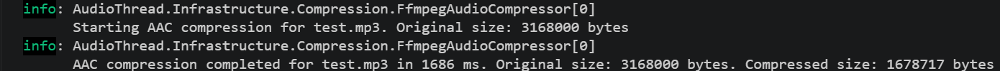

Log WAV

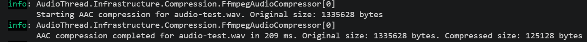

| Archivo | Tamano original | Tamano AAC | Reduccion | Tiempo de compresion |
| :--- | ---: | ---: | ---: | ---: |
| `test.mp3` | 3093.75 KB (3.02 MB) | 1639.37 KB (1.60 MB) | 47.01 % | 1686 ms |
| `audio-test.wav` | 1304.32 KB (1.27 MB) | 122.20 KB (0.12 MB) | 90.63 % | 209 ms |

El porcentaje de reduccion se calculo con la siguiente formula:

```text
Reduccion = (tamano original - tamano comprimido) / tamano original x 100
```

#### Analisis de los resultados

En la prueba con el archivo MP3 el tamano se redujo de 3,168,000 bytes a 1,678,717 bytes, lo que representa una reduccion aproximada del 47.01 %, en este caso la compresion tardo 1686 milisegundos, la reduccion fue menor porque el MP3 ya utiliza un formato de compresion con perdida antes de ser convertido a AAC.

En la prueba con el archivo WAV el tamano se redujo de 1,335,628 bytes a 125,128 bytes, alcanzando una reduccion aproximada del 90.63 %, en este caso la compresion tardo 209 milisegundos, la diferencia fue mayor porque WAV normalmente contiene audio sin comprimir o con una compresion mucho menor.

Estos resultados me permitieron comprobar que el proceso genera archivos AAC mas pequeños, sin embargo no considero correcto concluir que FFmpeg siempre procesa WAV mas rapido que MP3 usando solamente estas dos pruebas, porque los audios pueden tener diferente duracion, bitrate y contenido, para realizar una comparacion mas precisa tendria que utilizar el mismo audio en ambos formatos y repetir cada ejecucion varias veces.

Tambien revise el tiempo aproximado del flujo completo, separando la compresion, la subida a Supabase Storage y la persistencia en la base de datos:

| Archivo | Compresion | Subida a Storage | Base de datos | Tiempo aproximado total |
| :--- | ---: | ---: | ---: | ---: |
| `test.mp3` | 1686 ms | 1817 ms | 180 ms | 3683 ms |
| `audio-test.wav` | 209 ms | 1145 ms | 259 ms | 1613 ms |

Estos tiempos totales son aproximados porque se obtuvieron sumando las mediciones individuales mostradas en los logs.

### 4.2 Pruebas de concurrencia con k6

Para evaluar el comportamiento con varias cargas simultaneas utilice el mismo archivo WAV en los tres niveles, en cada ejecucion cada usuario virtual envio el archivo una sola vez, de esta forma compare 5, 10 y 20 solicitudes concurrentes bajo las mismas condiciones.

| Solicitudes concurrentes | Exitosas | Fallidas | Duracion total | Latencia promedio | p(95) | Throughput | CPU maxima | Memoria maxima |
| ---: | ---: | ---: | ---: | ---: | ---: | ---: | ---: | ---: |
| 5 | 5 | 0 | 4.4 s | 4.25 s | 4.37 s | 1.13 solicitudes/s | No registrado | No registrado |
| 10 | 10 | 0 | 1.8 s | 1.30 s | 1.41 s | 5.41 solicitudes/s | No registrado | No registrado |
| 20 | 20 | 0 | 2.6 s | 1.80 s | 2.50 s | 7.79 solicitudes/s | No registrado | No registrado |

**Nota:** Las evidencias de la ejecución de las pruebas estan en la sección 5 de evidencias

#### Analisis de los resultados

Las tres pruebas completaron el 100 % de las cargas sin errores. k6 registro 5 de 5, 10 de 10 y 20 de 20 respuestas exitosas, todas con estado HTTP `201`, tambien se cumplieron las cuatro validaciones definidas para cada respuesta, el tipo de contenido fue `audio/aac`, la ruta termino en `.aac`, la respuesta incluyo un UUID y la API devolvio el estado esperado. En total se ejecutaron 35 cargas y no se interrumpio ninguna iteracion.

En la prueba de 5 solicitudes la latencia promedio fue de 4.25 segundos y el throughput fue de 1.13 solicitudes por segundo, este resultado fue mas lento que el nivel de 10 solicitudes, pero no considero correcto atribuir la diferencia solamente a la concurrencia, al haber sido la primera ejecucion pudo estar afectada por el calentamiento inicial de la API, FFmpeg, las conexiones HTTP o Supabase.

Con 10 solicitudes concurrentes la latencia promedio bajo a 1.30 segundos, el percentil 95 fue de 1.41 segundos y el throughput aumento a 5.41 solicitudes por segundo, este nivel completó todas las cargas en aproximadamente 1.8 segundos y no presento errores funcionales.

Al aumentar a 20 solicitudes, el throughput subio a 7.79 solicitudes por segundo pero la latencia promedio aumento a 1.80 segundos y el percentil 95 llego a 2.50 segundos, esto muestra que el servidor proceso una mayor cantidad de archivos por segundo, aunque cada solicitud empezo a tardar mas por la competencia entre los procesos de compresion, las subidas a Storage y las operaciones de base de datos.

Con estas pruebas pude comprobar que la implementacion actual soporta hasta 20 cargas simultaneas dentro del escenario evaluado, porque no hubo respuestas fallidas ni datos incompletos, sin embargo esta prueba representa una sola ejecucion por usuario virtual y no una carga sostenida durante varios minutos, tampoco se registraron valores de CPU y memoria, por lo que todavia no es posible determinar el nivel de saturacion del equipo solamente con los resultados de k6, para obtener una comparacion mas estable seria conveniente repetir cada nivel varias veces, realizar una ejecucion de calentamiento y registrar tambien los recursos del servidor, aunque para esta actividad lo veo innecesario ya que con los resultados de la prueba que hicimos ya tenemos parámetros para poder medir en próximas implmentaciones o integraciones que vayan a realizar.


---

## 5. Resultados de ejecucion y evidencia empirica

### 5.1 Salidas de consola y logs

#### 5.1.1 Pruebas unitarias

En esta evidencia se muestra la ejecucion de las pruebas unitarias mediante `dotnet test AudioThread.sln`. La prueba comprueba que el caso de uso envia a Storage el contenido AAC producido por el compresor y no el stream original. El resultado obtenido fue:

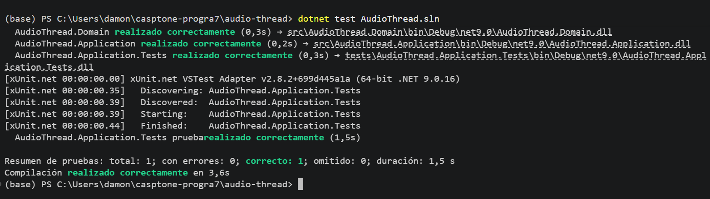

Con esta prueba pudimos comprobar que el handler utiliza el audio comprimido en formato AAC para almacenarlo y guardar su metadata, la prueba finalizó correctamente, sin errores ni casos omitidos.

#### 5.1.2 Pruebas de concurrencia con k6

En esta parte se presentan las salidas de k6 para 5, 10 y 20 solicitudes concurrentes, las tres ejecuciones alcanzaron un `audio_upload_success` del 100 %, no registraron solicitudes HTTP fallidas y completaron las 35 cargas realizadas.

Prueba con 5 usuarios virtuales

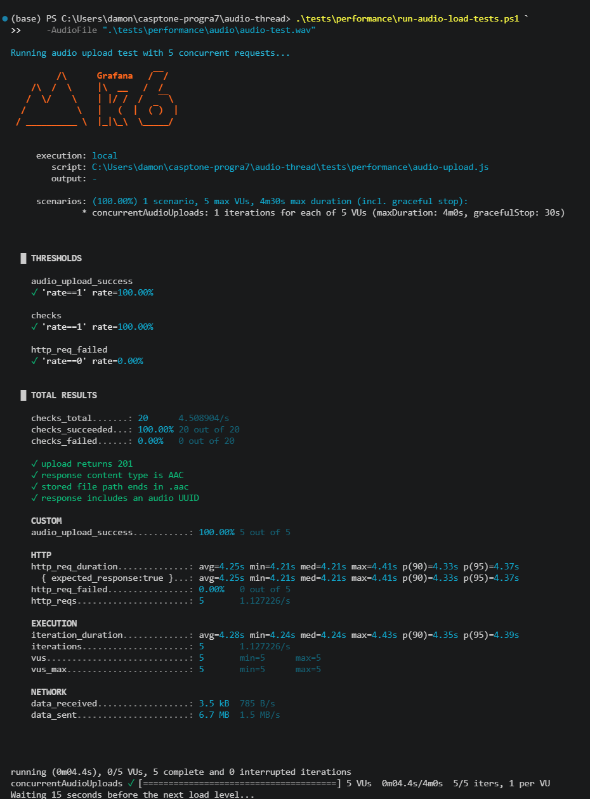

Prueba con 10 usuarios virtuales

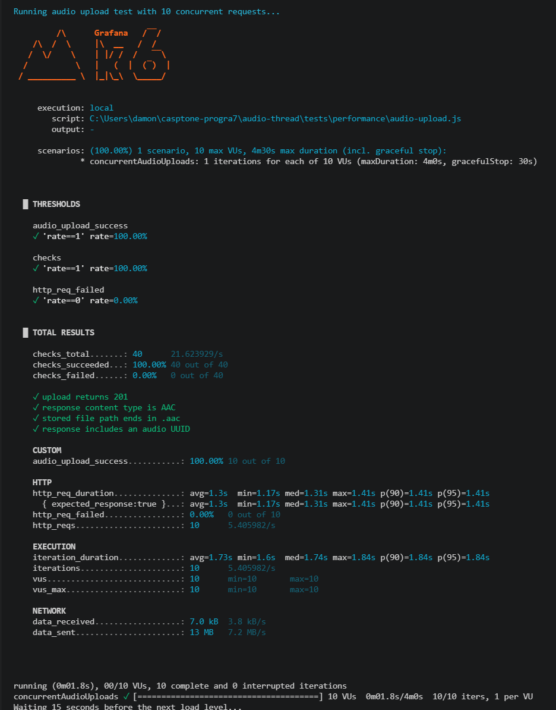

Prueba con 20 usuarios virtuales

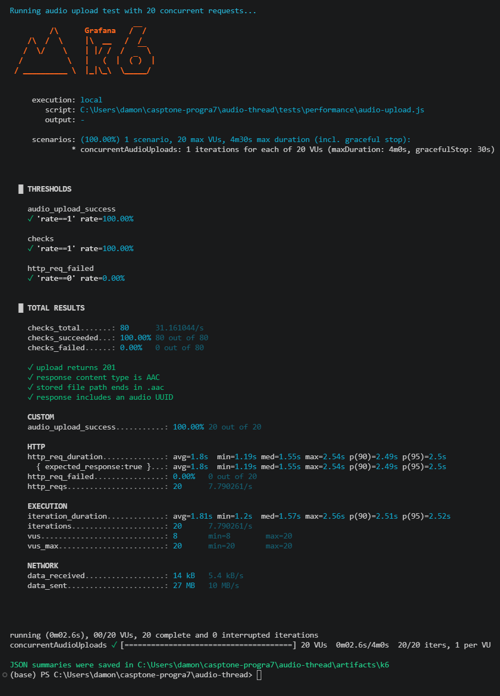

#### 5.1.3 Consola de ejecucion de la API

Esta evidencia corresponde a la consola de la API durante una llamada al endpoint `POST /api/audio-files`. En los logs se puede observar el inicio de la compresion, el tiempo utilizado por FFmpeg, el tamano original, el tamano del AAC, la respuesta de Supabase Storage y la insercion de la metadata en Postgres.

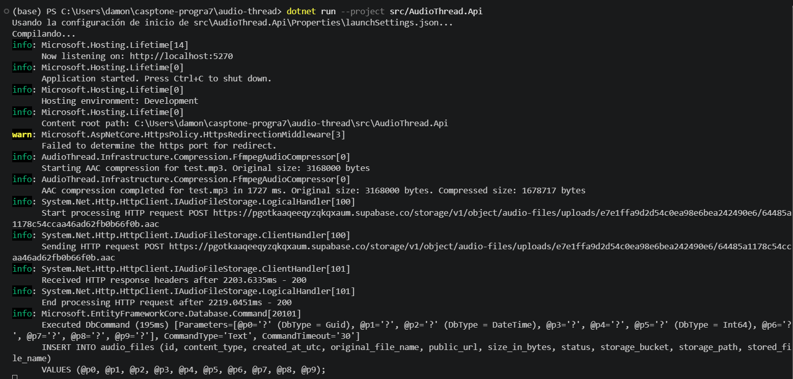

### 5.2 Evidencias de verificacion

- **Evidencia 1: carga exitosa de un archivo MP3**  
  **Descripcion:** En esta prueba cargue un archivo `.mp3` desde Postman, la respuesta debe mostrar el estado `201 Created`, conservar el nombre original y devolver `contentType` igual a `audio/aac`, junto con una ruta de almacenamiento terminada en `.aac`.

  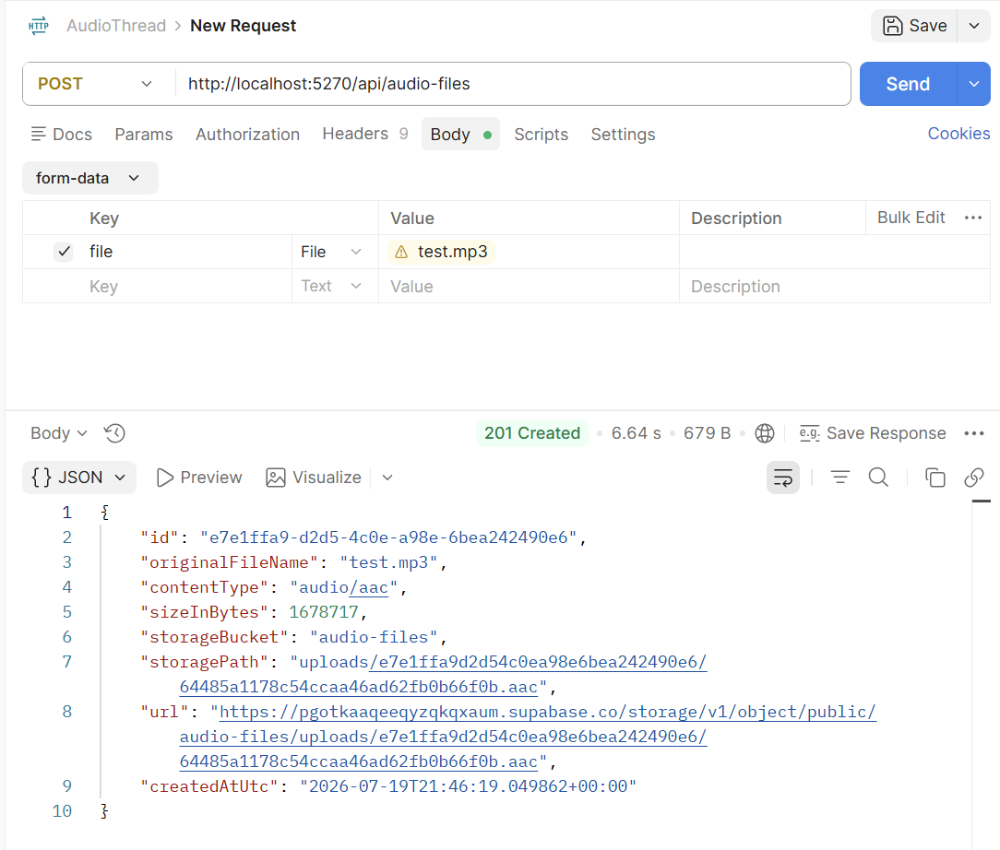

- **Evidencia 2: carga exitosa de un archivo WAV**  
  **Descripcion:** En esta prueba cargue un archivo `.wav` desde Postman, l a respuesta `201 Created` permite comprobar que el segundo formato de entrada tambien fue convertido a AAC antes de almacenarse.

  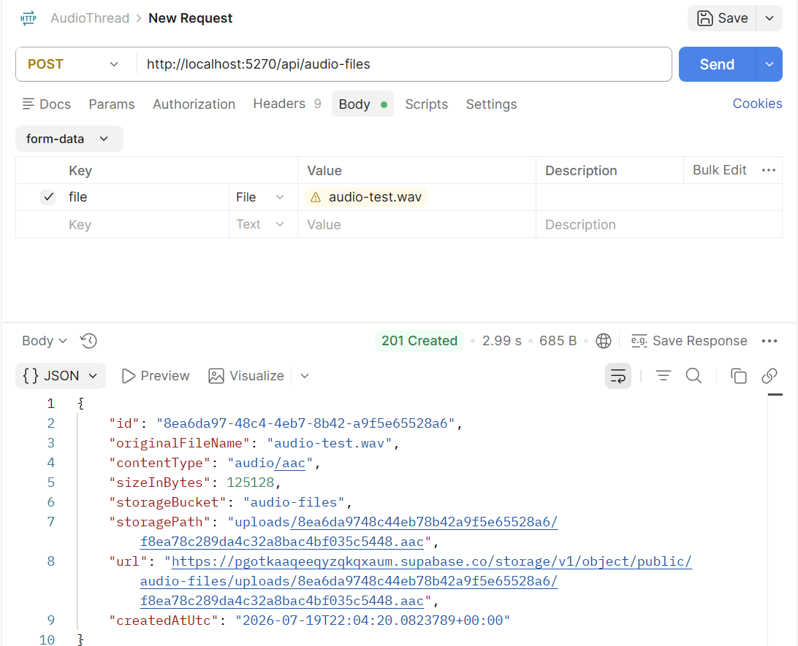

- **Evidencia 3: archivos comprimidos en Supabase Storage**  
  **Descripcion:** Esta captura muestra los archivos generados dentro del bucket `audio-files`, las rutas y extensiones `.aac` permiten verificar que se almacenaron los resultados comprimidos en lugar de los archivos MP3 y WAV originales.

  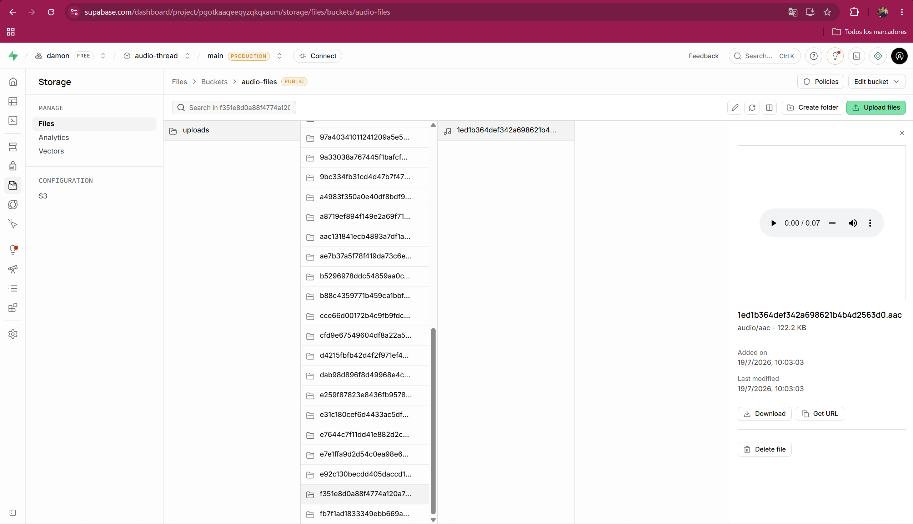

  Como se puede ver en la captura los archivos comprimidos .aac fueron almacenados en el bucket de supabase de forma correcta.

- **Evidencia 4: rechazo de un formato no permitido**  
  **Descripcion:** Para comprobar que el nuevo paso de compresion conserva las reglas de entrada, envie un archivo con una extension diferente de `.mp3` o `.wav`, la API debe responder `400 Bad Request` y evitar que FFmpeg, Storage y Postgres procesen el archivo, esta validacion ya existia desde la actividad anterior, pero sigue protegiendo el flujo actualizado.

  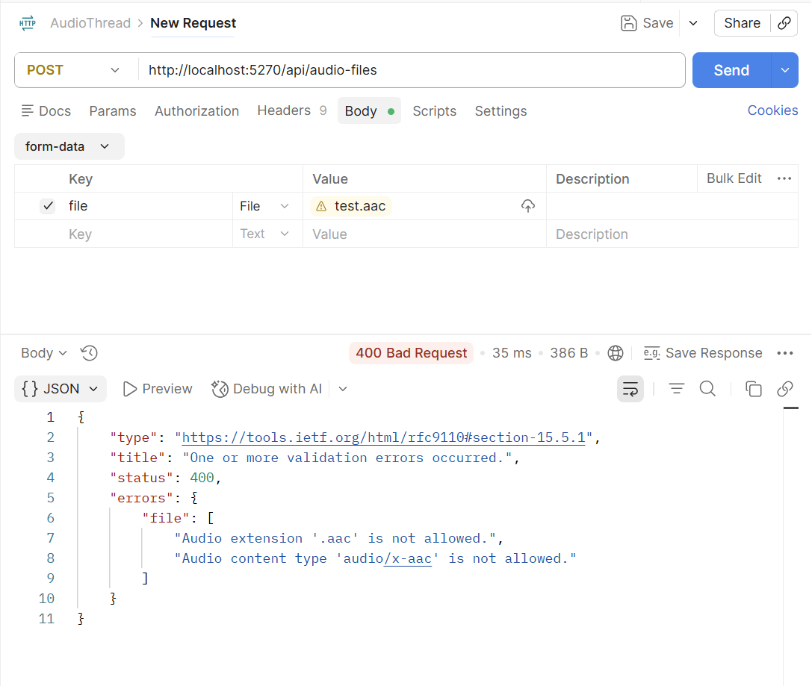

---

## 6. Autoevaluacion, bloqueos y errores

- El principal desafío fue integrar FFmpeg como un proceso externo, ya que debía asegurarme de que estuviera instalado y controlar posibles fallos, cancelaciones, tiempos de espera y archivos temporales, para solucionarlo tuve que centralizar esta lógica en FfmpegAudioCompressor, agregué mensajes de error claros, un timeout configurable y la limpieza de archivos dentro de finally, además utilicé dobles de prueba para verificar el flujo sin depender de FFmpeg ni de Supabase durante las pruebas unitarias.

---

## 7. Conclusiones

- **Aprendizaje 1:** Pude integrar una operacion pesada sin mezclar FFmpeg con el endpoint ni con el dominio, la interfaz del compresor mantiene el caso de uso enfocado en coordinar el flujo.

- **Aprendizaje 2:** Tambien pude diferenciar mejor asincronia de paralelismo, esperar un proceso con `await` evita bloquear hilos de ASP.NET, pero no significa que el audio se procese en paralelo.

- **Aprendizaje 3:** Los logs de duracion y tamaños dejan una base para medir el comportamiento real, antes de agregar hilos o aumentar concurrencia, considero mas responsable comparar datos con diferentes cargas.

---

## 8. Recomendaciones

- Como siguiente paso recomiendo procesar la compresión en segundo plano. De esta forma, el endpoint podría recibir el audio, asignarle un identificador y responder sin esperar a que termine todo el procesamiento. Posteriormente, el servidor tomaría los archivos pendientes y los comprimiría de manera controlada.
- Me gustaría agregar una prueba de integración que ejecute FFmpeg realmente sobre un audio controlado, después de generar el archivo utilizaría ffprobe para inspeccionarlo y comprobar que el codec sea AAC, que el archivo tenga contenido y que pueda reproducirse correctamente, esto complementaría la prueba unitaria actual que verifica la coordinación del flujo sin ejecutar herramientas externas.
- También recomiendo controlar cuántas compresiones pueden ejecutarse simultáneamente, actualmente cada solicitud puede iniciar un proceso de FFmpeg, por lo que una carga alta podría consumir demasiada CPU y memoria, el límite debería definirse después de repetir pruebas con diferentes niveles de concurrencia y comparar la latencia, el throughput, los errores y el uso de recursos del servidor.