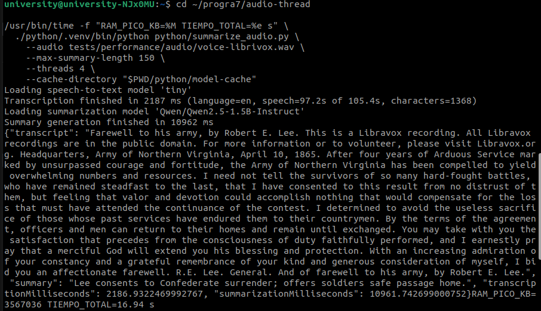
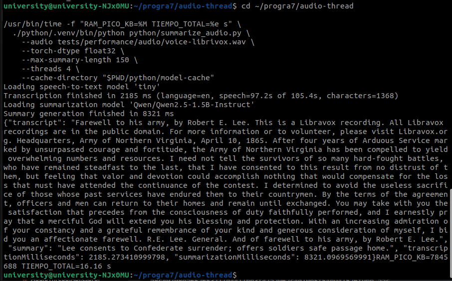
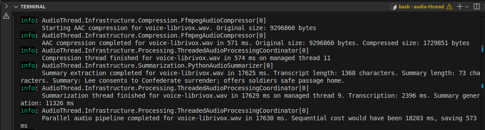
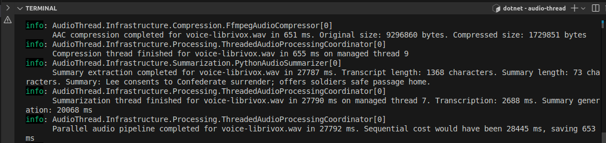
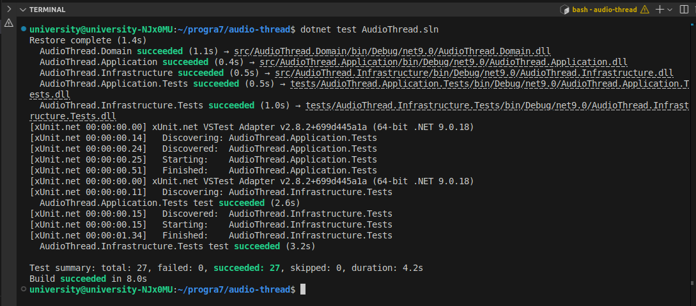
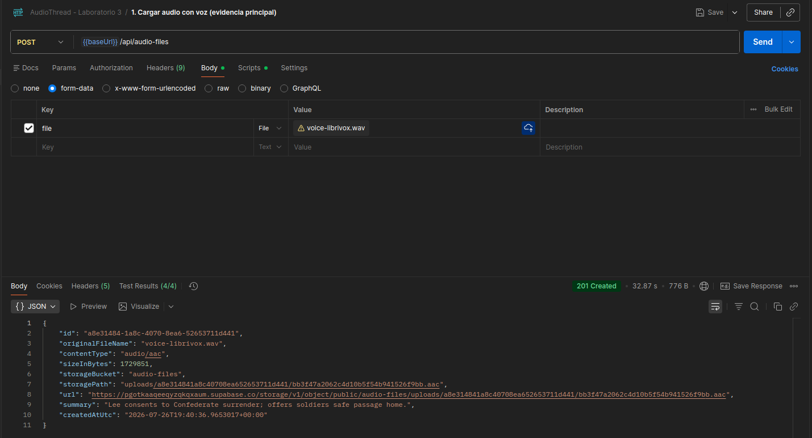
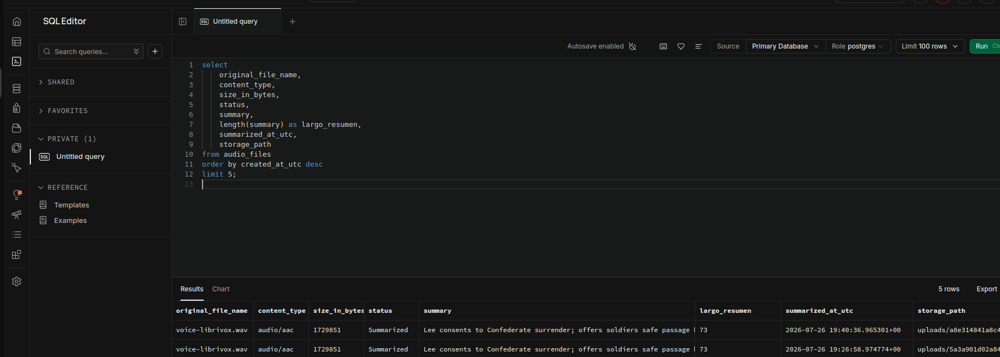
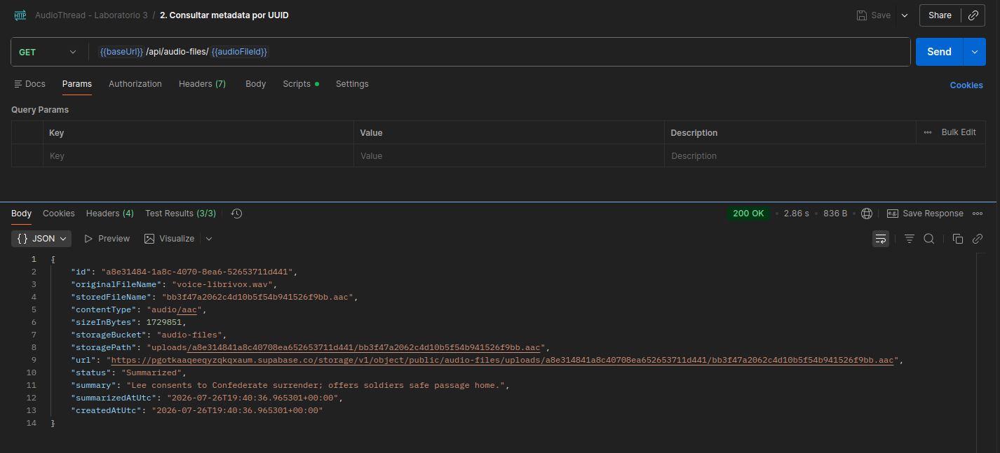
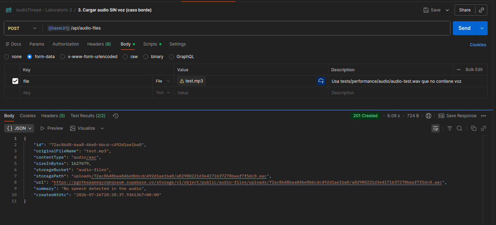
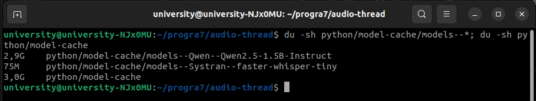

# Programacion 7
## Reporte de Laboratorio: Laboratorio #3

**Titulo del Proyecto:** AudioThread  
**Nombre del Estudiante:** Damon Osvaldo Fernandez Claros  
**Correo del Estudiante:** damon.fernandez@jala.university  
**Fecha de Entrega:** 26/07/2026  
**Instructor:** Leopoldo Flores Colque

---

## 1. Introduccion

- **Descripcion general:** En esta actividad agregue el extractor de resumen de audio al servidor, ahora cuando llega un archivo MP3 o WAV la API hace dos trabajos al mismo tiempo, por un lado sigue comprimiendo el audio a AAC con FFmpeg, y por otro lado saca el texto del audio con un modelo de reconocimiento de voz y despues genera un resumen corto de ese texto con un modelo de lenguaje, los dos modelos corren localmente en la maquina, no se usa ninguna API externa, cada uno de esos dos trabajos corre en su propio hilo creado a mano y los dos se sincronizan antes de guardar el resultado.

- **Objetivo:** El objetivo de este incremento fue cumplir con lo que pidio el profesor, que era empezar a usar hilos de verdad en el proyecto poniendo la compresion en un hilo y la extraccion del resumen en otro, y ademas dejar el resumen con un limite de caracteres controlado, con logs que permitan ver cuanto tarda cada etapa.

---

## 2. Arquitectura e implementacion

### 2.1 Decision de arquitectura

En el laboratorio anterior habia concluido que todavia no valia la pena crear hilos manualmente, porque el unico trabajo pesado era FFmpeg y ese ya corre fuera de .NET, esta semana la situacion cambio, porque ahora hay dos trabajos pesados que no dependen uno del otro, la compresion necesita el audio original y la transcripcion tambien necesita el audio original, pero ninguno de los dos necesita el resultado del otro, cuando dos trabajos son independientes recien tiene sentido correrlos en paralelo.

La capa `Application` dice que necesita un resumidor y necesita algo que coordine los dos trabajos, mientras que `Infrastructure` tiene las implementaciones concretas con los procesos externos y los hilos, hice esto porque el caso de uso no deberia saber nada de hilos, ni de rutas de Python, ni de modelos de IA.

El flujo quedo asi:


### 2.2 Contrato del resumidor

Cree la interfaz `IAudioSummarizer` dentro de `Application/Common/Interfaces`, siguiendo el mismo estilo que ya tenia `IAudioCompressor`, recibe el stream del audio y devuelve el resumen, la transcripcion completa y los tiempos de cada etapa por separado.

```csharp
public interface IAudioSummarizer
{
    Task<AudioSummaryResult> SummarizeAsync(
        Stream content,
        string originalFileName,
        CancellationToken cancellationToken);
}

public sealed record AudioSummaryResult(
    string Summary,
    string Transcript,
    TimeSpan TranscriptionDuration,
    TimeSpan SummarizationDuration);
```

Devolvi los dos tiempos separados a proposito porque adentro del resumidor pasan dos cosas distintas, primero el modelo de voz y despues el modelo de lenguaje, y para el analisis de rendimiento me servia saber cuanto tarda cada uno y no solamente el total.

### 2.3 Contrato del coordinador de hilos

Tambien cree `IAudioProcessingCoordinator` que es el contrato del que se encarga de correr la compresion y el resumen en paralelo y de devolver los dos resultados juntos.

```csharp
public interface IAudioProcessingCoordinator
{
    Task<AudioProcessingResult> ProcessAsync(
        AudioProcessingRequest request,
        CancellationToken cancellationToken);
}
```

Puse este contrato en `Application` y la implementacion con hilos en `Infrastructure` porque como se ejecuta el trabajo en paralelo es un detalle tecnico, no una regla de negocio, la ventaja de hacerlo asi es que en las pruebas puedo reemplazar el coordinador por uno falso y probar el handler sin levantar hilos ni procesos.

Dentro del resultado agregue un objeto con los tiempos que me sirve directamente para el analisis:

```csharp
public sealed record AudioProcessingTimings(
    TimeSpan CompressionDuration,
    TimeSpan SummarizationDuration,
    TimeSpan WallClockDuration)
{
    public TimeSpan SequentialDuration => CompressionDuration + SummarizationDuration;

    public TimeSpan TimeSaved
    {
        get
        {
            var saved = SequentialDuration - WallClockDuration;
            return saved > TimeSpan.Zero ? saved : TimeSpan.Zero;
        }
    }
}
```

`WallClockDuration` es el tiempo real que tardo todo el pipeline de punta a punta, y `SequentialDuration` es lo que hubiera tardado si los dos trabajos se hicieran uno detras del otro, la resta entre los dos es lo que gane con el paralelismo, y eso lo dejo calculado dentro del mismo objeto para no tener que hacer la cuenta a mano cada vez.

### 2.4 Los dos modelos locales

El profesor pidio dos modelos corriendo localmente, uno que saque el texto del audio y otro que saque el resumen de ese texto, elegi los siguientes:

| Etapa | Modelo | Tamaño aproximado | Por que lo elegi |
| :--- | :--- | :--- | :--- |
| Audio a texto | `faster-whisper` con el modelo `tiny` en `int8` | 75 MB | Es una reimplementacion de Whisper que corre mucho mas rapido en CPU, y la version `tiny` con cuantizacion `int8` es la mas liviana |
| Texto a resumen | `Qwen/Qwen2.5-1.5B-Instruct` | 3 GB | Es el modelo de instrucciones mas chico de la familia Qwen2.5 que todavia resume de verdad en lugar de repetir el titulo, y entra en la memoria de mi maquina |

Para el modelo de resumen la duda estaba entre la version de 0.5B y la de 1.5B, que son las dos opciones livianas de la familia, me decidi por la de 1.5B porque los benchmarks publicados por el propio equipo de Qwen muestran una diferencia grande entre las dos, en MMLU la de 1.5B saca 52.4 % contra 37.9 % de la de 0.5B, y en GSM8K saca 61.6 % contra 40.1 %, esos numeros estan en el blog oficial de Qwen2.5 y en el reporte tecnico del modelo:

- Blog oficial de Qwen2.5: https://qwenlm.github.io/blog/qwen2.5-llm/
- Qwen2.5 Technical Report (arXiv 2412.15115): https://arxiv.org/pdf/2412.15115

Para resumir un audio lo que mas importa es que el modelo entienda el texto y siga la instruccion de no pasarse del limite, y en las dos cosas la version de 1.5B esta bastante por encima. El costo es que ocupa unas tres veces mas memoria y tarda mas en generar, en la seccion 4 muestro esos numeros medidos.

Los dos modelos se descargan una sola vez desde Hugging Face y quedan guardados en la carpeta `python/model-cache`, que termina ocupando unos 3 GB, despues de esa primera descarga todo corre sin internet, esto es importante porque el documento del capstone prohibe usar Ollama o cualquier API externa para la transcripcion y el resumen, la restriccion es sobre no mandar el audio a un servicio de afuera, y en este caso la inferencia ocurre completamente en mi CPU.

Mi maquina no tiene GPU, entonces instale la version de PyTorch compilada solo para CPU, esto ademas evita bajar mas de 2 GB de dependencias de CUDA que no se iban a usar nunca.

### 2.5 El script de Python

Los modelos corren dentro de un script de Python que la API arranca como subproceso, igual que ya se hacia con FFmpeg, el script esta en `python/summarize_audio.py` y hace tres cosas, primero carga el modelo de voz y transcribe, despues carga el modelo de lenguaje y le pide un resumen corto, y al final imprime un JSON con todo.

La parte del prompt quedo asi:

```python
messages = [
    {
        "role": "system",
        "content": (
            "You summarize voice recordings. Reply with the summary text only, "
            "without quotes and without any introduction. Use the available "
            f"space to cover the main points, but never exceed {max_length} "
            "characters."
        ),
    },
    {
        "role": "user",
        "content": (
            f"Summarize this transcript in at most {max_length} characters. "
            f"If the recording is short, keep the summary short as well.\n\n{excerpt}"
        ),
    },
]
```

Una decision importante fue separar las salidas, el script escribe los mensajes de progreso en `stderr` y el JSON con el resultado en `stdout`, hice esto porque del lado de C# necesito parsear el JSON, y si los mensajes de progreso se mezclaran con el resultado el parseo se romperia, tambien puse la generacion en modo determinista con `do_sample=False`, asi el mismo audio da siempre el mismo resumen y las pruebas son repetibles.

El script tambien maneja el caso de un audio sin voz, si la transcripcion sale vacia no tiene sentido cargar el segundo modelo, entonces devuelve el resumen vacio y termina, y el lado de C# se encarga de poner un texto por defecto.

### 2.6 Ejecucion del script desde C#

La implementacion `PythonAudioSummarizer` esta en `Infrastructure/Summarization` y sigue el mismo patron que ya usaba `FfmpegAudioCompressor`, escribe el audio a un archivo temporal, arranca el subproceso, lee la salida y borra el archivo temporal en un bloque `finally`.

Reutilice las mismas practicas del laboratorio anterior, use `ProcessStartInfo.ArgumentList` para pasar cada argumento por separado y no tener problemas con espacios en las rutas, capture `stderr` para poder mostrar el error real cuando algo falla, revise el codigo de salida del proceso y agregue un timeout configurable que mata el proceso junto con sus hijos.

Algo que tuve que resolver aparte fue como encontrar el script y el interprete de Python, la API se ejecuta desde `src/AudioThread.Api/bin/Debug/net9.0`, entonces una ruta relativa como `python/summarize_audio.py` no se encuentra desde ahi. Lo que hice fue subir carpeta por carpeta desde donde esta el ejecutable hasta encontrar el archivo, asi funciona igual si se corre con `dotnet run` o si se publica en otra carpeta.

### 2.7 El coordinador con hilos manuales

Esta es la parte central de la actividad. `ThreadedAudioProcessingCoordinator` crea dos objetos `Thread` a mano, les pone nombre para poder reconocerlos en los logs y los arranca.

```csharp
var compressionThread = new Thread(() => RunCompression(run, cancellationToken))
{
    Name = CompressionThreadName,
    IsBackground = true
};

var summarizationThread = new Thread(() => RunSummarization(run, cancellationToken))
{
    Name = SummarizationThreadName,
    IsBackground = true
};
```

Use `Thread` directamente y no `Task.Run` porque el profesor pidio expresamente hilos creados a mano, y ademas en este caso tiene sentido, los dos trabajos son largos y bloqueantes, esperan a un proceso externo durante segundos y ese tipo de trabajo no conviene mandarlo al `ThreadPool` porque ocuparia hilos que .NET reserva para atender peticiones cortas.

Los puse como `IsBackground = true` para que si la aplicacion se cierra no se quede esperando a que estos hilos terminen.

Antes de arrancar los hilos, el handler guarda el audio original en un arreglo de bytes una sola vez, y cada hilo abre su propio `MemoryStream` sobre ese mismo arreglo, esto lo hice asi porque un `Stream` no se puede leer desde dos hilos al mismo tiempo, cada uno lleva su propia posicion de lectura y se pisarian entre ellos, como los dos hilos solamente leen y nunca escriben, compartir el arreglo es seguro.

### 2.8 La sincronizacion entre los dos hilos

El profesor menciono que en algun momento iba a haber que sincronizar, y efectivamente ese momento es cuando los dos hilos terminan y hay que juntar los resultados para guardarlos, toda la parte de sincronizacion la deje en una clase aparte llamada `AudioProcessingPipelineRun`, que guarda el estado compartido de una peticion.

Use tres mecanismos distintos, cada uno para algo diferente:

| Mecanismo | Para que lo use |
| :--- | :--- |
| `CountdownEvent` | Es la barrera, se inicializa en 2 y cada hilo la baja en 1 cuando termina, el que la deja en 0 sabe que fue el ultimo |
| `Lock` | Es la exclusion mutua, protege las variables compartidas donde cada hilo deja su resultado, para que no escriban las dos al mismo tiempo |
| `TaskCompletionSource` | Es el puente entre los hilos y el `async` de la API, permite devolver un `Task` sin bloquear ningun hilo de ASP.NET |

Cada hilo hace su trabajo, guarda el resultado adentro de un `lock`, y en el bloque `finally` avisa que termino:

```csharp
public void SignalWorkerFinished()
{
    if (!_pendingWorkers.Signal())
    {
        return;
    }

    _wallClock.Stop();
    _pendingWorkers.Dispose();
    PublishResult();
}
```

`Signal()` devuelve `true` solamente cuando el contador llega a cero, o sea que solamente el ultimo hilo en terminar entra al `if` y publica el resultado final, esto me gusto porque no necesito un tercer hilo vigilando ni tengo que hacer un `Join` que bloquee.

Sobre esto ultimo quiero explicar por que no use `Thread.Join()`, que seria lo mas obvio, `Join` bloquea al hilo que llama hasta que el otro termine, y el hilo que llamaria seria un hilo de ASP.NET atendiendo la peticion, entonces ese hilo se quedaria parado 12 segundos sin hacer nada, mientras que con `TaskCompletionSource` el hilo de ASP.NET queda libre para atender otras peticiones mientras los dos hilos de trabajo hacen lo suyo, y recien cuando terminan se retoma la peticion.

Otra cosa que tuve que cuidar fue el manejo de errores uya que si un hilo lanza una excepcion no puede simplemente subir, porque nadie la estaria escuchando del otro lado y la peticion quedaria colgada para siempre, entonces lo que hago es atrapar la excepcion adentro del hilo, guardarla en una lista protegida por el `lock` y al final decidir, si fallo uno solo se relanza esa excepcion tal cual, si fallaron los dos se junta todo en un `AggregateException` y si los dos fueron cancelaciones se marca la tarea como cancelada.

### 2.9 La regla del largo maximo del resumen

La actividad pedia que el resumen tenga un maximo de 50 caracteres. Al probarlo me parecio un limite corto para un resumen que sea util de verdad, asi que decidi dejarlo configurable y elegir el valor haciendo una prueba en lugar de fijarlo a ojo, mas abajo explico que numero elegi y por que, pero antes quiero contar como implemente la regla, porque eso no cambia sin importar el limite.

Los modelos de lenguaje no siempre obedecen ese tipo de instruccion, entonces no me quise confiar solamente del prompt, puse la regla en el dominio con un value object llamado `AudioSummary`.

Este objeto hace varias cosas: 
- Junta los espacios y saltos de linea repetidos en uno solo
- Quita las comillas que el modelo suele poner alrededor de la respuesta.
- Si el texto sigue siendo muy largo lo corta, pero no lo corta en cualquier lado sino que retrocede hasta el ultimo espacio para no dejar una palabra partida por la mitad.

```csharp
private static string Shorten(string value, int maxLength)
{
    if (value.Length <= maxLength)
    {
        return value;
    }

    var truncated = value[..maxLength];
    var lastSeparator = truncated.LastIndexOf(' ');

    if (lastSeparator > maxLength / 2)
    {
        truncated = truncated[..lastSeparator];
    }

    return truncated.TrimEnd(' ', ',', ';', ':', '.', '-');
}
```

Deje el limite configurable desde `appsettings.json` con la clave `AudioSummarization:MaxSummaryLength`, de esta forma se puede cambiar el numero sin tocar nada de codigo ni hacer una migracion, porque la columna de la base de datos acepta hasta 512 caracteres, el mismo valor se usa en dos lugares, se le pasa al prompt del modelo para pedirle un resumen de ese largo, y se usa en el dominio para hacer cumplir el limite aunque el modelo no obedezca.

Como valor por defecto elegi **150 caracteres**, pero no lo elegi a ojo sino que hice una prueba para decidirlo, use una grabacion de voz de 1 minuto 45 segundos que produjo una transcripcion de 1368 caracteres, y corri el mismo audio con tres limites distintos:

| Limite configurado | Resumen generado | Largo real |
| ---: | :--- | ---: |
| 50 | `Lee bids farewell to Confederate soldiers.` | 42 |
| 150 | `Lee consents to Confederate surrender; offers soldiers safe passage home.` | 73 |
| 250 | `Lee consents to Confederate surrender after four years of fighting; offers soldiers safe passage home.` | 102 |

Aca se ve que el modelo si aprovecha el espacio que se le da y que cada nivel agrega informacion real, con 50 caracteres solamente entra el hecho basico de que Lee se despide de sus soldados, con 150 ya entra tambien que acepta la rendicion y que los hombres pueden volver a sus casas, y con 250 ademas aparece el contexto de los cuatro años de guerra.

Elegi 150 porque me parecio el punto de equilibrio, alcanza para una oracion completa que dice de que trata el audio sin convertirse en un parrafo.

Tambien puse dos formas distintas de crear el objeto, `Create` es estricto y lanza una excepcion si el texto pasa del limite, y `FromModelOutput` es tolerante y corta el texto, uso `FromModelOutput` para lo que viene del modelo porque ahi el texto es impredecible, y `Create` queda disponible para cuando el texto ya deberia venir validado.

Por ultimo agregue un valor por defecto para cuando el audio no tiene voz, en ese caso se guarda el texto `No speech detected in the audio`, que son 31 caracteres y por lo tanto respeta cualquiera de los dos limites.

### 2.10 Cambios en la entidad y en la base de datos

A la entidad `AudioFile` le agregue dos propiedades, `Summary` y `SummarizedAtUtc`, y un metodo para asignarlas:

```csharp
public void AttachSummary(AudioSummary summary, DateTimeOffset summarizedAtUtc)
{
    ArgumentNullException.ThrowIfNull(summary);

    Summary = summary.Value;
    SummarizedAtUtc = summarizedAtUtc;
    Status = AudioFileStatus.Summarized;
}
```

Preferi un metodo en vez de meter el resumen en el constructor porque el constructor ya tenia bastantes parametros, y ademas asi queda mas claro que asignar el resumen es un paso que ocurre despues y que cambia el estado del archivo, agregue el estado `Summarized` al enum para poder distinguir un archivo que ya paso por todo el pipeline.

Esta vez si hizo falta una migracion porque son columnas nuevas:

```powershell
dotnet ef migrations add AddAudioSummary --project src/AudioThread.Infrastructure --startup-project src/AudioThread.Api --output-dir Persistence/Migrations
```

La migracion agrega la columna `summary` como texto de hasta 512 caracteres y la columna `summarized_at_utc` como fecha, las dos aceptan nulos. 

### 2.11 Cambio en el caso de uso de carga

El `UploadAudioFileHandler` ahora ya no llama al compresor directamente, llama al coordinador y este se encarga de los dos trabajos.

```csharp
var originalContent = await BufferOriginalContentAsync(command, cancellationToken);

var processing = await _coordinator.ProcessAsync(
    new AudioProcessingRequest(originalContent, command.FileName, command.SizeInBytes),
    cancellationToken);

await using var compressedContent = processing.CompressedAudio.Content;
var storedFile = await _storage.UploadAsync(
    audioFileId,
    compressedContent,
    processing.CompressedAudio.FileName,
    processing.CompressedAudio.ContentType,
    cancellationToken);
```

Y despues de crear la entidad se le pega el resumen:

```csharp
var summary = AudioSummary.FromModelOutput(processing.Summary.Summary, _summaryOptions.MaxLength);
audioFile.AttachSummary(summary, createdAtUtc);
```

El handler quedo casi igual de simple que antes, no sabe que hay hilos de por medio, solamente pide que se procese el audio y espera el resultado, eso para mi es la señal de que la separacion quedo bien hecha.

Tambien agregue el campo `summary` a las respuestas de la API, tanto en la respuesta de la carga como en la consulta por UUID.

### 2.12 Logs de la extraccion

La actividad pedia logs para la extraccion, puse logs en dos niveles distintos:

- En el resumidor, o sea `PythonAudioSummarizer`, un log al empezar que dice que modelos se van a usar, y uno al terminar con el tiempo total, el largo de la transcripcion, el largo del resumen y el resumen mismo.

- En el coordinador puse los logs que tienen que ver con los hilos, uno al arrancar que dice los nombres de los dos hilos, uno por cada hilo cuando termina que incluye el numero del hilo administrado, y uno final que compara el tiempo real contra el tiempo secuencial y dice cuanto se ahorro.

Ese ultimo log lo agregue pensando justamente en este reporte, porque hace la comparacion sola en cada ejecucion y no tengo que estar sacando la cuenta a mano:

```csharp
_logger.LogInformation(
    "Parallel audio pipeline completed for {FileName} in {WallClockMilliseconds} ms. Sequential cost would have been {SequentialMilliseconds} ms, saving {SavedMilliseconds} ms",
    Request.FileName,
    (long)timings.WallClockDuration.TotalMilliseconds,
    (long)timings.SequentialDuration.TotalMilliseconds,
    (long)timings.TimeSaved.TotalMilliseconds);
```

### 2.13 Pruebas simples

Los entregables pedian pruebas simples que verifiquen que el resumen respete el limite de caracteres. Agregue esas pruebas y ademas otras para la parte de los hilos, porque me parecio que el paralelismo tambien habia que demostrarlo y no solamente afirmarlo.

Algo que cuide a proposito fue que las pruebas no quedaran atadas a un solo numero, cada prueba de largo recibe el limite como parametro y verifica que se respete, asi la prueba sirve igual con 50 que con 150 y no se rompe si mañana se cambia el valor, los casos incluyen 50 de forma explicita, que era el numero del enunciado original.

En `tests/AudioThread.Application.Tests` agregue `AudioSummaryTests` con 14 casos que verifican:

- Que un texto largo del modelo se corte respetando el limite por defecto de 150.
- Que tambien lo respete con limites configurados de 20, 50, 120, 150 y 250 caracteres.
- Que no corte una palabra por la mitad y que no queden espacios dobles.
- Que se quiten las comillas y se junten los espacios repetidos.
- Que si el modelo devuelve vacio o solo espacios se use el texto por defecto.
- Que `Create` rechace un texto mas largo que el limite y acepte uno exactamente del largo del limite.
- Que se rechacen limites invalidos como 0, negativos o mayores al maximo permitido.

Tambien actualice `UploadAudioFileHandlerTests`, que ahora tiene 6 pruebas, las que ya existian sobre la compresion mas las nuevas, una que verifica que el resumen se guarde en la entidad y se devuelva en la respuesta, otra que verifica que un resumen largo se corte antes de guardarse tanto con limite 50 como con 150 y otra que comprueba que cuando no se configura nada se usa el limite por defecto.

Aparte cree un proyecto nuevo, `tests/AudioThread.Infrastructure.Tests`, con 5 pruebas para el coordinador de hilos:

- Que la compresion y el resumen corran en hilos distintos, comparando los identificadores y los nombres de los hilos.
- Que el pipeline en paralelo termine antes que la suma de las dos etapas por separado.
- Que devuelva los dos resultados juntos despues de sincronizar.
- Que si un hilo falla la excepcion llegue correctamente a quien llamo.
- Que si fallan los dos hilos se junten las dos excepciones.

Para estas pruebas hice compresores y resumidores falsos que simplemente duermen 400 milisegundos y anotan en que hilo se ejecutaron, asi puedo probar el comportamiento de los hilos sin depender de FFmpeg ni de los modelos.

```powershell
dotnet test AudioThread.sln
```

En total quedaron 27 pruebas, 22 en el proyecto de Application y 5 en el de Infrastructure.

**Nota:** La ejecucion de las pruebas esta como evidencia en la seccion 5.

---

## 3. Merge Request

- **Enlace del Merge Request:** `[Agregar aqui el enlace del Merge Request]`

---

## 4. Mediciones de rendimiento

### 4.1 Equipo utilizado

Todas las mediciones las hice en la misma maquina y bajo las mismas condiciones:

| Componente | Detalle |
| :--- | :--- |
| Procesador | Intel Core i5-1135G7, 4 nucleos fisicos, 8 hilos logicos |
| Memoria | 16 GB |
| GPU | No tiene, todo corre en CPU |
| Sistema | Ubuntu con .NET 9, Python 3.10 y FFmpeg 4.4.2 |

### 4.2 Extraccion de resumen sobre un audio de voz

Para probar el extractor use una grabacion de voz de dominio publico de 1 minuto 45 segundos, que en WAV pesa 9296860 bytes, los archivos de prueba que ya tenia en el proyecto de los laboratorios anteriores no me sirvieron porque no contienen voz, el detector de actividad de voz los descarta por completo y la transcripcion sale vacia, eso me sirvio igual para comprobar que el caso del audio sin voz esta bien manejado.

Corriendo el script de Python por separado, sin la API de por medio, los tiempos fueron estos:

| Etapa | Tiempo |
| :--- | ---: |
| Transcripcion con Whisper | 2187 ms |
| Generacion del resumen con Qwen | 10962 ms |
| Carga de los modelos y arranque del proceso | 3791 ms |
| Tiempo total del proceso | 16.94 s |
| Memoria maxima usada | 3.4 GB |

De 105 segundos de audio, el detector de voz encontro 97.2 segundos con habla, la transcripcion salio con 1368 caracteres y el resumen final fue:

```text
Lee consents to Confederate surrender; offers soldiers safe passage home.
```

Son 73 caracteres, y se puede ver que el modelo entendio el contenido de la carta en lugar de repetir el titulo de la grabacion, que es lo que se buscaba.

Log de la ejecucion del script:



#### Precision del modelo, una decision con datos

El modelo se puede cargar en distintas precisiones y eso cambia el consumo de memoria y la velocidad, probe las dos que tenian sentido en una maquina sin GPU, corriendo el script solo y con el mismo audio:

| Precision | Generacion del resumen | Memoria maxima | Tiempo total | Calidad del resumen |
| :--- | ---: | ---: | ---: | :--- |
| `bfloat16` | 10962 ms | 3.4 GB | 16.94 s | identica |
| `float32` | 8321 ms | 7.5 GB | 16.16 s | identica |

El resumen que sale es exactamente el mismo texto en los dos casos. `float32` genera un 24 % mas rapido, pero necesita 2.2 veces mas memoria, curiosamente el tiempo total del proceso queda casi igual, 16.9 contra 16.2 segundos porque lo que `float32` gana generando lo pierde en parte cargando el doble de datos a memoria.

Me quede con `bfloat16` porque la cuenta no cierra a favor de `float32`, se pagan 4.1 GB extra de memoria para ganar 2.6 segundos en una sola peticion, y en una maquina de 15 GB donde ademas corren la API, FFmpeg y el editor, ese margen de memoria vale mas que esos segundos. 

Log de la ejecucion con `float32`:



### 4.3 Comparacion entre secuencial y paralelo

Esta es la medicion mas importante de la actividad. La saque del log del pipeline cuando subi el audio por la API real desde Postman:

| Estrategia de ejecucion | Detalle | Tiempo | Ahorro |
| :--- | :--- | ---: | ---: |
| **Secuencial (referencia)** | Comprimir primero y despues resumir | 18203 ms | |
| **Paralelo con dos hilos** | Los dos trabajos al mismo tiempo | 17630 ms | 573 ms |

Y el detalle de cada hilo:

| Hilo | Trabajo | Tiempo | Hilo administrado |
| :--- | :--- | ---: | ---: |
| `audio-compression` | FFmpeg convierte 9296860 bytes a 1729851 bytes AAC | 574 ms | 11 |
| `audio-summarization` | Python transcribe y resume | 17629 ms | 9 |

Log del pipeline completo, tomado de la consola de la API mientras se cargaba el audio desde Postman:



**Analisis de rendimiento:**

El ahorro fue de 573 milisegundos sobre 18203, o sea aproximadamente un 3.1 %, que es un numero bajo y quiero explicar por que pasa esto en lugar de presentarlo como si fuera un gran resultado.

Cuando se corren dos trabajos en paralelo el tiempo total no es la suma sino el del trabajo mas lento, entonces la ganancia maxima posible es el tiempo del trabajo mas rapido, en este caso la compresion tarda 574 milisegundos y el resumen tarda 17629 osea que la compresion es 30 veces mas rapida, y lo maximo que se podia ahorrar eran esos 574 milisegundos, el resultado de 573 esta practicamente en ese maximo teorico, entonces el paralelismo funciono como debia, lo que pasa es que habia poco que ganar porque las dos ramas estan muy desbalanceadas.

Dicho de otra forma, el paralelismo aca no hace que el resumen sea mas rapido, lo que hace es que la compresion salga gratis, se paga el tiempo del resumen y la compresion se hace mientras tanto sin costo adicional.

### 4.4 Donde se va el tiempo realmente

Separando el tiempo del hilo de resumen en sus partes, se ve donde esta el costo real:

| Etapa | Tiempo | Porcentaje |
| :--- | ---: | ---: |
| Transcripcion con Whisper | 2396 ms | 13.6 % |
| Generacion del resumen con Qwen | 11326 ms | 64.2 % |
| **Trabajo real de los modelos** | **13722 ms** | **77.8 %** |
| Arranque del proceso y carga de los modelos | 3907 ms | 22.2 % |

El que manda es la generacion del resumen, que se lleva casi dos tercios del tiempo total, la carga de los modelos y el arranque del proceso de Python se llevan 3.9 segundos, que no es poco, pero ya no es lo dominante.

Pero la mejora grande esta en la generacion, y ahi las opciones son otras, cambiar la precision a `float32` como mostre mas arriba baja la generacion casi a la mitad, o usar una libreria de inferencia optimizada para CPU en lugar de PyTorch puro.

#### Cuanto cuesta la competencia por la CPU

Como medi las mismas etapas de dos formas, el script corriendo solo y el script dentro del pipeline, se puede ver cuanto cuesta que los dos hilos compitan por los mismos nucleos:

| Etapa | Script solo | Dentro del pipeline | Diferencia |
| :--- | ---: | ---: | ---: |
| Transcripcion | 2187 ms | 2396 ms | 209 ms mas lento (9.6 %) |
| Generacion del resumen | 10962 ms | 11326 ms | 364 ms mas lento (3.3 %) |

O sea que correr FFmpeg al mismo tiempo hace que el resumen tarde unos 570 milisegundos mas. Es un costo real pero chico, y conviene compararlo contra lo que se gana, que son los 573 milisegundos que el paralelismo ahorra al no tener que esperar la compresion. 

Esto no significa que este mal paralelizar, significa que con una rama tan liviana como la compresion actual la ganancia es marginal.

#### El tiempo total de la peticion

El pipeline de los dos hilos no es todo lo que tarda una carga, despues viene la subida a Supabase Storage y la insercion en Postgres, sacando los tiempos del mismo log:

| Etapa | Tiempo | Porcentaje |
| :--- | ---: | ---: |
| Pipeline paralelo (compresion y resumen) | 17630 ms | 85.1 % |
| Subida del AAC a Supabase Storage | 2906 ms | 14.0 % |
| Insercion de la metadata en Postgres | 182 ms | 0.9 % |
| **Total aproximado de la peticion** | **20718 ms** | **100 %** |

La extraccion del resumen se lleva la mayor parte, pero la subida a Storage tampoco es despreciable con casi 3 segundos, y eso depende de la conexion a internet y no del equipo, la base de datos en cambio casi no pesa.

#### Cuantos hilos usar para los modelos

Una prueba que hice y que dio un resultado mucho mas grande que el paralelismo fue ajustar cuantos hilos usa cada modelo internamente, con la opcion `AudioSummarization:ModelThreads`, medi el pipeline completo dos veces con el mismo audio, cambiando solamente ese numero:

| ModelThreads | Transcripcion | Generacion | Carga de modelos | Pipeline completo |
| ---: | ---: | ---: | ---: | ---: |
| 2 | 2688 ms | 20068 ms | 5034 ms | 27792 ms |
| 4 | 2396 ms | 11326 ms | 3907 ms | 17630 ms |
| **Mejora** | **10.9 %** | **43.6 %** | **22.4 %** | **36.6 %** |

Log del pipeline con `ModelThreads` en 2, para comparar contra el de la seccion 4.3 que ya estaba en 4:



Subir de 2 a 4 hilos bajo el pipeline completo un 36.6 %, unos 10 segundos menos por peticion, cambiando un solo numero de configuracion, la etapa que mas mejoro fue la generacion del resumen con un 43.6 %, que tiene sentido porque es la que hace mas calculo matematico y es la que mejor se reparte entre nucleos.

Elegi 4 porque es la cantidad de nucleos fisicos de mi procesador, no lo subi a 8 por ejemplo porque esos son hilos logicos y no fisicos, y en cargas de calculo intensivo como esta el hyperthreading suele aportar poco o incluso estorbar, ya que dos hilos logicos del mismo nucleo se pelean por las mismas unidades de calculo.

---

## 5. Resultados de ejecucion y evidencia empirica

### 5.1 Salidas de consola y logs

#### 5.1.1 Pruebas unitarias

En esta evidencia se muestra la ejecucion de las 27 pruebas mediante `dotnet test AudioThread.sln`, las pruebas verifican por un lado que el resumen respete el limite de caracteres configurado probando con varios valores incluido el 50 del enunciado original, y por otro que los dos trabajos realmente corran en hilos separados.



#### 5.1.2 Nota sobre los logs del pipeline

Los logs de la ejecucion del pipeline y de las corridas del script de Python estan en la
seccion 4, junto a las tablas de mediciones que respaldan para que se puedan leer los
numeros y la evidencia al mismo tiempo.

### 5.2 Evidencias de verificacion

- **Evidencia 1: carga de un audio con voz y respuesta con resumen**  
  **Descripcion:** En esta prueba cargue un archivo de voz desde Postman, la respuesta debe mostrar el estado `201 Created` y ahora debe incluir el campo `summary` con el texto generado por los modelos, junto con los campos que ya existian desde los laboratorios anteriores.

  

- **Evidencia 2: el resumen guardado en la base de datos**  
  **Descripcion:** Esta captura muestra la fila en la tabla `audio_files` de Supabase Postgres, se puede ver la columna `summary` con el texto, la columna `summarized_at_utc` con la fecha y el estado en `Summarized`, lo que comprueba que la migracion se aplico y que el resumen se persiste.

  

- **Evidencia 3: consulta por UUID devolviendo el resumen**  
  **Descripcion:** En esta prueba consulte `GET /api/audio-files/{id}` para comprobar que el resumen tambien se devuelve al recuperar la metadata y no solamente en el momento de la carga.

  

- **Evidencia 4: audio sin voz usando el texto por defecto**  
  **Descripcion:** Para comprobar el caso borde cargue uno de los archivos de prueba que no tiene voz, la respuesta debe traer `No speech detected in the audio` como resumen, lo que demuestra que el sistema no se rompe cuando la transcripcion sale vacia.

  

- **Evidencia 5: los modelos descargados localmente**  
  **Descripcion:** Esta captura muestra el contenido de la carpeta `python/model-cache` con los pesos de los dos modelos guardados en disco, lo que comprueba que la inferencia ocurre de forma local y que no se esta llamando a ninguna API externa.

  

---

## 6. Autoevaluacion, bloqueos y errores

- **Problema con el stream compartido entre los dos hilos:** Al principio le pasaba el mismo `Stream` de la peticion a los dos hilos y los resultados salian corruptos o vacios de forma intermitente, el problema es que un `Stream` tiene una sola posicion de lectura, entonces cuando los dos hilos leian al mismo tiempo se robaban los bytes entre ellos y ninguno recibia el archivo completo, lo resolvi copiando el audio a un arreglo de bytes una sola vez antes de arrancar los hilos, y dandole a cada hilo su propio `MemoryStream` sobre ese arreglo, como los dos solamente leen no hay riesgo de que se pisen.

- **Riesgo de que la peticion se colgara para siempre:** Me di cuenta revisando el codigo que si un hilo lanzaba una excepcion antes de avisar que habia terminado, el contador nunca iba a llegar a cero y la peticion se iba a quedar esperando indefinidamente, lo resolvi poniendo el aviso de finalizacion dentro de un bloque `finally`, asi se ejecuta siempre tanto si el trabajo salio bien como si fallo, despues encontre un segundo caso parecido, si `Thread.Start()` fallaba tampoco se iba a avisar nunca, y para eso agregue el conteo de cuantos hilos alcanzaron a arrancar.

---

## 7. Conclusiones

- **Aprendizaje 1:** Entendi cuando el paralelismo sirve de verdad y cuando no, os numeros mostraron que la ganancia esta limitada por el trabajo mas lento, si una rama tarda 1009 milisegundos y la otra 36489, por mas hilos que se pongan lo maximo que se puede ahorrar son esos 1009 milisegundos, antes de paralelizar algo conviene mirar cuanto pesa cada parte, porque si estan muy desbalanceadas la mejora va a ser chica, y eso no significa que el paralelismo este mal hecho sino que el problema no daba para mas.

- **Aprendizaje 3:** Vi la diferencia practica entre asincronia y paralelismo dentro de un mismo flujo, los dos hilos son paralelismo de verdad porque hacen trabajo al mismo tiempo en nucleos distintos, mientras que el `TaskCompletionSource` es asincronia porque libera al hilo de ASP.NET para que no se quede bloqueado, las dos cosas conviven en la misma solucion y resuelven problemas diferentes, una aprovecha los nucleos y la otra evita desperdiciar hilos esperando.

- **Aprendizaje 4:** Confirme que poner las reglas de negocio en el dominio da tranquilidad, como el limite de caracteres vive en el value object y no en el prompt, no importa si el modelo desobedece la instruccion o si mañana se cambia de modelo, el resumen que llega a la base de datos siempre va a respetar el limite.

---

## 8. Recomendaciones

- Mantener un proceso de Python levantado en lugar de arrancar uno nuevo por cada peticion.

- Limitar cuantos resumenes pueden correr al mismo tiempo, ahora cada peticion arranca su propio proceso de Python cargando 1 GB de modelos, entonces con varias cargas simultaneas la memoria se acaba rapido, en este caso onvendria poner un semaforo que permita solamente dos o tres resumenes a la vez, y definir ese numero despues de repetir pruebas de carga midiendo memoria y CPU.

- Repetir las pruebas de carga con k6 que hice en el laboratorio anterior, pero ahora con el resumen incluido, para ver como se comporta el servidor con 5, 10 y 20 cargas concurrentes cuando cada una levanta modelos de IA.

- Guardar tambien la transcripcion completa en la base de datos y no solamente el resumen ya que permitiria regenerar el resumen con otro modelo o con otro limite de caracteres sin tener que volver a transcribir el audio, que es la parte mas cara del proceso.

- Evaluar un modelo de resumen mas capaz, por ejemplo `Qwen2.5-3B-Instruct`, que segun los benchmarks del equipo de Qwen sigue mejorando de forma clara sobre la version de 1.5B. 
