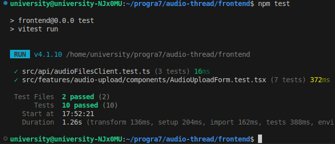
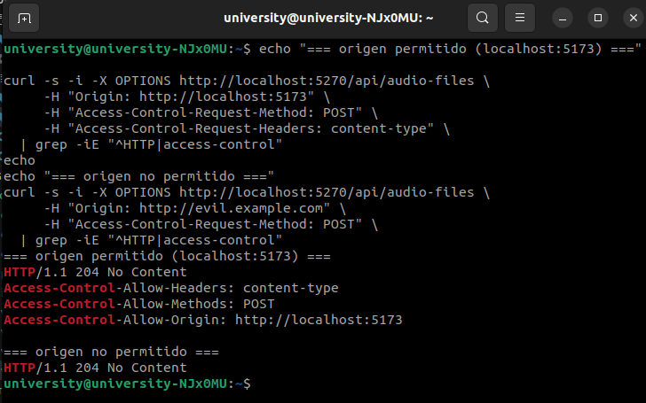
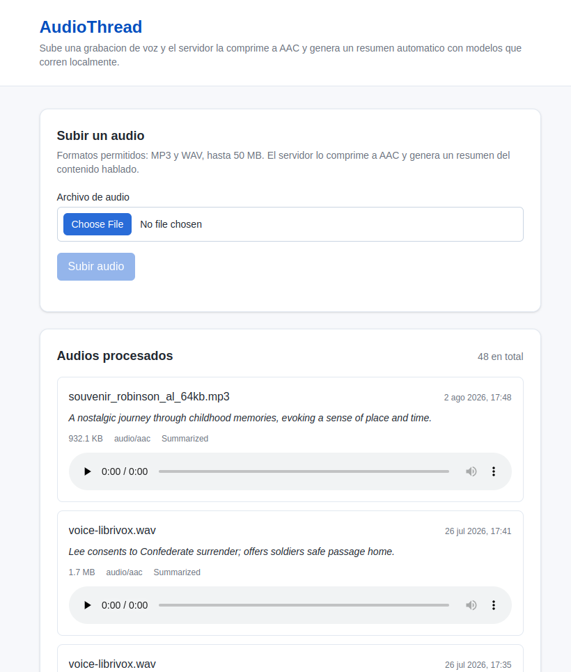
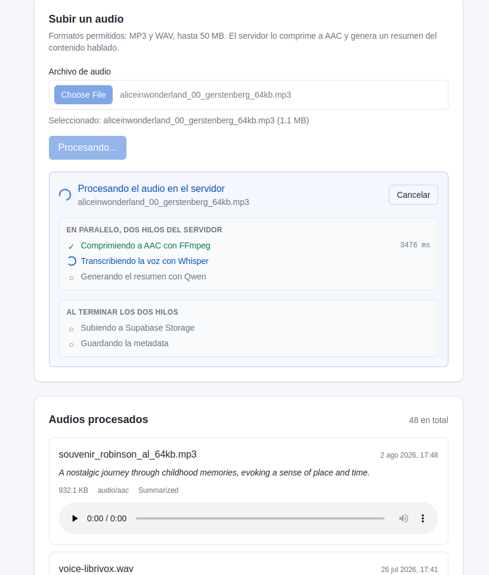
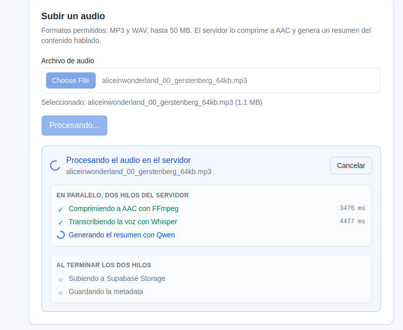
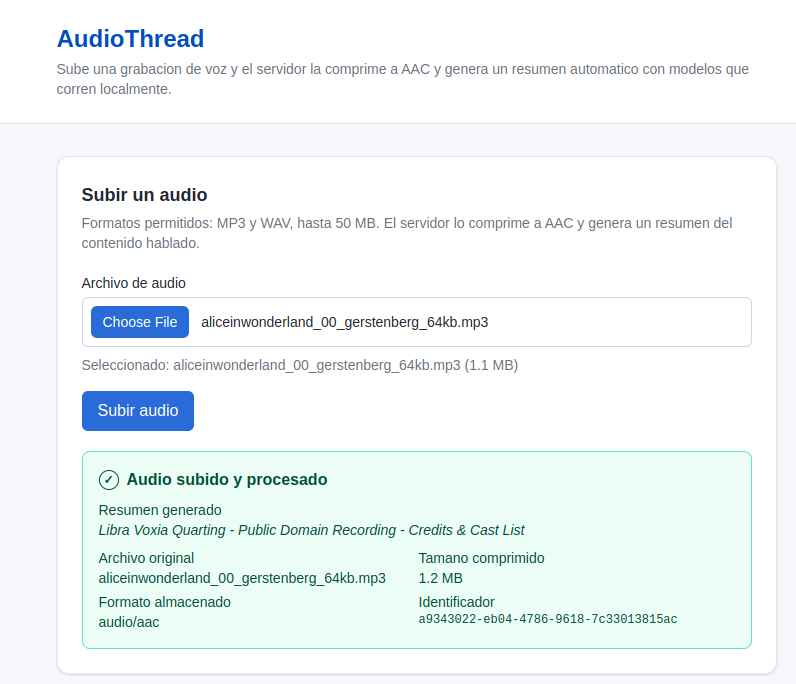
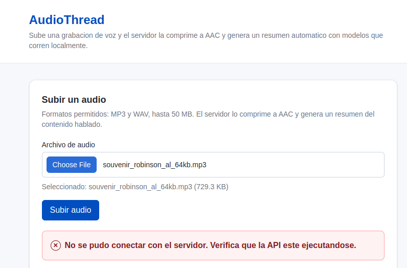
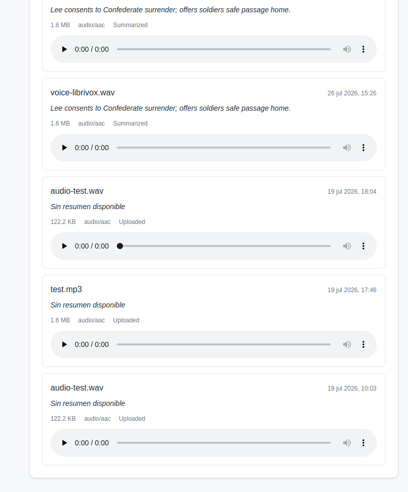
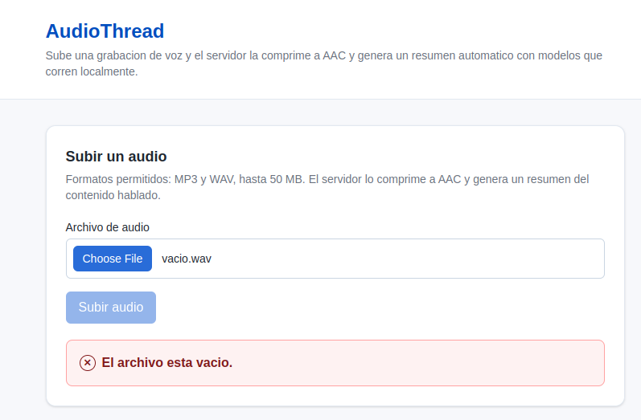

# Programacion 7
## Reporte de Laboratorio: Laboratorio #4

**Titulo del Proyecto:** AudioThread  
**Nombre del Estudiante:** Damon Osvaldo Fernandez Claros  
**Correo del Estudiante:** damon.fernandez@jala.university  
**Fecha de Entrega:** 02/08/2026  
**Instructor:** Leopoldo Flores Colque

---

## 1. Introduccion

- **Descripcion general:** En esta actividad cree la aplicacion web que consume la API que vengo construyendo desde los laboratorios anteriores, la interfaz permite elegir un archivo de audio, subirlo al servidor, ver un indicador mientras se procesa y recibir un mensaje de exito con el resumen generado o un mensaje de error si algo falla, ademas aproveche para conectar el resto de lo que el backend ya sabia hacer, agregando un listado de los audios procesados con su resumen y un reproductor.

- **Objetivo:** El objetivo fue tener por primera vez las dos mitades del proyecto hablando entre si, y hacerlo con un manejo de la asincronia que sea claro, que no bloquee la interfaz y que trate los errores de forma consistente.

---

## 2. Arquitectura e implementacion

### 2.1 Decision del stack

El PDF del proyecto pide TypeScript y deja libre el framework entre React, Angular, Svelte u otro, en este caso elegi **React con Vite** por dos razones concretas, la primera es que Vitest, que es el motor de pruebas de Vite, comparte la misma configuracion que la aplicacion, entonces no tuve que mantener dos configuraciones separadas para compilar y para probar, la segunda es que la prueba que pide el entregable, verificar que el componente de carga se muestre durante la subida, se resuelve muy bien con Testing Library, que es la libreria estandar del ecosistema de React.

Para los estilos use **Tailwind CSS 4**.

### 2.2 Estructura y separacion de responsabilidades

La rubrica califica explicitamente que el codigo tenga una separacion de responsabilidades clara, asi que organice el frontend en tres capas, con la misma idea que use en el backend con la Clean Architecture.

```
frontend/src/
├── api/                    contrato con el backend
├── features/
│   ├── audio-upload/       la actividad del laboratorio
│   └── audio-library/      listado y reproduccion
├── shared/                 componentes y utilidades reutilizables
└── test/setup.ts
```

La regla que segui es simple y se puede verificar leyendo los imports de cada archivo:

| Capa | Puede | No puede |
| :--- | :--- | :--- |
| `api/` | Hablar HTTP | Importar React |
| `hooks/` | Manejar estado y llamar al cliente | Devolver JSX |
| `components/` | Presentar y disparar acciones | Llamar a `fetch` |

Lo hice asi porque cada capa se vuelve testeable por separado, eliente de la API se puede probar sin montar componentes, y los componentes se pueden probar sin tocar la red, que es justamente lo que necesite para la prueba del entregable.

### 2.3 El cliente de la API y el manejo de errores

Todo el trato con el backend esta en `audioFilesClient.ts`, que expone tres funciones y no sabe nada de React.

```typescript
export async function uploadAudioFile(
  file: File,
  options: RequestOptions = {},
): Promise<AudioFileResponse> {
  const formData = new FormData();
  formData.append('file', file);

  const response = await send(() =>
    fetch(AUDIO_FILES_ENDPOINT, {
      method: 'POST',
      body: formData,
      signal: options.signal,
    }),
  );

  return (await response.json()) as AudioFileResponse;
}
```

Los errores los normalice en dos tipos propios, porque el componente no deberia tener que interpretar codigos HTTP, `NetworkError` es cuando el servidor no responde, y `ApiError` es cuando responde pero con un estado de error, llevando adentro el estado y los detalles de validacion.

Aca aproveche algo que ya existia del lado del servidor, la API devuelve los errores de validacion en formato `ProblemDetails`, con un diccionario `errors` que trae la lista de motivos, el cliente lo aplana y el componente los muestra como una lista, entonces el mensaje que ve el usuario es el que escribio el backend y no uno generico inventado en el frontend.

### 2.4 La maquina de estados de la subida

Esta fue la decision de diseño mas importante del laboratorio, en vez de tener varias banderas sueltas como `isLoading`, `error` y `result`, modele el estado con una union discriminada:

```typescript
type UploadState =
  | { status: 'idle' }
  | { status: 'uploading'; fileName: string }
  | { status: 'success'; result: AudioFileResponse }
  | { status: 'error'; message: string; details: string[] };
```

La ventaja concreta es que con banderas sueltas se pueden dar combinaciones que no tienen sentido, como estar cargando y mostrar un resultado al mismo tiempo, o tener un error y un exito juntos, mientras que con la union discriminada esos estados directamente no se pueden representar, y ademas TypeScript obliga a manejar los cuatro casos cuando se renderiza.

Tambien note que cada estado lleva justo los datos que necesita y ninguno mas, `uploading` sabe el nombre del archivo para mostrarlo, `success` tiene la respuesta completa y `error` tiene el mensaje con sus detalles.

### 2.5 Asincronia y cancelacion

Para la asincronía y que no se bloquee el hilo principal y tampoco se caiga en el callbacks hell, lo resolvi con tres decisiones:

- La primera es usar `fetch` con `async` y `await` en todo, sin un solo callback anidado.

- La segunda es *cancelar con `AbortController`, cada subida crea el suyo y lo guarda en una referencia, y el hook lo aborta cuando el componente se desmonta, esto evita el error tipico de intentar actualizar el estado de un componente que ya no existe,

```typescript
useEffect(() => {
  return () => abortControllerRef.current?.abort();
}, []);
```

- La tercera decision fue **no usar una barra de progreso de subida**, y esto merece explicacion porque al principio pense que era la opcion obvia. `fetch` no expone el progreso de subida, solo `XMLHttpRequest` lo hace y es una API de callbacks. Pero al medir descubri algo mas importante, de los veinte segundos que tarda una peticion, la transferencia del archivo son unos pocos cientos de milisegundos y el resto es el servidor procesando. 

  Una barra de progreso saltaria a 100 % en menos de un segundo y despues se quedaria clavada, dando la impresion de que se colgo, termine resolviendolo de otra forma, que explico en la seccion 2.11.

### 2.6 El componente de carga

Este componente lo deje aislado en su propio archivo con una unica responsabilidad, mostrarse mientras la operacion esta en curso.

Le puse un `data-testid` para poder buscarlo en la prueba sin depender del texto, y el spinner tiene `role="status"` con una etiqueta accesible, que ademas de ser buena practica de accesibilidad me sirvio para afirmar sobre el en la prueba usando un rol y no una clase de CSS.

El componente pasa por dos momentos: 
- Mientras el archivo viaja al servidor solamente se ve el spinner con el texto "Subiendo el archivo", porque en ese punto el servidor todavia no respondio y no hay ninguna etapa que mostrar. 
- En cuanto el servidor acepta la solicitud y devuelve el job, el titulo cambia a "Procesando el audio en el servidor" y debajo aparece el stepper con las etapas reales, que explico en la seccion 2.11.

En la practica el primer momento dura menos de un segundo, asi que el usuario ve el spinner solo un instante y el resto del tiempo ve el detalle de las etapas actualizandose.

### 2.7 El formulario y la validacion en el cliente

El formulario valida el archivo antes de mandarlo, revisando extension, que no este vacio y que no supere los 50 MB, estas reglas viven en un archivo aparte, `validation.ts` que no toca el DOM ni React.

Vale aclarar que esta validacion **no reemplaza a la del servidor**, la duplica a proposito, el servidor sigue validando porque no puede confiar en el cliente, y el cliente valida para no hacer viajar 50 MB por la red solo para recibir un rechazo, los limites los alinee con los que ya tenia configurados en `appsettings.json`.

Mientras la subida esta en curso deshabilito el boton y el input, para evitar subidas dobles por doble clic.

### 2.8 CORS, el cambio necesario en el backend

Apenas conecte el frontend con la API me encontre con que el navegador bloqueaba todas las peticiones, la causa es que el frontend corre en el puerto 5173 y la API en el 5270, y para el navegador son origenes distintos, entonces exige que el servidor autorice explicitamente.

Agregue la politica en `Program.cs`, leyendo los origenes permitidos desde la configuracion:

```csharp
builder.Services.AddCors(options =>
{
    options.AddPolicy(FrontendCorsPolicy, policy => policy
        .WithOrigins(allowedOrigins)
        .AllowAnyHeader()
        .AllowAnyMethod());
});
```

Decidi usar `WithOrigins` con una lista concreta, la lista es configurable, asi que en Docker se le pasa el origen que corresponda sin recompilar.

### 2.9 El listado paginado y la reproduccion

Esta parte no la pedia la actividad, la agregue para conectar el frontend con el resto de lo que el backend ya sabia hacer.

El problema era que sin un listado, la unica forma de ver un audio ya subido era pegar su UUID a mano, algo que nadie va a hacer y además no es una muy buena experiencia de usuario, entonces agregue el endpoint `GET /api/audio-files` con paginacion:

```
GET /api/audio-files?skip=0&take=20
```

Lo hice paginado desde el principio y no como una consulta que devuelve todo, el `take` queda acotado entre 1 y 100 y el orden es por fecha descendente para que lo recien subido aparezca primero.

En el frontend, despues de una subida exitosa el listado se refresca solo, entonces el usuario ve aparecer su audio con el resumen ya generado sin tener que hacer nada, cada card muestra el resumen, el tamaño, el formato y un reproductor con el elemento `<audio>` nativo, usando la URL publica que la API ya devolvia y que hasta ahora nadie consumia.

Preferi el `<audio>` nativo antes que wavesurfer.js, que es la otra opcion que menciona la documentación del proyecto porque para reproducir y pausar no necesito la forma de onda y me ahorro una dependencia.

### 2.10 Las pruebas

Para esta ctividad se implementarion pruebas simples que verifiquen que el componente de carga se muestra cuando el archivo se esta subiendo, escribi diez casos en el frontend, mas seis en el backend para el almacen de jobs.

| Archivo | Casos |
| :--- | :--- |
| `AudioUploadForm.test.tsx` | Muestra el indicador mientras sube, muestra las etapas reales que reporta el servidor, lo oculta al terminar, muestra el resumen, muestra el error del servidor, muestra el error de la API, deshabilita el boton, rechaza extensiones no permitidas |
| `audioFilesClient.test.ts` | Arma el `FormData` con la clave correcta, traduce el error de validacion, traduce la falla de red |

Del lado del backend agregue seis casos mas para el almacen de jobs, que verifican que un job nace con todos los pasos pendientes, que actualizar un paso no toca los demas, que al fallar los pasos en curso quedan marcados como fallidos y que la suscripcion emite el estado actual y cada cambio hasta que el job termina.

### 2.11 Etapas reales del servidor con el patron asincrono

Esta es la parte de la que estoy mas conforme ya que en vez de un spinner generico durante veinte segundos, por que no mostrar en que etapa esta el servidor.

El problema es que el endpoint que tenia era sincrono, el navegador mandaba el POST y la conexion quedaba abierta hasta que todo terminaba sin recibir nada en el medio.

Investigando encontre que Microsoft documenta un patron para exactamente esto, el **Asynchronous Request-Reply Pattern** del Azure Architecture Center, donde la idea es que el POST valide y responda `202 Accepted` de inmediato, con una cabecera `Location` que apunte a donde consultar el estado, mientras el job sigue en segundo plano.

Para el canal en vivo use **Server-Sent Events** ya que encaja bien con este caso porque el progreso solo viaja del servidor al cliente, no hace falta que el navegador mande nada de vuelta, y ademas el navegador reconecta solo si se corta la conexion usando `EventSource` y la cabecera `Last-Event-ID`, del lado del cliente no requiere ninguna libreria adicional.

Referencias que consulte:

- Asynchronous Request-Reply Pattern: https://learn.microsoft.com/en-us/azure/architecture/patterns/asynchronous-request-reply

#### Nuevos endpoints

```
POST /api/audio-files/jobs        202 Accepted + Location, encola y responde al instante
GET  /api/audio-files/jobs/{id}          estado del job en cualquier momento
GET  /api/audio-files/jobs/{id}/events   flujo SSE con cada cambio de etapa
```

Del lado del servidor agregue una cola con `Channel`, un `BackgroundService` que la consume, y un almacen en memoria de los jobs que permite suscribirse a sus cambios.

Una decision importante fue no tocar el endpoint sincrono, El `POST /api/audio-files` original quedo exactamente igual, el asincrono es un endpoint nuevo, asi no rompi nada de lo que ya funcionaba ni las pruebas de los laboratorios anteriores, y el frontend elige cual usar.

### 2.12 Docker

Agregue el frontend al `docker-compose` que ya existia, la imagen usa dos etapas, una con Node que compila la aplicacion y otra con Nginx que sirve los archivos estaticos, lo que deja una imagen de 48.5 MB en lugar de arrastrar Node y las dependencias a produccion.

La URL de la API se pasa como argumento de build, porque Vite reemplaza las variables de entorno en tiempo de compilacion y no en tiempo de ejecucion.

```bash
docker compose up --build
```

Levanta la API en el 5270 y el frontend en el 8080.

---

## 3. Merge Request

- **Enlace del Merge Request:** `[Agregar aqui el enlace del Merge Request]`

---

## 4. Mediciones

Esta actividad no tiene mediciones de concurrencia como la anterior, pero si registre el costo del build y del paquete que se descarga el navegador.

| Metrica | Valor |
| :--- | ---: |
| Tiempo de compilacion | 149 ms |
| JavaScript generado | 201.83 kB, 63.61 kB comprimido |
| CSS generado | 16.06 kB, 4.02 kB comprimido |

---

## 5. Resultados de ejecucion y evidencia empirica

### 5.1 Salidas de consola

#### 5.1.1 Pruebas del frontend

Las diez pruebas cubren dos capas.

Del cliente de la API:

- El archivo viaja como `multipart/form-data` bajo la clave `file`.
- Una respuesta de validacion se traduce en un `ApiError` con sus detalles.
- Una falla de red se traduce en un `NetworkError`.

Del formulario:

- El componente de carga aparece mientras el archivo se esta subiendo, que es lo que pide el entregable.
- Se muestran las etapas reales que reporta el servidor.
- El indicador se oculta y aparece el resumen cuando el job termina.
- Se muestra el mensaje de error si el job falla en el servidor.
- Se muestra el mensaje de error si la API rechaza el archivo.
- El boton queda deshabilitado mientras el job esta en curso.
- Un archivo con extension no permitida se rechaza sin llegar a llamar a la API.



#### 5.1.2 Verificacion de CORS

Para comprobar que la politica quedo bien acotada probe los dos casos, un origen permitido y uno que no lo esta:



### 5.2 Evidencias de verificacion

- **Evidencia 1: la aplicacion con el formulario de subida**  
  **Descripcion:** Pantalla inicial con el formulario, el input de archivo y el listado de audios ya procesados que se carga al abrir la pagina.

  

- **Evidencia 2: el componente de carga durante la subida**  
  **Descripcion:** Esta es la evidencia central de la actividad, muestra el indicador visible mientras el archivo se sube, con el nombre del archivo, el aviso de que puede tardar y el boton de cancelar, en este caso el boton de subir queda deshabilitado.

  

  

- **Evidencia 3: mensaje de exito con el resumen**  
  **Descripcion:** Al terminar la subida el indicador desaparece y aparece el mensaje de exito con el resumen generado por los modelos locales, el tamaño comprimido, el formato y el identificador.

  

- **Evidencia 4: mensaje de error**  
  **Descripcion:** Comportamiento cuando la subida falla, ya sea porque la API rechaza el archivo o porque el servidor no responde. El mensaje viene del backend y no es un texto generico del frontend.

  

- **Evidencia 5: listado con resumen y reproductor**  
  **Descripcion:** El listado paginado mostrando los audios procesados, cada uno con su resumen y su reproductor, comprueba que el frontend consume los tres endpoints de la API.

  

- **Evidencia 6: validacion del archivo en el cliente**  
  **Descripcion:** Al elegir un archivo vacio, la aplicacion muestra el motivo del rechazo y deja el boton de subir deshabilitado, sin llegar a hacer ninguna peticion al servidor, esto evita que un archivo invalido viaje por la red solo para ser rechazado del otro lado., tabién hay uno para el formato pero en este caso hay un filtro en el input que verifica que solo se puedan subir los formatos permitidos.

  

---

## 6. Autoevaluacion, bloqueos y errores

- **Implementacion del tracking para seguir el estado de la carga:** Al principio use un spinner simple, pero al probarlo con audios reales note que veinte segundos sin informacion daban la sensacion de que la aplicacion se habia colgado, lo cambie por el seguimiento de etapas en tiempo real, que se ve mucho mejor y ademas deja ver el paralelismo del laboratorio anterior, con la compresion terminando al segundo mientras el resumen sigue corriendo.

- **El navegador bloqueaba todas las peticiones:** Fue lo primero que me freno al conectar las dos partes, las peticiones fallaban sin llegar al servidor y el mensaje de la consola hablaba de una politica CORS, lo resolvi agregando la politica en la API con una lista concreta de origenes.

- **Los enums viajaban como numeros y el frontend no los entendia:** Cuando probe el flujo asincrono por primera vez, el estado del job llegaba como `1` y `3` en lugar de `Processing` y `Completed`, y el stepper no mostraba nada, la causa era que `System.Text.Json` serializa los enums como numeros por defecto y lo resolvi agregando `JsonStringEnumConverter` tanto en la configuracion global de la API como en el serializador del flujo SSE, que usa sus propias opciones.

---

## 7. Conclusiones

- **Aprendizaje 1:** Modelar el estado con una union discriminada en lugar de banderas sueltas cambia la forma de escribir la interfaz, con flags se pueden dar combinaciones sin sentido y uno termina agregando condiciones defensivas para que no ocurran, mientras que con la union esos estados no se pueden ni escribir, y el compilador obliga a manejar todos los casos.

- **Aprendizaje 2:** Entendi que asincronia bien hecha no es solamente usar `await`, tambien es saber cuando cortar, el `AbortController` resolvio dos cosas actualizar un componente que ya se desmonto y darle al usuario la posibilidad de arrepentirse de una operacion larga, esto ya lo había utilizado antes pero fue bueno recordar.

- **Aprendizaje 3:** Aprendi que antes de elegir una solucion conviene buscar si el problema ya tiene un patron documentado, primero queria mostrar el progreso fue transmitir la respuesta del POST, que era lo mas simple, pero al investigar encontre que Microsoft documenta el Asynchronous Request-Reply Pattern justo para operaciones largas por HTTP, y que resuelve cosas que mi idea no resolvia, como que el job sobreviva si se corta la conexion o si el usuario recarga la pagina.

---

## 8. Recomendaciones

- Integrar un IAM para autenticar a los usuarios, de forma que cada uno tenga su propia sesion y vea solamente sus audios, hoy la aplicacion no tiene usuarios y el listado muestra todo lo que se subio, entonces cualquiera que abra la pagina ve los audios de los demas.

- Persistir el estado de los jobs en la base de datos en lugar de memoria, hoy el almacen es un diccionario en memoria, lo que significa que si la API se reinicia se pierden los jobs en curso, y que no funcionaria con varias instancias de la API detras de un balanceador. 

- Agregar paginacion visible en el listado. Hoy el frontend pide los primeros diez audios y no ofrece forma de ver los siguientes, aunque el endpoint ya soporta `skip` y `take`. Falta solamente la parte visual.

- Verificar la reproduccion del audio en varios navegadores. El servidor guarda AAC en contenedor ADTS y el soporte de ese formato varia entre navegadores. Si alguno no lo reproduce, la solucion seria que FFmpeg genere un contenedor `.m4a`, que tiene soporte mas amplio.

