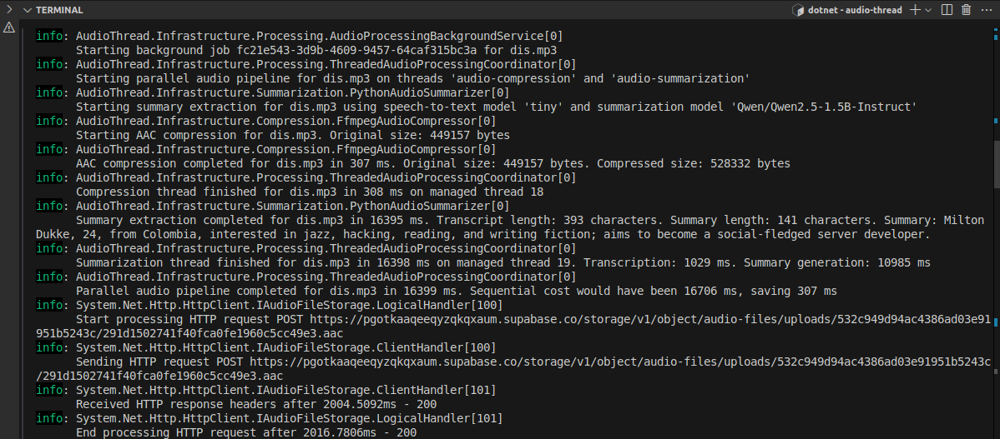
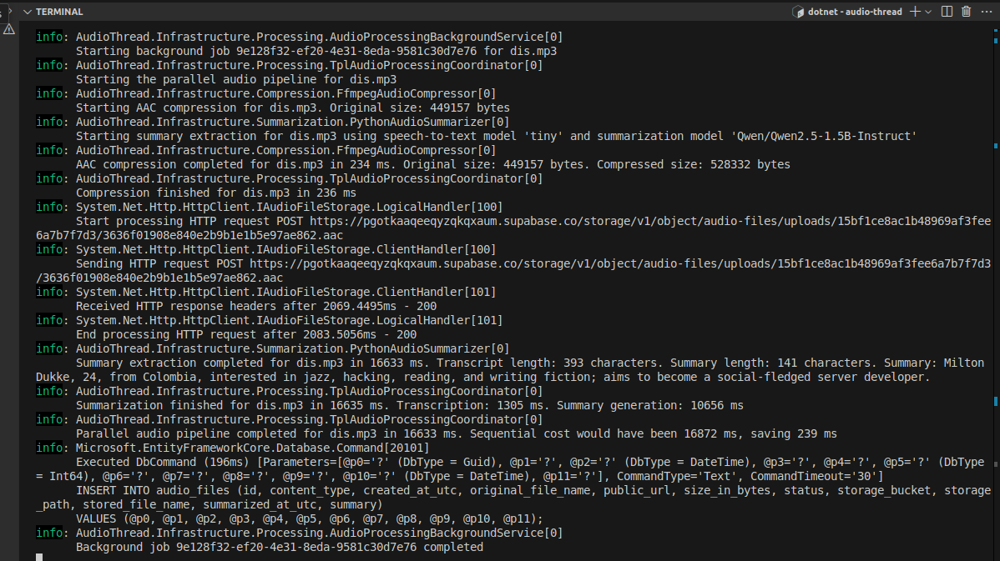
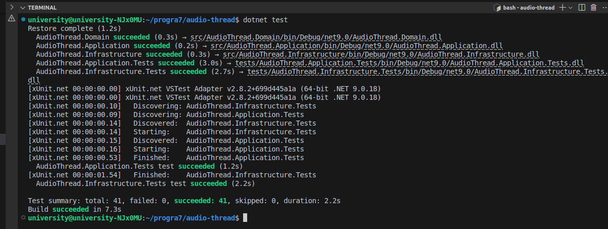
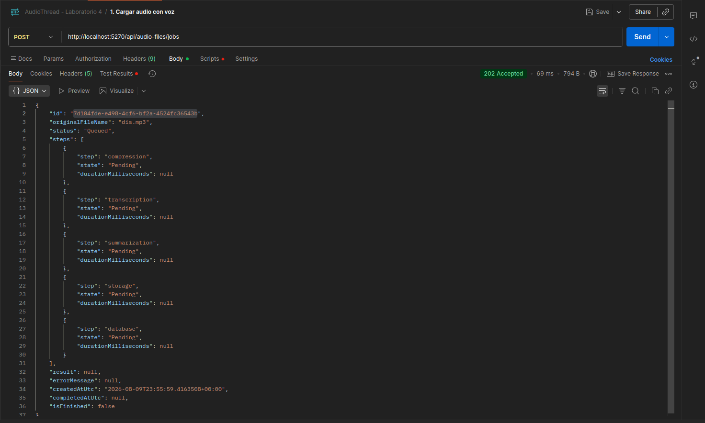
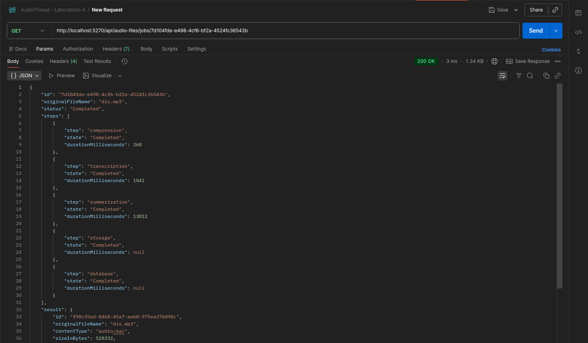
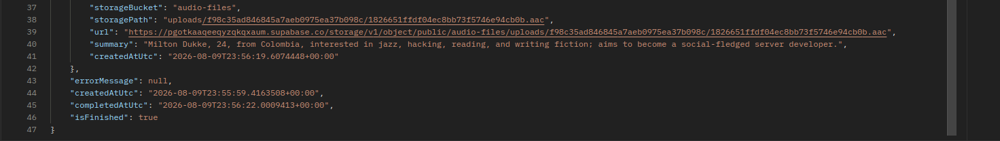
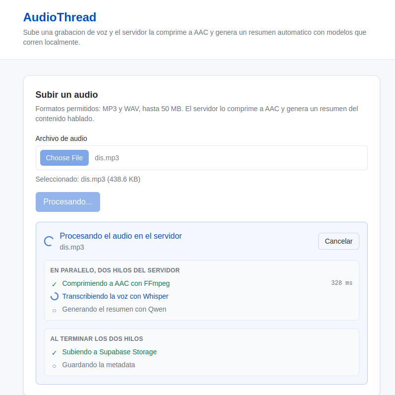
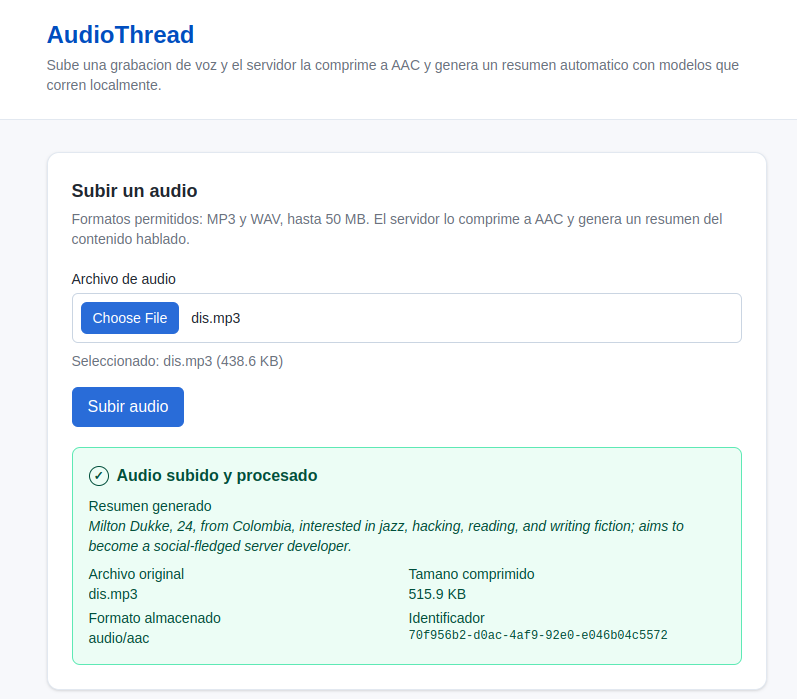
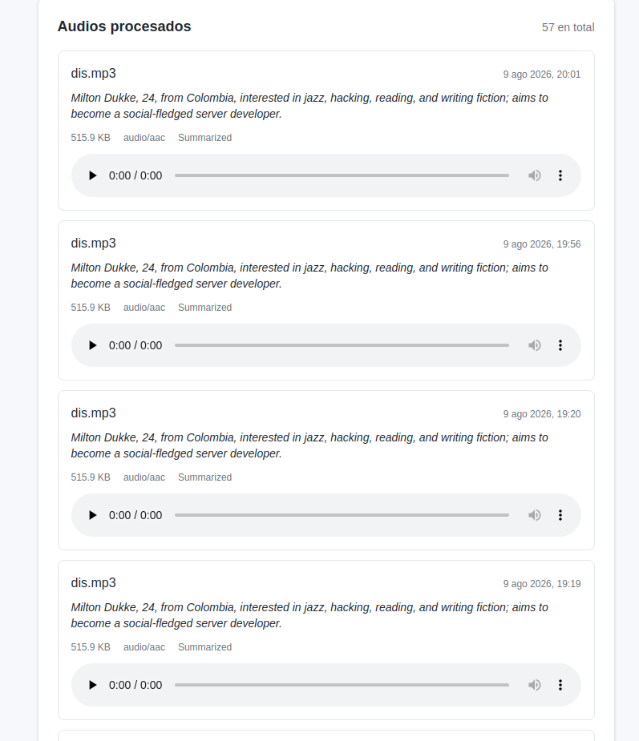

# Programación 7
## Reporte de Laboratorio: Laboratorio #5

**Título del Proyecto:** AudioThread  
**Nombre del Estudiante:** Damon Osvaldo Fernandez Claros  
**Correo del Estudiante:** damon.fernandez@jala.university  
**Fecha de Entrega:** 09/08/2026  
**Instructor:** Leopoldo Flores Colque

---

## 1. Introducción

- **Descripción general:** En esta actividad cambié la forma en que el servidor ejecuta la compresión y la extracción del resumen, antes las dos etapas corrían en hilos que yo creaba a mano y las sincronizaba con un `CountdownEvent`, ahora corren como tareas de la TPL y se sincronizan con `Task.WhenAll`, además aproveché el cambio para adelantar la subida del archivo a Supabase, que antes esperaba a que terminara todo y ahora arranca apenas la compresión queda lista mientras el resumen sigue corriendo.

- **Objetivo:** Cumplir con lo que pide la actividad, que era aplicar TPL de C# para procesar las tareas de compresión y resumen, aplicar los mecanismos de sincronización donde hicieran falta, mejorar el tiempo total de procesamiento de una solicitud, mostrar el resumen en cada elemento del lado del cliente, y todo esto sin romper las pruebas que ya venían pasando.

---

## 2. Arquitectura e implementación

### 2.1 Reemplazo de los hilos bloqueados por tareas de la TPL

Cuando revisé el código del laboratorio 3 me di cuenta de algo que no había visto antes, tanto FFmpeg como el script de Python corren en procesos aparte del servidor, y los adaptadores que los llaman ya estaban escritos de forma asincrónica con `WaitForExitAsync`, pero el coordinador de hilos los llamaba así:

```csharp
.GetAwaiter()
.GetResult();
```

Eso significa que yo creaba dos hilos del sistema operativo y cada uno se quedaba bloqueado sin hacer absolutamente nada durante los 16 segundos que tardaban los procesos externos, dos hilos completos consumidos para esperar, con la TPL esos dos hilos ya no existen, mientras FFmpeg y Python trabajan no hay ningún hilo del servidor ocupado, y de paso desapareció el `GetAwaiter().GetResult()` que es justamente el patrón que puede provocar interbloqueos.

### 2.2 Coordinador de tareas y eliminación de la coordinación manual

`TplAudioProcessingCoordinator` reemplaza a `ThreadedAudioProcessingCoordinator`, y lo único que hace es lanzar las dos etapas y devolverlas juntas:

```csharp
public AudioProcessingSession Start(
    AudioProcessingRequest request,
    CancellationToken cancellationToken)
{
    return new AudioProcessingSession(
        CompressAsync(request, cancellationToken),
        SummarizeAsync(request, cancellationToken),
        timings => LogPipelineCompleted(request.FileName, timings));
}
```

Al hacer este cambio pude borrar dos archivos enteros, `ThreadedAudioProcessingCoordinator` y `AudioProcessingPipelineRun`, con su `CountdownEvent`, su `Lock` y su `TaskCompletionSource`, toda esa coordinación manual la resuelve la TPL sola.

### 2.3 Sincronización con Task.WhenAll y agregación de fallas

El punto de sincronización vive en `AudioProcessingSession`, que espera las dos etapas y arma el resultado:

```csharp
var stages = Task.WhenAll(_compression, _summarization);

try
{
    await stages;
}
catch
{
    _wallClock.Stop();
    throw DescribeFailure(stages);
}
```

El try está ahí por un detalle que casi se me pasa, `Task.WhenAll` cuando se le hace await lanza solamente la primera excepción, y yo necesitaba conservar el comportamiento anterior que juntaba las fallas de las dos etapas, entonces en `DescribeFailure` leo `stages.Exception.InnerExceptions` y según cuántas fallas haya devuelvo la excepción sola o una `AggregateException` con las dos adentro.

### 2.4 Encadenamiento de la subida sobre la tarea de compresión

Revisando las dependencias entre etapas me di cuenta de que la subida a Supabase solo necesita el audio comprimido, no necesita el resumen para nada, pero en el código anterior esperaba a que terminaran las dos etapas igual, entonces reordené el trabajo así:

Antes el orden era este:

1. Arrancan la compresión y el resumen al mismo tiempo.
2. Termina la compresión, pero no se hace nada con el archivo todavía.
3. Termina el resumen, recién ahí se libera el paso siguiente.
4. Se sube el archivo comprimido a Supabase.
5. Se guarda el registro en la base de datos.

Y ahora quedó así:

1. Arrancan la compresión y el resumen al mismo tiempo.
2. Termina la compresión y de inmediato empieza la subida a Supabase, sin esperar al resumen.
3. Mientras el resumen sigue corriendo, la subida se completa en paralelo.
4. Termina el resumen, que es la etapa más larga y la que marca el ritmo.
5. Se guarda el registro en la base de datos.

La diferencia está en el paso 2, esos dos segundos de subida antes se sumaban al final y ahora quedan adentro del tiempo del resumen.

En el handler la subida se encadena sobre la tarea de compresión y recién al final espero las dos cosas:

```csharp
var storageTask = UploadWhenCompressedAsync(session, audioFileId, command.Progress, cancellationToken);
var processingTask = session.CompleteAsync();

await WhenBothStagesSettleAsync(processingTask, storageTask);
```

`WhenBothStagesSettleAsync` existe por un problema concreto, si la subida falla mientras el resumen todavía corre, la excepción del resumen quedaría sin observar, entonces ese método espera las dos y le da prioridad a la falla del procesamiento, que es la que trae la agregación con la forma correcta.

También hice que la sesión sea `IAsyncDisposable` y que ella sea la dueña del stream comprimido, antes el handler lo liberaba con `await using` pero ahora que la subida corre en paralelo con el resumen, liberarlo desde el handler podía cortar el stream mientras Supabase todavía lo estaba leyendo.

### 2.5 Visualización del resumen en cada elemento del cliente

El requisito de que cada elemento muestre el resumen del audio ya estaba cumplido desde el laboratorio 4, la tarjeta de cada audio muestra el resumen como texto principal y no como un dato secundario:

```tsx
<p className="font-display mt-3 text-lg leading-snug tracking-tight">
  {audioFile.summary ?? 'Sin resumen disponible'}
</p>
```

Lo verifiqué de nuevo en esta entrega para confirmar que el cambio del servidor no rompió nada de la vista.

### 2.6 Pruebas de solapamiento real entre etapas

Las cinco pruebas del coordinador siguen ahí y agregué dos más, pero tuve que cambiar dos aserciones, antes verificaban el nombre del hilo:

```csharp
Assert.Equal("audio-compression", compressor.ExecutionThreadName);
```

Los hilos del grupo de subprocesos que usa la TPL no tienen nombre, entonces esa aserción era imposible de mantener, y además nunca probó paralelismo de verdad, hubiera pasado igual si las dos etapas corrieran una después de la otra en hilos distintos, la reemplacé por una que verifica que los intervalos de las dos etapas se cruzan en el tiempo:

```csharp
Assert.True(
    compressor.StartedAt < summarizer.FinishedAt && summarizer.StartedAt < compressor.FinishedAt,
    "Expected both stages to overlap in time but they ran one after the other.");
```

Las dos pruebas nuevas verifican que el audio comprimido está disponible mientras el resumen sigue corriendo, y que la subida al almacenamiento arranca antes de que el resumen termine que es la mejora de la sección 2.4.

---

## 3. Pull Request (PR)

* **Pull Request Link:** `[pegar la URL del merge request de GitLab]`

---

## 4. Benchmark y mediciones de rendimiento

Para comprobar si el cambio realmente sirvió comparé las dos implementaciones, la del laboratorio 3 con los hilos manuales que está en la rama `main`, contra la de este laboratorio con TPL y la subida encadenada, medí tres veces cada una con el mismo archivo `dis.mp3` de 32 segundos, en la misma máquina y contra el mismo bucket de Supabase, descartando siempre la primera corrida porque ahí los modelos se cargan en frío y el número no representa nada.

| Estrategia de ejecución | Detalle de la carga | Cola después del resumen | Total del trabajo |
| :--- | :--- | :--- | :--- |
| **Hilos manuales (laboratorio 3)** | Subida y base de datos en serie después del pipeline | `2068 ms` | `17986 ms` |
| **TPL con solapamiento** | Subida encadenada sobre la compresión | `196 ms` | `16829 ms` |

Los valores de la primera columna son la mediana de las tres corridas de cada rama.

Detalle completo de las corridas:

| | Hilos C | Hilos D | Hilos E | TPL A | TPL B | TPL F |
| :--- | ---: | ---: | ---: | ---: | ---: | ---: |
| Compresión | 308 | 268 | 287 | 396 | 342 | 236 |
| Resumen | 16398 | 15876 | 16274 | 34299 | 17689 | 16635 |
| Subida a Supabase | 2016 | 1932 | 1468 | 2168 | 2490 | 2083 |
| Base de datos | 260 | 136 | 243 | 205 | 181 | 196 |
| Cola tras el resumen | 2276 | 2068 | 1711 | 205 | 181 | 196 |
| Total | 18675 | 17945 | 17986 | 34501 | 17867 | 16829 |

**Análisis de rendimiento:**

> - La mejora es de 1.87 segundos por solicitud y equivale a una reducción del 90.5% en el tiempo que pasa entre que el resumen termina y el trabajo se da por completo, la razón es que la subida a Supabase tarda alrededor de dos segundos en las seis corridas sin importar la rama, lo que cambió es que antes esos dos segundos se sumaban al total y ahora quedan escondidos adentro del resumen que dura mucho más.
>
> - La comparación más clara son las corridas E y F porque el resumen tardó casi lo mismo en las dos, 16274 ms contra 16635 ms y aun así la versión con TPL terminó 1157 ms antes a pesar de haber hecho 361 ms más de trabajo de modelo.
>
> - Si se mira solamente el total, la diferencia entre medianas es de apenas 119 ms, ese número está dominado por la variabilidad del modelo de lenguaje, que en mis corridas fue de 10 a 27 segundos generando el mismo resumen del mismo audio, esa variación es mucho más grande que la mejora que buscaba y no tiene nada que ver con lo que cambié por eso mido la cola después del resumen, que es la parte del pipeline que sí depende de mi implementación.

---

## 5. Resultados de ejecución y evidencia empírica

### 5.1 Salidas de consola y logs

La línea que hay que mirar en las dos capturas es la que dice `Start processing HTTP request POST https://...supabase.co/storage/...`, que es el momento exacto en que el servidor empieza a subir el archivo comprimido al bucket, lo que cambia entre una versión y la otra es en qué lugar del registro aparece esa línea.

Versión con hilos manuales, la subida a Supabase arranca recién después de `Parallel audio pipeline completed`, es decir cuando ya terminó el resumen, y sus casi dos segundos se suman enteros al tiempo que el usuario espera:



Versión con TPL procesando el mismo audio, la subida arranca apenas se imprime `Compression finished` a los 236 ms, y la línea `Summary extraction completed` aparece después, o sea que Supabase respondió mientras el modelo de lenguaje todavía estaba generando el resumen y esos dos segundos ya no se suman a nada:



### 5.2 Evidencia de verificación (capturas)

* **Evidencia 1: Suite de pruebas completa en verde**  
  *Descripción:* Salida de `dotnet test` con las 41 pruebas pasando, que demuestra que la migración a TPL no rompió ninguna de las pruebas que ya venían pasando y que se agregaron dos nuevas.

  

* **Evidencia 2: Respuesta 202 Accepted en Postman**  
  *Descripción:* Muestra que el flujo de carga de audio sigue funcionando de punta a punta después del cambio, con la cabecera `Location` apuntando al trabajo creado.

  

* **Evidencia 3: Trabajo completado con las etapas y sus tiempos**  
  *Descripción:* Respuesta del `GET` del trabajo con estado `Completed` y la duración de cada etapa, que es la fuente de los números de la sección 4.

  

  

* **Evidencia 4: Biblioteca del frontend mostrando el resumen en cada tarjeta**  
  *Descripción:* Cumple el requisito del lado del cliente, cada elemento de audio procesado muestra su resumen, y confirma que el cambio en el servidor no afectó la vista.

  

  

  

---

## 6. Autoevaluación, bloqueos y errores

* **Dificultades técnicas y errores encontrados:** Tuve tres problemas, los dobles de prueba usaban `Thread.Sleep` que bloquea el hilo antes de devolver la tarea y hubiera hecho que las dos etapas corrieran una detrás de la otra, el stream del audio comprimido podía liberarse mientras Supabase todavía lo estaba leyendo ahora que la subida corre en paralelo, y `Task.WhenAll` al hacerle `await` descarta todas las excepciones menos la primera.

* **Estrategia de resolución:** Cambié los dobles a `await Task.Delay`, hice que `AudioProcessingSession` sea `IAsyncDisposable` para que sea ella la dueña del stream y lo libere recién cuando terminó todo, y para las fallas leo directamente `stages.Exception.InnerExceptions` en lugar de confiar en lo que lanza el `await`.

---

## 7. Conclusiones

* **Conclusión 1:** La ganancia más grande de pasar a la TPL no fue el tiempo de una solicitud sino los recursos, antes cada solicitud tenía dos hilos del sistema operativo bloqueados esperando a procesos externos que corren afuera de .NET, y ahora no tiene ninguno, eso no se nota midiendo una carga sola pero cambia cuántas solicitudes simultáneas puede atender el servidor con la misma máquina.

* **Conclusión 2:** Lo que más me sirvió fue mirar las dependencias reales entre etapas en vez de asumir el orden que ya tenía escrito, la subida a Supabase nunca necesitó el resumen y sin embargo lo esperaba, mover ese punto de unión fue lo que dio la mejora medible y me quedó la idea de que paralelizar no es solamente lanzar cosas al mismo tiempo sino entender qué necesita cada paso para poder empezar.

---

## 8. Recomendaciones

* Revisar la carga del modelo de lenguaje dentro del script de Python, hoy se carga después de la transcripción y no depende de ella, cargarlo en paralelo podría dar una mejora bastante más grande que la de este laboratorio, aunque ya sería threading de Python y no TPL de C#.

* Poner un límite a cuántos trabajos se procesan al mismo tiempo, porque ahora que los hilos no son la barrera, nada impide que varias solicitudes levanten varios procesos de Python a la vez y saturen la memoria de la máquina.
