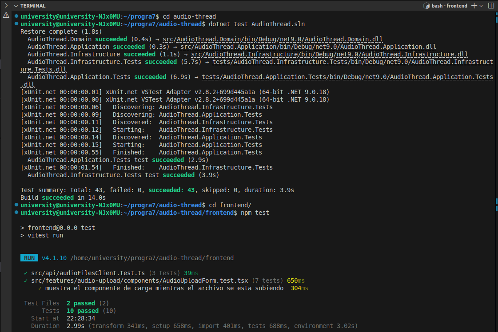
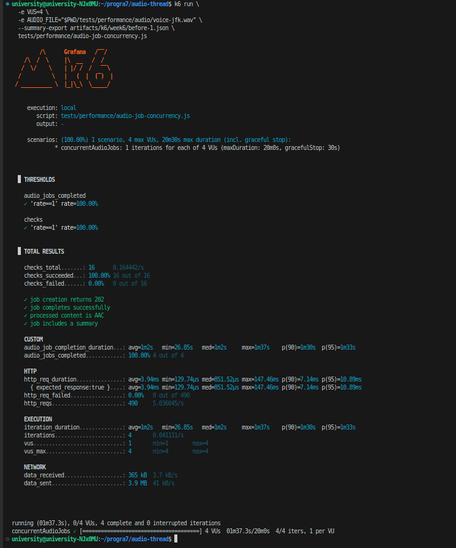
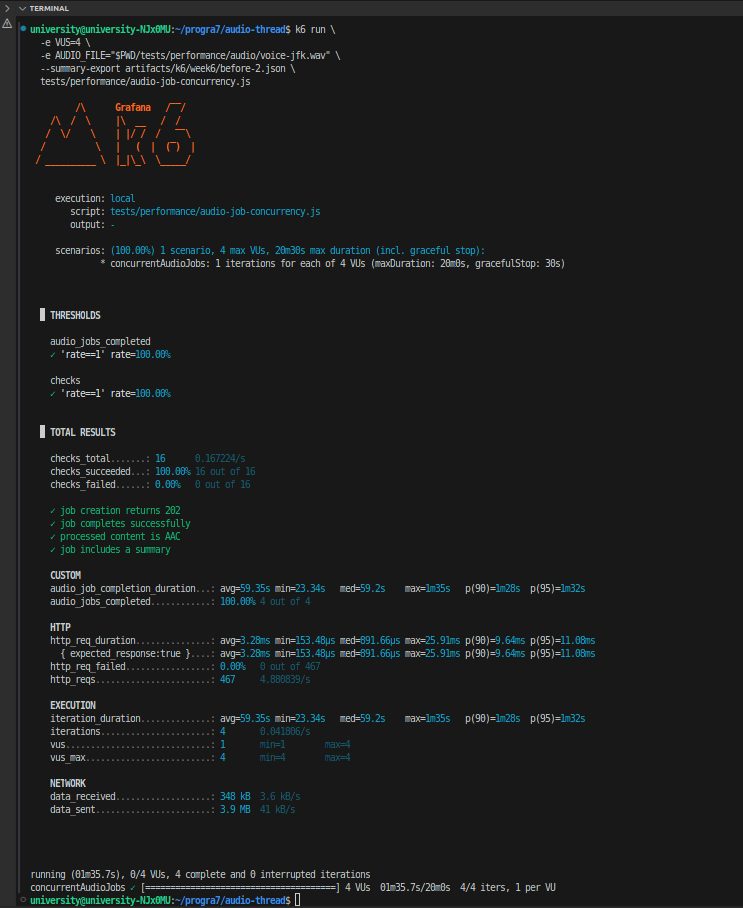
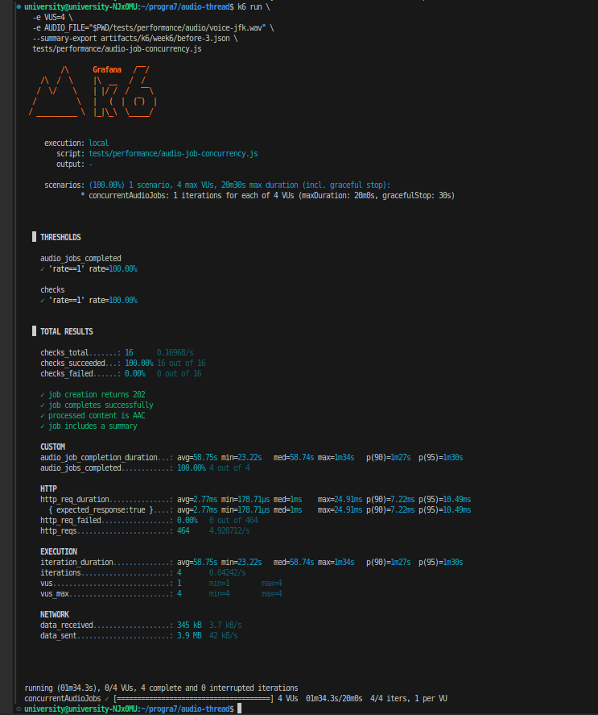
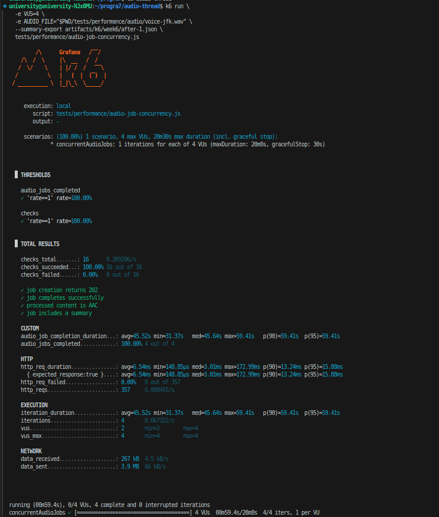
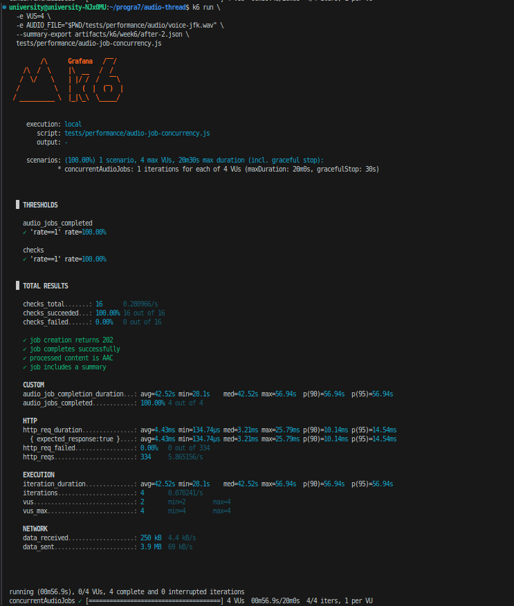
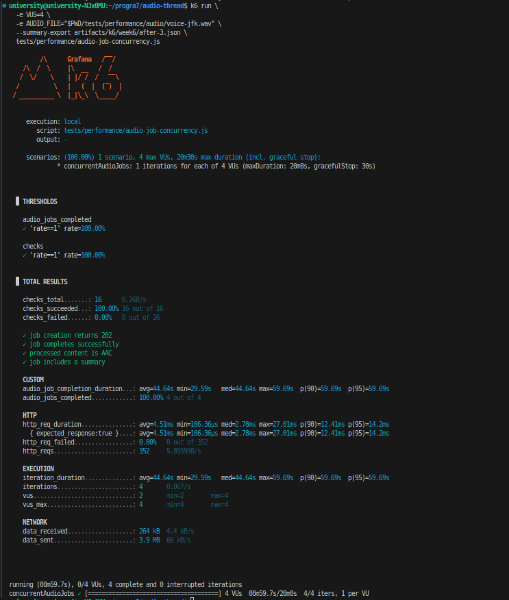
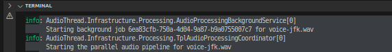
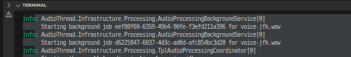

# Programación 7
## Reporte de Laboratorio: Laboratorio #6

**Título del Proyecto:** AudioThread  
**Nombre del Estudiante:** Damon Osvaldo Fernandez Claros  
**Correo del Estudiante:** damon.fernandez@jala.university  
**Fecha de Entrega:** 16/08/2026  
**Instructor:** Leopoldo Flores Colque

---

## 1. Introducción

- **Descripción general:** En esta actividad cambié la forma en que el servidor consume los trabajos de audio que están en segundo plano, antes el `BackgroundService` sacaba un trabajo de la cola y esperaba que terminara completamente antes de comenzar el siguiente, por lo que varios usuarios podían subir archivos, pero solamente el audio de uno de ellos se procesaba de forma activa, ahora el servidor utiliza `Parallel.ForEachAsync` para ejecutar hasta dos trabajos independientes al mismo tiempo.

- **Objetivo:** Aplicar una biblioteca de Programación Paralela en el servidor para aumentar el número de usuarios cuyos audios pueden procesarse simultáneamente, mantener el flujo de carga funcionando y conservar la separación de responsabilidades y las pruebas de los laboratorios anteriores.

---

## 2. Arquitectura e implementación

### 2.1 El problema del consumidor secuencial

El procesamiento en segundo plano ya existía desde el laboratorio 4, el endpoint creaba un trabajo, respondía `202 Accepted` y colocaba el audio en un `Channel`, sin embargo, el consumidor de esa cola seguía siendo secuencial:

```csharp
await foreach (var workItem in _queue.DequeueAllAsync(stoppingToken))
{
    await ProcessAsync(workItem, stoppingToken);
}
```

El `await` estaba dentro del ciclo, por lo que no se pedía el siguiente elemento hasta que el audio actual terminaba de comprimirse, resumirse, subirse a Supabase y guardarse en PostgreSQL.

Esto significa que la API aceptaba solicitudes concurrentes, pero los trabajos pesados quedaban esperando en la cola, en este reporte considero **usuario concurrente activo** al usuario cuyo audio está siendo procesado realmente y no solamente al que ya recibió un identificador de trabajo.

### 2.2 Procesamiento paralelo con `Parallel.ForEachAsync`

Reemplacé el ciclo secuencial por un ejecutor basado en la clase `Parallel` de la TPL:

```csharp
var parallelOptions = new ParallelOptions
{
    MaxDegreeOfParallelism = _options.MaxConcurrentJobs,
    CancellationToken = cancellationToken
};

return Parallel.ForEachAsync(
    workItems,
    parallelOptions,
    async (workItem, itemCancellationToken) =>
        await processor(workItem, itemCancellationToken));
```

Elegí `Parallel.ForEachAsync` en lugar de `Parallel.For` porque el origen es un `IAsyncEnumerable` y el procesamiento de cada audio también es asincrónico, cada iteración espera procesos externos, llamadas HTTP y operaciones de base de datos, usar `Parallel.For` obligaría a bloquear hilos mientras esas operaciones terminan.

Los audios son elementos independientes de una colección de trabajo y el orden en que finalizan no importa, la documentación oficial de .NET confirma que `Parallel.ForEachAsync` permite procesar los elementos de un `IAsyncEnumerable` en paralelo y controlar el grado mediante `ParallelOptions`.

### 2.3 Grado de paralelismo configurable

Agregué la sección `AudioProcessing` a la configuración:

```json
"AudioProcessing": {
  "MaxConcurrentJobs": 2,
  "QueueCapacity": 8
}
```

Las propiedades tienen las siguientes responsabilidades:

| Opción | Responsabilidad |
| :--- | :--- |
| `MaxConcurrentJobs` | Número máximo de audios que pueden procesarse al mismo tiempo. |
| `QueueCapacity` | Número máximo de trabajos que pueden permanecer esperando dentro del canal. |

El registro de dependencias valida al iniciar la API que `MaxConcurrentJobs` sea mayor que cero y que la capacidad de la cola no sea menor que el número de trabajadores.

Elegí dos trabajos concurrentes como valor predeterminado porque cada audio puede iniciar un proceso de FFmpeg y otro de Python con los modelos locales, un valor sin límite podría levantar varios modelos de aproximadamente 3.4 GB y dejar al servidor sin memoria.

### 2.4 Cola acotada y contrapresión

La cola anterior utilizaba `Channel.CreateUnbounded`, por lo que no tenía una capacidad máxima, esto era especialmente riesgoso porque cada elemento contiene el audio completo en un arreglo de bytes.

La cambié por un canal acotado:

```csharp
_channel = Channel.CreateBounded<AudioProcessingWorkItem>(
    new BoundedChannelOptions(options.Value.QueueCapacity)
    {
        SingleReader = true,
        SingleWriter = false,
        FullMode = BoundedChannelFullMode.Wait,
        AllowSynchronousContinuations = false
    });
```

Con `BoundedChannelFullMode.Wait`, cuando la cola alcanza su límite la escritura espera de forma asincrónica hasta que exista espacio, de esta manera se aplica contrapresión en lugar de seguir acumulando trabajos indefinidamente.

### 2.5 Separación de responsabilidades

La solución mantiene responsabilidades separadas:

| Componente | Responsabilidad |
| :--- | :--- |
| `AudioProcessingJobQueue` | Almacenar temporalmente los trabajos pendientes. |
| `AudioProcessingBackgroundService` | Consumir la cola y ejecutar cada trabajo fuera de la solicitud HTTP. |
| `ParallelAudioProcessingExecutor` | Aplicar `Parallel.ForEachAsync` y controlar el grado de paralelismo. |
| `UploadAudioFileHandler` | Coordinar compresión, resumen, Storage y base de datos para un audio. |
| `InMemoryAudioProcessingJobStore` | Guardar estado, pasos y resultado de cada trabajo. |

Cada iteración crea su propio scope de dependencias antes de resolver `UploadAudioFileHandler`. Esto es necesario porque `DbContext` es scoped y no debe compartirse entre trabajos concurrentes.

### 2.6 Relación con el paralelismo interno del audio

Existen dos niveles distintos de paralelismo:

1. **Entre usuarios:** el laboratorio 6 permite procesar dos trabajos de audio al mismo tiempo.
2. **Dentro de un audio:** el laboratorio 5 ejecuta compresión y resumen como tareas independientes de la TPL y adelanta la subida cuando termina la compresión.

Por lo tanto, si hay dos trabajos activos, cada uno conserva su propio pipeline y su propio scope, el nuevo paralelismo no reemplaza el del laboratorio anterior, trabaja un nivel por encima, distribuyendo distintos audios.

### 2.7 Prueba de carga para el endpoint asíncrono

Agregué `tests/performance/audio-job-concurrency.js`. A diferencia de la prueba antigua, esta no usa el endpoint síncrono, cada usuario virtual:

1. Envía el audio a `POST /api/audio-files/jobs`.
2. Verifica la respuesta `202 Accepted`.
3. Consulta el estado mediante `GET /api/audio-files/jobs/{jobId}`.
4. Espera hasta recibir `Completed` o `Failed`.
5. Registra el tiempo completo percibido por el usuario.

El script valida que el resultado sea AAC, que exista un resumen y que todos los trabajos finalicen correctamente.

---

## 3. Pull Request (PR)

- **Pull Request Link:** `[pegar la URL del merge request de GitLab]`

---

## 4. Benchmark y mediciones de rendimiento

### 4.1 Usuarios concurrentes: antes y después

Para la verificación automatizada utilicé cuatro trabajos controlados, cada trabajo espera de forma asincrónica hasta que la prueba lo libera, lo que permite contar cuántos están activos al mismo tiempo sin depender de FFmpeg, Python, Supabase o la velocidad de Internet.

| Estrategia de ejecución | Usuarios enviados | Máximo configurado | Máximo observado | Esperando inicialmente | Incremento |
| :--- | ---: | ---: | ---: | ---: | ---: |
| **Antes: consumidor secuencial** | 4 | 1 | 1 usuario activo | 3 | — |
| **Después: `Parallel.ForEachAsync`** | 4 | 2 | 2 usuarios activos | 2 | 100 % |

**Análisis de rendimiento:**

> El servidor pasó de procesar activamente el audio de un usuario a procesar los audios de dos usuarios al mismo tiempo, esto representa un incremento del 100 % en la capacidad configurada de procesamiento concurrente.
>
> Este resultado demuestra concurrencia activa, pero no permite afirmar que el throughput real se duplique. Los dos procesos de Python compiten por CPU y memoria, mientras que FFmpeg, Supabase y PostgreSQL también comparten recursos. Por esa razón el valor está limitado y es configurable en lugar de utilizar `Environment.ProcessorCount` automáticamente.

### 4.2 Procedimiento para la medición real

La comparación real utilizó cuatro usuarios virtuales en ambos escenarios, esta cantidad permite observar el procesamiento secuencial de la versión anterior y dos grupos de hasta dos trabajos con la implementación paralela, sin elevar innecesariamente la cantidad de modelos cargados al mismo tiempo.

Para que el resultado represente un **antes y después real**, ejecuté la versión anterior directamente desde `main`, que contiene el laboratorio 5, y después ejecuté la rama `feature/lab-6-background-parallelism`, en ambos casos usé el mismo equipo, el mismo entorno externo, el mismo script, cuatro usuarios y el archivo mismo archivo de audio.

Cada versión se ejecutó tres veces y produjo los archivos `before-1.json` a `before-3.json` y `after-1.json` a `after-3.json`, como valor representativo utilicé la mediana de las tres ejecuciones, para reducir la influencia de una corrida excepcionalmente rápida o lenta.

La prueba se ejecutó con el siguiente comando, cambiando únicamente el nombre del archivo de salida y la versión de la API que estaba levantada:

```bash
k6 run \
  -e VUS=4 \
  -e AUDIO_FILE="$PWD/tests/performance/audio/voice-jfk.wav" \
  --summary-export artifacts/k6/week6/before-1.json \
  tests/performance/audio-job-concurrency.js
```

### 4.3 Resultados reales de k6

Todas las ejecuciones completaron los cuatro trabajos, aprobaron el 100 % de las verificaciones y no registraron errores HTTP, los tiempos están expresados en segundos.

| Versión | Ejecución | Tiempo promedio por trabajo | Mediana | p95 | Tiempo total del grupo |
| :--- | :---: | ---: | ---: | ---: | ---: |
| Lab 5 (`main`) | Antes 1 | 62.08 s | 62.08 s | 93.75 s | 97.30 s |
| Lab 5 (`main`) | Antes 2 | 59.36 s | 59.20 s | 92.02 s | 95.68 s |
| Lab 5 (`main`) | Antes 3 | 58.75 s | 58.75 s | 90.74 s | 94.29 s |
| Lab 6 (paralelo) | Después 1 | 45.52 s | 45.65 s | 59.41 s | 59.41 s |
| Lab 6 (paralelo) | Después 2 | 42.53 s | 42.53 s | 56.94 s | 56.94 s |
| Lab 6 (paralelo) | Después 3 | 44.64 s | 44.64 s | 59.70 s | 59.70 s |

La comparación representativa, usando la mediana de las tres corridas de cada versión, es la siguiente:

| Métrica | Antes: Lab 5 | Después: Lab 6 | Mejora |
| :--- | ---: | ---: | ---: |
| Usuarios procesados activamente | 1 | 2 | **100 % más** |
| Tiempo promedio por trabajo | 59.36 s | 44.64 s | **24.8 % menor** |
| Mediana de finalización | 59.20 s | 44.64 s | **24.6 % menor** |
| Percentil 95 | 92.02 s | 59.41 s | **35.4 % menor** |
| Tiempo para completar los 4 trabajos | 95.68 s | 59.41 s | **37.9 % menor** |
| Trabajos completados | 4 de 4 | 4 de 4 | Sin regresiones |

**Interpretación:** La versión paralela terminó el grupo de cuatro usuarios aproximadamente 36.26 segundos antes, la mejora no llegó al 50 % porque los trabajos concurrentes comparten CPU, memoria y servicios externos, pero fue consistente en las tres ejecuciones ya que todos los tiempos totales del Lab 6 estuvieron entre 56.94 y 59.70 segundos, mientras que los del Lab 5 estuvieron entre 94.29 y 97.30 segundos.

Los resultados demuestran dos aspectos distintos, la prueba automatizada confirma que el máximo de trabajos activos pasó de uno a dos, y k6 confirma que ese cambio también redujo el tiempo percibido por cuatro usuarios reales del endpoint asíncrono.

---

## 5. Resultados de ejecución y evidencia empírica

### 5.1 Salidas de consola y logs

La suite completa fue ejecutada después del cambio:



| Suite | Aprobadas | Fallidas |
| :--- | ---: | ---: |
| Backend Application | 29 | 0 |
| Backend Infrastructure | 14 | 0 |
| Frontend | 10 | 0 |
| **Total** | **53** | **0** |

La prueba nueva `ParallelAudioProcessingExecutorTests` ejecuta los casos con límites de uno y dos. Usa `Interlocked` para contar los trabajos activos y comprueba que el valor observado coincida exactamente con `MaxConcurrentJobs`.

### 5.2 Evidencia de verificación (capturas)

- **Evidencia 1: ejecución anterior con un usuario activo**  
  **Descripción:** Tres resultados de k6 contra `main` (laboratorio 5), usando cuatro usuarios virtuales y el mismo archivo de voz, los cuatro trabajos finalizaron correctamente y el tiempo representativo del grupo fue 95.68 segundos, los datos completos están guardados en `artifacts/k6/week6/before-1.json`, `before-2.json` y `before-3.json`.  
  
  

  

  

- **Evidencia 2: ejecución paralela con dos usuarios activos**  
  **Descripción:** Tres resultados de k6 contra la rama del laboratorio 6, con el mismo script, usuarios y audio. Los cuatro trabajos finalizaron correctamente y el tiempo representativo del grupo bajó a 59.41 segundos. Los datos completos están guardados en `artifacts/k6/week6/after-1.json`, `after-2.json` y `after-3.json`.  
  
  

  

  
  

- **Evidencia 3: seguimiento de dos trabajos**  
  **Descripción:** Comparación de los logs del consumidor de trabajos. En el Lab 5, cada trabajo comienza después de que finaliza el anterior. En el Lab 6, dos identificadores distintos comienzan antes de que alguno finalice, demostrando que Parallel.ForEachAsync mantiene dos trabajos de audio activos simultáneamente.
  
  Lab5

  


  Lab6
  

---

## 6. Autoevaluación, bloqueos y errores

- **Dificultades técnicas y errores encontrados:** El primer riesgo fue confundir solicitudes aceptadas con usuarios realmente procesados, el patrón `202 Accepted` permitía que muchos usuarios crearan trabajos, pero el consumidor seguía atendiendo uno por uno, el segundo riesgo fue usar un paralelismo sin límite, porque cada trabajo carga modelos locales y puede consumir varios gigabytes, finalmente al ejecutar trabajos concurrentes debía evitar compartir dependencias scoped como `DbContext`.

- **Estrategia de resolución:** Definí usuario concurrente como trabajo activo, moví el paralelismo al consumidor de la cola mediante `Parallel.ForEachAsync`, agregué `MaxDegreeOfParallelism`, cambié el canal por uno acotado y mantuve la creación de un scope independiente por iteración, para probarlo utilicé trabajos controlados y contadores atómicos en lugar de tiempos arbitrarios o dependencias externas.

---

## 7. Conclusiones

- **Conclusión 1:** El procesamiento en segundo plano y el procesamiento paralelo resuelven problemas diferentes, responder `202 Accepted` evita mantener abierta la solicitud HTTP, pero no aumenta por sí solo la cantidad de audios procesados, el aumento real apareció al permitir que el consumidor trabajara sobre dos elementos independientes al mismo tiempo.

- **Conclusión 2:** Paralelizar no significa ejecutar todo sin límite, en un sistema que carga modelos locales, controlar el grado de paralelismo es parte de la solución, el valor de dos mejora la concurrencia respecto al consumidor anterior y mantiene un límite explícito para proteger CPU y memoria.

- **Conclusión 3:** `Parallel.ForEachAsync` fue más apropiado que `Parallel.For` porque el pipeline espera operaciones asincrónicas, de esta manera el servidor no necesita bloquear un hilo durante toda la ejecución de FFmpeg, Python, Supabase o PostgreSQL.

- **Conclusión 4:** La medición real respaldó la prueba de concurrencia. Con cuatro usuarios y el mismo audio, el Lab 6 redujo en 37.9 % el tiempo representativo necesario para terminar el grupo, manteniendo cuatro de cuatro trabajos exitosos en todas las corridas.

---

## 8. Recomendaciones

- Registrar CPU y memoria junto con k6 para confirmar que dos procesos de modelos locales caben con seguridad en el equipo.
- Mantener `MaxConcurrentJobs` configurable y no aumentarlo sin nuevas mediciones.
- Persistir la cola y los estados de los trabajos para que no se pierdan si la API se reinicia.


