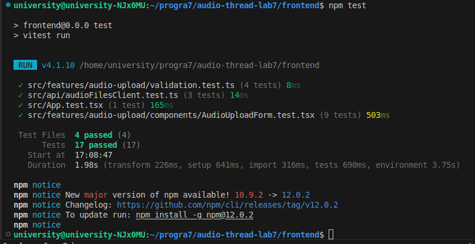
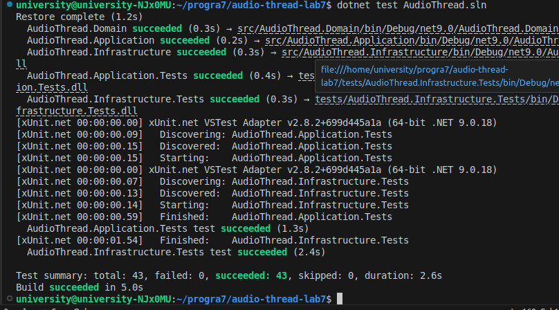
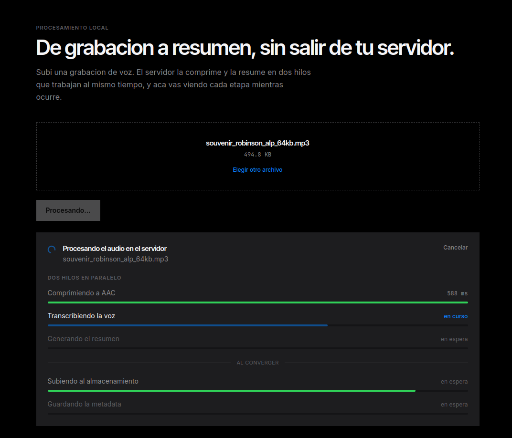
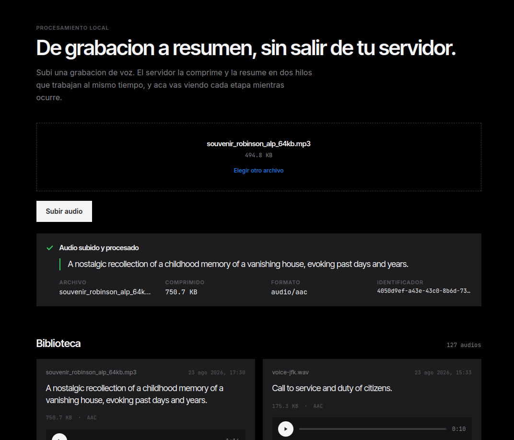
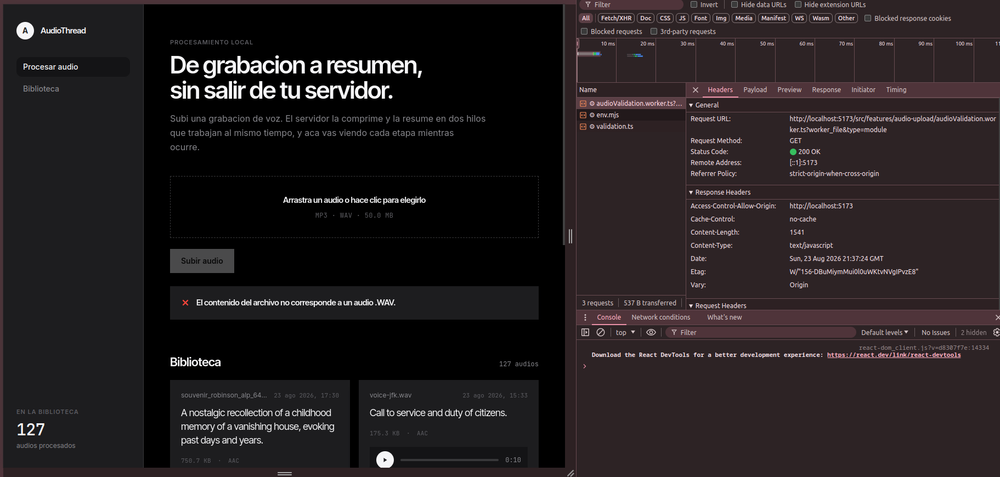
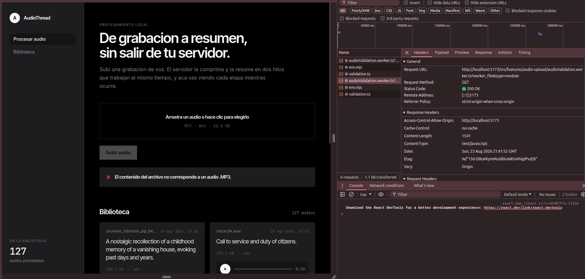
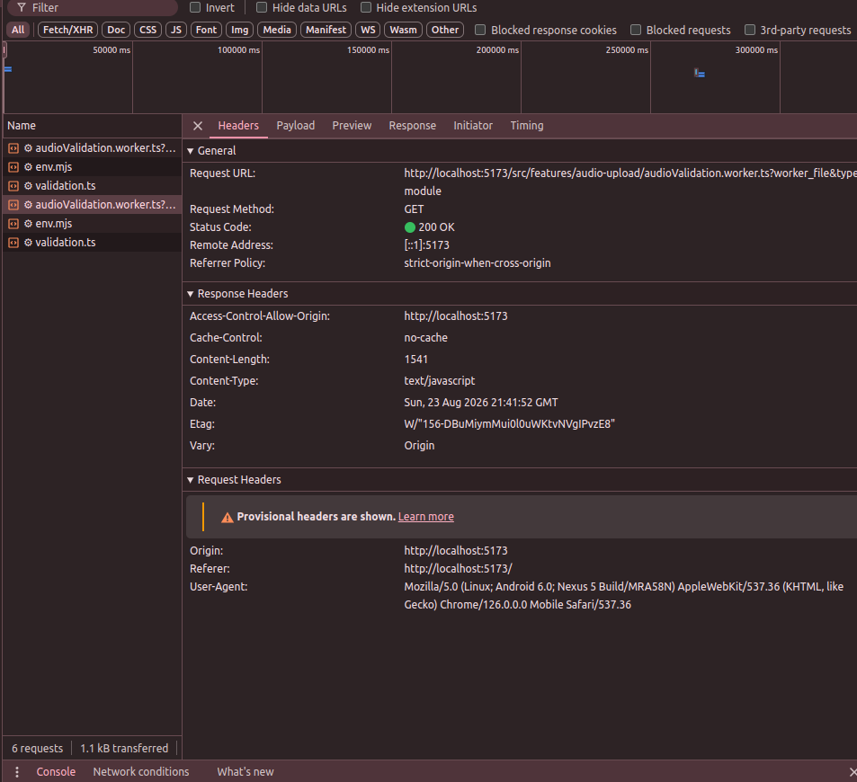

# Programación 7
## Reporte de Laboratorio: Laboratorio #7

**Título del Proyecto:** AudioThread  
**Nombre del Estudiante:** Damon Osvaldo Fernandez Claros  
**Correo del Estudiante:** damon.fernandez@jala.university  
**Fecha de Entrega:** 23/08/2026  
**Instructor:** Leopoldo Flores Colque

---

## 1. Introducción

- **Descripción general:** En esta actividad reforcé la validación del formulario de audio antes de enviar archivos al servidor, la validación anterior solamente comprobaba extensión y tamaño en el hilo principal, ahora la nueva implementación crea un Web Worker dedicado que comprueba extensión, tipo MIME, límite de 50 MB y la firma binaria del contenido, mientras React mantiene disponible el hilo de la interfaz, también conservé la lista de audios, su carga inicial y la actualización automática después de completar un nuevo trabajo.

- **Objetivo:** Aplicar programación paralela en el cliente mediante Web Workers para bloquear archivos WAV o MP3 no válidos antes de crear un trabajo en la API, mantener una interfaz responsiva durante la validación y conservar el flujo asíncrono, la biblioteca de audios y todas las pruebas anteriores.

---

## 2. Arquitectura e implementación

### 2.1 Estado anterior y requisitos ya existentes

El frontend ya cargaba la biblioteca mediante `useAudioFiles` al montar `App`, y después de una carga exitosa `useAudioUploadJob` ejecutaba el callback `onCompleted`. `App` conectaba ese evento con `refresh`, por lo que la lista volvía a consultarse:

```tsx
const { state, refresh, goToPage } = useAudioFiles();

const handleUploaded = useCallback(() => {
  void refresh();
}, [refresh]);

<AudioUploadForm onUploaded={handleUploaded} />
<AudioFileList state={state} onRetry={refresh} onPageChange={goToPage} />
```

La validación existente también bloqueaba extensiones distintas de `.mp3` y `.wav` y archivos mayores a 50 MB, sin embargo se ejecutaba sin un worker y confiaba en el nombre del archivo, un documento renombrado como `documento.wav` podía superar esa validación del cliente y llegar hasta el servidor.

### 2.2 Separación de responsabilidades

Organicé la solución en cuatro partes:

| Componente | Responsabilidad |
| :--- | :--- |
| `validation.ts` | Reglas puras para extensión, MIME, tamaño y firma binaria. |
| `audioValidation.worker.ts` | Ejecutar las reglas fuera del hilo principal y devolver el resultado mediante mensajes. |
| `validateAudioFile` | Leer una cabecera pequeña, crear el worker, transferir el buffer y terminarlo al recibir la respuesta. |
| `AudioUploadForm` | Mostrar el estado, bloquear el botón y decidir si el archivo puede subirse. |

Esta separación permite probar las reglas sin depender del navegador y mantiene el worker libre de React y del acceso al DOM.

### 2.3 Validación del contenido binario

La propiedad `accept` del elemento HTML solamente orienta al selector de archivos, pero no demuestra que el contenido sea audio, por eso el worker comprueba también las firmas binarias:

- Un WAV debe comenzar con `RIFF` y contener `WAVE` en los bytes esperados.
- Un MP3 debe comenzar con `ID3` o con una cabecera MPEG válida.

La regla devuelve un resultado discriminado:

```ts
export type FileValidationResult =
  | { valid: true }
  | { valid: false; message: string };
```

Si el nombre, MIME, tamaño o contenido no coinciden, el archivo queda bloqueado, se limpia el input y se muestra el motivo, esta validación mejora la experiencia del usuario, pero no reemplaza la validación del servidor, porque toda comprobación del cliente puede ser omitida por una solicitud externa.

### 2.4 Ejecución en un Web Worker dedicado

El adaptador crea un worker de módulo siguiendo el formato reconocido por Vite:

```ts
const worker = new Worker(
  new URL('./audioValidation.worker.ts', import.meta.url),
  { type: 'module' },
);
```

El hilo principal envía una solicitud con `postMessage` y el worker responde después de ejecutar las reglas:

```ts
self.onmessage = (event) => {
  self.postMessage({
    requestId: event.data.requestId,
    result: validateAudioFileData(event.data),
  });
};
```

El `requestId` relaciona cada respuesta con su solicitud, al terminar o fallar, el cliente ejecuta `worker.terminate()` para liberar el contexto del worker.

El worker no intenta manipular el DOM porque se ejecuta en un contexto separado, solamente recibe datos, calcula el resultado y envía un mensaje al hilo principal, tal como se explicó en el material de la semana 7.

### 2.5 Transferencia eficiente de una cabecera

Enviar un archivo completo de hasta 50 MB al worker sería innecesario para reconocer su formato, la implementación lee solamente los primeros 64 KiB:

```ts
const header = await file.slice(0, AUDIO_HEADER_BYTES).arrayBuffer();
worker.postMessage(request, [header]);
```

El segundo parámetro de `postMessage` transfiere la propiedad del `ArrayBuffer` al worker en vez de clonarlo, para un archivo del tamaño máximo se inspecciona como máximo el 0.125 % de su contenido, esto reduce la comunicación entre hilos y aplica la recomendación del material sobre objetos transferibles.

### 2.6 Estado de validación y bloqueo de la subida

`AudioUploadForm` incorpora un estado específico:

```ts
const [validatingFileName, setValidatingFileName] = useState<string | null>(null);
```

Mientras el worker valida:

- se muestra `Validando ... en segundo plano`;
- el input y el botón permanecen deshabilitados;
- todavía no se llama a `POST /api/audio-files/jobs`.

Cuando el resultado es válido, el archivo queda seleccionado y se habilita `Subir audio` y cuando es inválido, se muestra un `Alert`, se limpia el selector y el botón permanece bloqueado.

### 2.7 Conservación de la lista y actualización automática

No reemplacé el flujo de la biblioteca porque ya cumplía el requisito de mostrar los audios y refrescarse después de una subida. 

Agregué una prueba de integración de App que simula la finalización de una carga y verifica que refresh se llame exactamente una vez, así el requisito deja de depender solamente de una revisión visual.

### 2.8 Pruebas agregadas

Se agregaron siete casos nuevos:

1. Aceptar un WAV con firma `RIFF/WAVE`.
2. Aceptar un MP3 con encabezado `ID3`.
3. Rechazar un archivo renombrado como WAV cuyo contenido no coincide.
4. Rechazar un archivo mayor a 50 MB.
5. Mantener bloqueado el botón mientras el worker valida.
6. No llamar a la API cuando la validación del contenido falla.
7. Actualizar la biblioteca cuando una nueva carga termina.

---

## 3. Pull Request (PR)

- **Pull Request Link:** `[pegar la URL del merge request de GitLab]`

---

## 4. Benchmark y mediciones de rendimiento

No aplica para esta actividad ya que el objetivo del laboratorio no es reducir ni comparar tiempos de ejecución, sino aplicar programación paralela en el frontend mediante un Web Worker para validar archivos sin ejecutar esa lógica en el hilo principal.

La implementación se verifica mediante pruebas funcionales, el build separado del Web Worker y evidencia en las herramientas de desarrollo del navegador, no se incluyen tiempos de ejecución porque no se realizó un benchmark y presentar valores sin una metodología de medición produciría resultados poco representativos.

---

## 5. Resultados de ejecución y evidencia empírica

### 5.1 Salidas de consola y logs





| Suite | Aprobadas | Fallidas |
| :--- | ---: | ---: |
| Backend Application | 29 | 0 |
| Backend Infrastructure | 14 | 0 |
| Frontend | 17 | 0 |
| **Total** | **60** | **0** |

También se ejecutaron correctamente `npm run build` y `npm run lint`.

### 5.2 Evidencia de verificación (capturas)

- **Evidencia 1: archivo válido y flujo completo**  
  **Descripción:** Selección de un WAV o MP3 real, validación completada, trabajo procesado correctamente y biblioteca actualizada con el nuevo elemento.  

  
  

- **Evidencia 2: archivo renombrado bloqueado**  
  **Descripción:** Selección de un documento u otro contenido renombrado como `.wav` o `.mp3`, el formulario muestra que el contenido no corresponde al formato, mantiene deshabilitado el botón y la pestaña Network no contiene una solicitud POST del archivo.  

  En este caso lo que hice fue cambiar el nombre de dos archivos, una imagen y un archivo pdf agregando la extension wav y mp3 al final para confundir al sistema y crea que son archivos de audio pero en este caso la prueba de validación fue un éxito.

  

  

- **Evidencia 3: Web Worker separado**  
  **Descripción:** Herramientas de desarrollo del navegador mostrando `audioValidation.worker-*.js` o la sección Threads/Sources con el worker dedicado, demostrando que la validación no se ejecuta en el contexto principal de React.  

  

---

## 6. Autoevaluación, bloqueos y errores

- **Dificultades técnicas y errores encontrados:** La primera decisión fue evitar que el Web Worker recibiera los 50 MB completos, porque `postMessage` normalmente aplica clonación estructurada y eso podía introducir memoria y transferencia innecesarias, también debía conservar la validación del servidor como autoridad final y mantener el formulario bloqueado mientras la respuesta asincrónica todavía no estaba disponible. Finalmente, jsdom no ejecuta Web Workers reales, por lo que no era correcto hacer que todas las pruebas de componentes dependieran del runtime de un navegador.

- **Estrategia de resolución:** Separé las reglas en una función pura que se prueba directamente, transferí únicamente una cabecera mediante `ArrayBuffer`, encapsulé la creación y terminación del worker en `validateAudioFile` y en las pruebas de React sustituí el adaptador del worker por promesas controladas. 

---

## 7. Conclusiones

- **Conclusión 1:** Un Web Worker tiene sentido cuando el análisis puede crecer o procesar datos binarios y no debe competir con la interfaz, la solución mantiene React en el hilo principal y coloca la inspección del audio en un contexto aislado que se comunica solamente mediante mensajes.

- **Conclusión 2:** La programación paralela del cliente no reemplaza la asincronía de red ni la validación del servidor, el worker decide si el archivo puede intentar subirse, después `fetch`, SSE y el procesamiento paralelo del servidor conservan sus responsabilidades anteriores.

- **Conclusión 3:** Validar solamente extensión y MIME no es suficiente para detectar un archivo renombrado, revisar una firma binaria permite bloquear ese caso antes de consumir red, cola y recursos de los modelos, aunque el servidor debe repetir sus propias validaciones por seguridad.

---

## 8. Recomendaciones

- Mantener las reglas del cliente alineadas con `AudioUploadOptions` del servidor para evitar límites diferentes.
- Si se agregan formatos con cabeceras más complejas, ampliar el worker sin mover esa carga al componente React.
- Reutilizar una instancia del worker si en el futuro se validan lotes de archivos, porque crear un contexto nuevo también tiene un costo.
- Considerar validación profunda o decodificación parcial para detectar archivos dañados que conservan una cabecera correcta.
