# Programación 7
## Reporte de Laboratorio: Laboratorio #8

**Título del Proyecto:** AudioThread  
**Nombre del Estudiante:** Damon Osvaldo Fernandez Claros  
**Correo del Estudiante:** damon.fernandez@jala.university  
**Fecha de Entrega:** 30/08/2026  
**Instructor:** Leopoldo Flores Colque

---

## 1. Introducción

- **Descripción general:** En esta actividad incorporé un modo secuencial controlado para comparar el estado optimizado de AudioThread con una versión que no solapa etapas ni procesa varios trabajos simultáneamente, la comparación cubre la API de audio y la validación del cliente, conserva el comportamiento optimizado como configuración predeterminada y presenta resultados obtenidos mediante k6 y Chrome DevTools.

- **Objetivo:** Medir el ahorro general obtenido con las técnicas paralelas y asíncronas aplicadas durante el proyecto, mostrar métricas importantes y explicar en qué escenarios la versión optimizada reduce el tiempo y dónde introduce costos adicionales.

---

## 2. Arquitectura e implementación

### 2.1 Modos de ejecución comparables

Se agregó `AudioProcessing:ExecutionMode` con dos valores:

| Modo | Servidor | Cliente |
| :--- | :--- | :--- |
| `Sequential` | Procesa un job a la vez, comprime antes de resumir y almacena después de completar ambas etapas. | Valida el contenido en el hilo principal. |
| `Optimized` | Solapa compresión y resumen, adelanta el almacenamiento y procesa hasta dos jobs simultáneamente. | Valida la cabecera binaria mediante un Web Worker. |

La aplicación continúa utilizando `Optimized` y `worker` de forma predeterminada, el modo secuencial solamente proporciona una línea base equivalente para las mediciones.

La línea base espera cada etapa antes de iniciar la siguiente y no procesa jobs simultáneos, se conservan las APIs asíncronas necesarias para leer archivos, atender HTTP y acceder al almacenamiento, porque sustituirlas por bloqueo síncrono cambiaría el funcionamiento del sistema y no produciría una comparación equivalente.

### 2.2 Comparación del servidor

`TplAudioProcessingCoordinator` selecciona el orden de las etapas, en modo secuencial espera la compresión antes de iniciar el resumen, mientras que en modo optimizado inicia ambas tareas y las coordina con TPL.

`ParallelAudioProcessingExecutor` aplica la segunda diferencia importante:

- El modo secuencial consume la cola con un `await foreach` y termina cada trabajo antes de tomar el siguiente;
- El modo optimizado utiliza `Parallel.ForEachAsync` con un máximo de dos trabajos simultáneos.

`UploadAudioFileHandler` también respeta el modo seleccionado, de modo que la referencia secuencial no adelanta la subida del archivo mientras el resumen continúa ejecutándose.

### 2.3 Comparación del cliente

Para crear una referencia equivalente en el cliente, `validateAudioFile` conserva las mismas reglas y permite seleccionar el contexto mediante `VITE_AUDIO_VALIDATION_MODE`:

- `sequential` lee la cabecera y comprueba extensión, MIME, tamaño y firma binaria directamente en el hilo principal;
- `worker` lee la misma cabecera y transfiere el `ArrayBuffer` a `audioValidation.worker.ts`, que ejecuta las mismas reglas en un hilo dedicado y devuelve el resultado mediante `postMessage`.

La prueba se realizó sobre el formulario real, arrastrando tres veces el mismo audio después de una ejecución de calentamiento, en ambos modos se inspeccionaron únicamente los primeros 64 KiB, por lo que la entrada y las reglas permanecieron iguales y solamente cambió el contexto de ejecución.

Para evitar que el tiempo humano, la subida HTTP o el procesamiento del servidor alteraran la comparación, `validateAudioFile` agregó una marca User Timing al comenzar y otra al recibir el resultado. 

Chrome DevTools Performance registró tres medidas `audio-validation-sequential` sobre `CrRendererMain` y tres medidas `audio-validation-worker` asociadas a contextos `DedicatedWorker`, de esta forma se comparó exclusivamente la validación del frontend y también se verificó visualmente dónde fue ejecutada.

### 2.4 Automatización de las mediciones

| Script | Responsabilidad |
| :--- | :--- |
| `run_week8_server_benchmark.sh` | Inicia la API en modo secuencial u optimizado, ejecuta el calentamiento y las tres mediciones con k6, y guarda los resultados de uno o cuatro usuarios. |
| `week8-audio-performance.js` | Crea los jobs de audio, consulta su estado hasta que terminan y registra duración, p95, rendimiento, etapas y tasa de éxito. |

---

## 3. Pull Request (PR)

- **Pull Request Link:** `[pegar la URL del merge request de GitLab]`

---

## 4. Benchmark y mediciones de rendimiento

### 4.1 Metodología

El servidor se evaluó con el mismo archivo MP3 de `3.3 MB` y `212.85 segundos` en ambos modos, cada escenario tuvo una corrida de calentamiento y tres corridas medidas, para reducir el efecto de valores atípicos la comparación principal utiliza la mediana de las tres corridas.

El porcentaje de ahorro se calculó con:

```text
Ahorro (%) = (tiempo secuencial - tiempo optimizado) / tiempo secuencial × 100
```

Todos los trabajos terminaron correctamente, produjeron contenido AAC e incluyeron un resumen.

### 4.2 Resultados del servidor

| Escenario | Métrica | Secuencial | Optimizado | Ahorro |
| :--- | :--- | ---: | ---: | ---: |
| Un usuario | Tiempo completo | 92.04 s | 91.63 s | **0.44 %** |
| Cuatro usuarios | Tiempo promedio por job | 329.10 s | 268.65 s | **18.37 %** |
| Cuatro usuarios | p95 por job | 506.31 s | 357.83 s | **29.33 %** |
| Cuatro usuarios | Tiempo del grupo completo | 525.90 s | 357.84 s | **31.96 %** |
| Cuatro usuarios | Rendimiento | 0.456 jobs/min | 0.671 jobs/min | **46.96 % más** |

Resultados completos del grupo de cuatro usuarios:

| Corrida | Secuencial: grupo completo | Optimizado: grupo completo |
| :--- | ---: | ---: |
| 1 | 522.32 s | 357.25 s |
| 2 | 525.90 s | 357.84 s |
| 3 | 530.85 s | 359.66 s |
| **Mediana** | **525.90 s** | **357.84 s** |

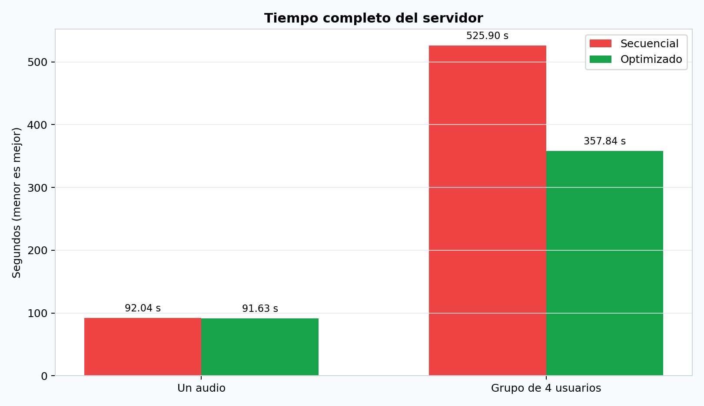

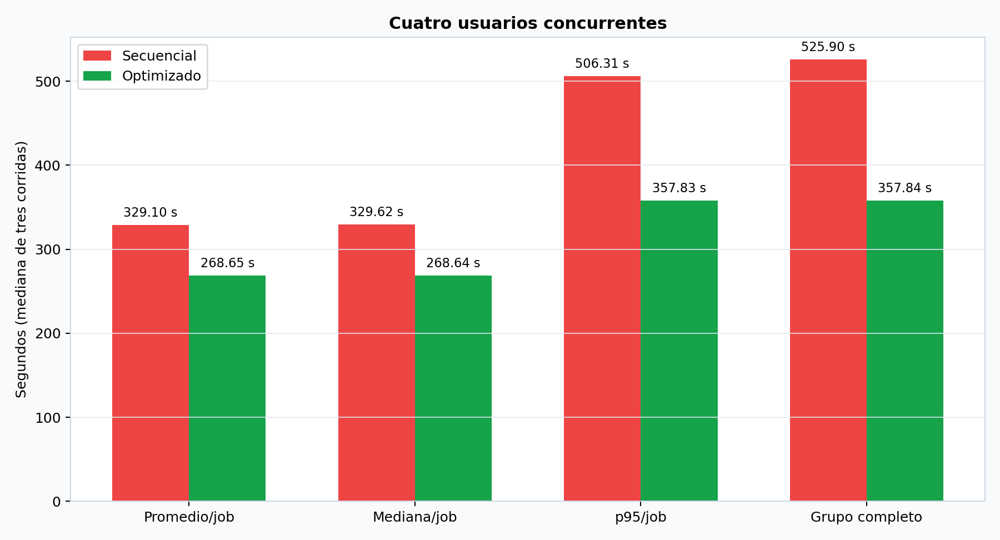

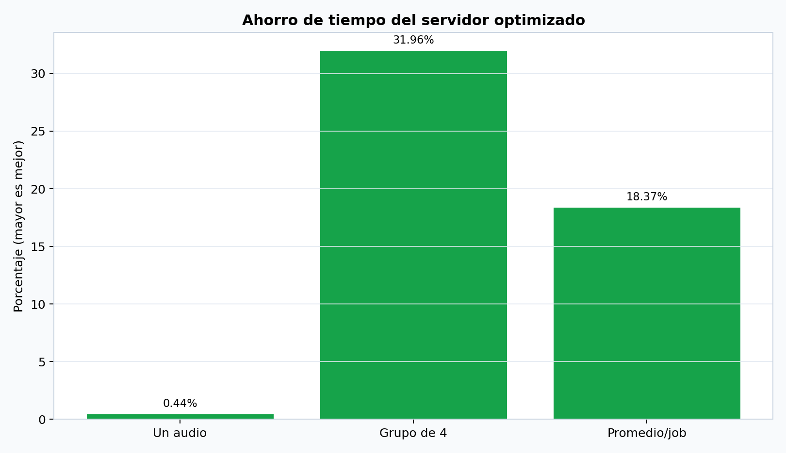

**Análisis de rendimiento:**

> Con un solo audio la mejora fue de 0.44 %, porque la mayor parte del tiempo pertenece a la transcripción y a la generación del resumen, mientras la compresión que puede solaparse representa una fracción pequeña, el beneficio principal aparece bajo concurrencia donde la versión secuencial termina los cuatro jobs en 525.90 segundos y la optimizada en 357.84 segundos, un ahorro de 168.07 segundos o 31.96 %.
>
> La generación del resumen continúa siendo el área de mayor costo, su duración individual puede aumentar cuando dos jobs compiten por CPU, memoria y el modelo de Python, por lo que el paralelismo no divide el tiempo exactamente entre dos, aun con esa contención, el tiempo del lote y el p95 mejoran de forma clara, aumentar el grado de paralelismo sin medir esos recursos podría producir rendimientos decrecientes.

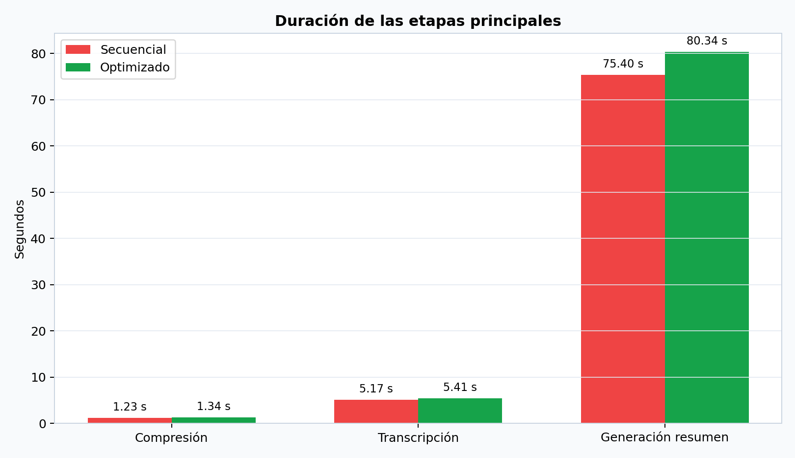

### 4.3 Resultados del cliente

El cliente se evaluó sobre la aplicación real con Chrome DevTools Performance, después de una validación de calentamiento fuera de la grabación, se seleccionó tres veces el mismo audio en cada modo, las marcas User Timing miden únicamente la validación del archivo.

| Estrategia | Contexto | Medición 1 | Medición 2 | Medición 3 | Mediana |
| :--- | :--- | ---: | ---: | ---: | ---: |
| Secuencial | Hilo principal | 7.668 ms | 2.685 ms | 3.118 ms | **3.118 ms** |
| Web Worker | Hilo dedicado | 30.976 ms | 19.792 ms | 27.354 ms | **27.354 ms** |

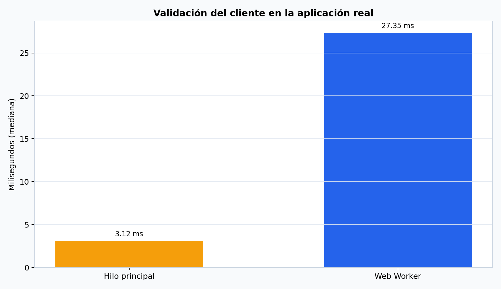

**Análisis del cliente:**

> El Web Worker no reduce la latencia de esta regla pequeña, añade 24.236 ms en la mediana por la creación del worker y el intercambio de mensajes, la mejora es de capacidad de respuesta, no de velocidad absoluta, la inspección queda fuera del hilo principal y evita que una validación más costosa compita con React, para la cabecera actual, la versión secuencial es más rápida, mientras que el worker ofrece aislamiento y margen para ampliar las reglas sin congelar la interfaz.
>

---

## 5. Resultados de ejecución y evidencia empírica

### 5.1 Salidas de consola y logs

Los logs verifican que cada serie utilizó el modo solicitado:

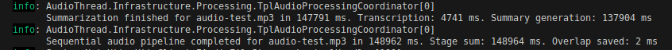

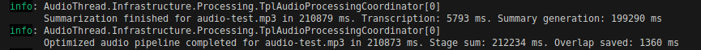

| Suite | Aprobadas | Fallidas |
| :--- | ---: | ---: |
| Backend Application | 30 | 0 |
| Backend Infrastructure | 16 | 0 |
| Frontend | 17 | 0 |
| **Total** | **63** | **0** |

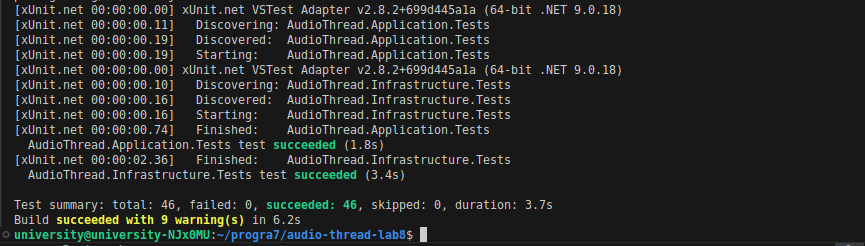

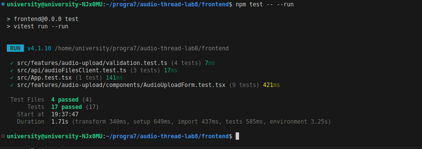

También se verificaron correctamente el build y el lint del frontend.

### 5.2 Evidencia de verificación

- **Evidencia 1: servidor secuencial con cuatro usuarios**  
  **Descripción:** Resumen de k6 mostrando cuatro trabajos completados, cero solicitudes fallidas y el tiempo del grupo secuencial. Los resultados originales se encuentran en `artifacts/performance/week8/server/sequential/concurrent`.  
  
  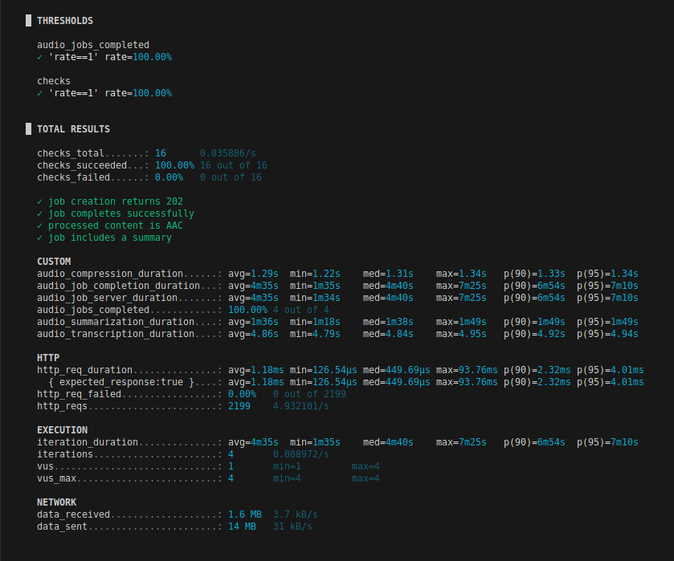

  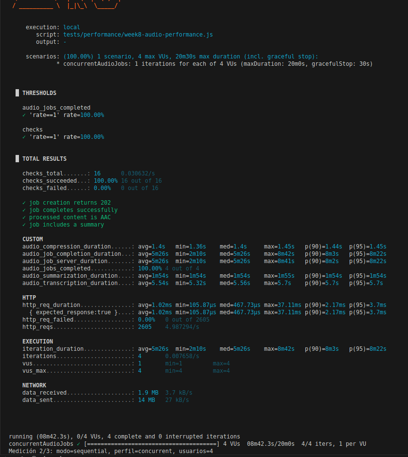

  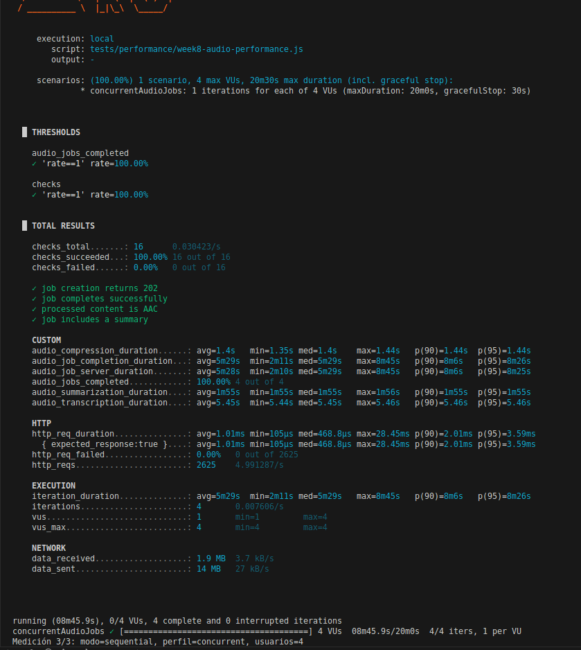

  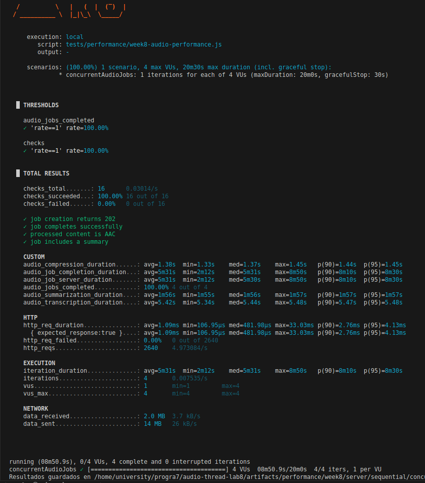

- **Evidencia 2: servidor optimizado con cuatro usuarios**  
  **Descripción:** Resumen de k6 mostrando cuatro trabajos completados, cero solicitudes fallidas y el menor tiempo obtenido al procesar hasta dos jobs simultáneamente. Los resultados originales se encuentran en `artifacts/performance/week8/server/optimized/concurrent`.  
  
  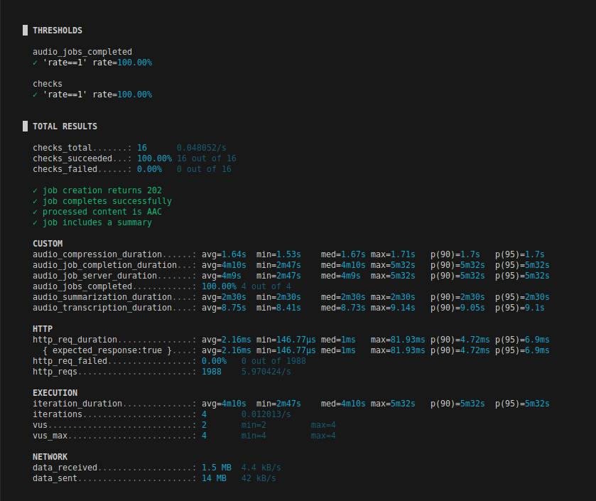

  

  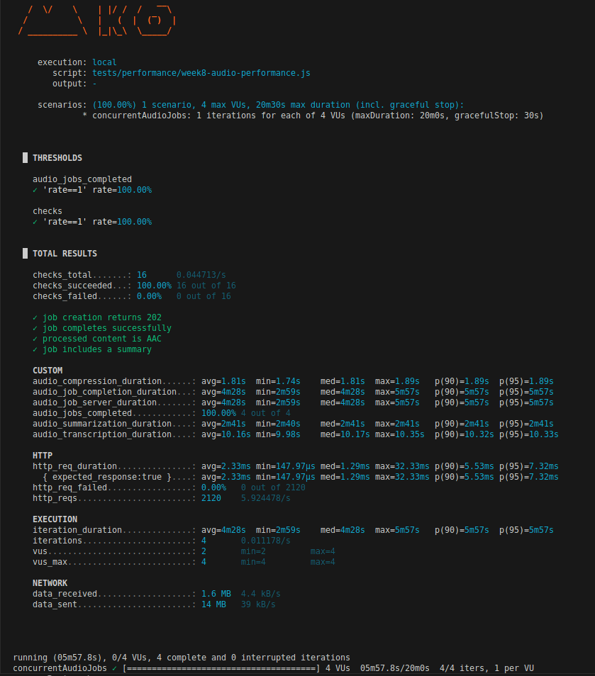

  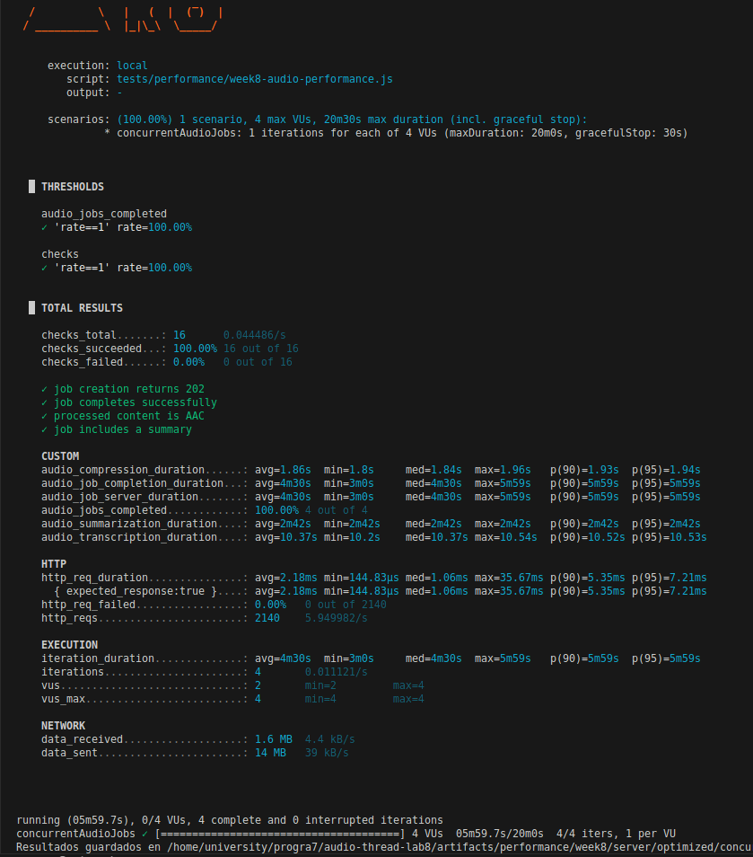

- **Evidencia 3: perfil secuencial del cliente**  
  **Descripción:** Captura general del análisis realizado con Chrome DevTools Performance durante las tres validaciones ejecutadas en modo secuencial.  
  
  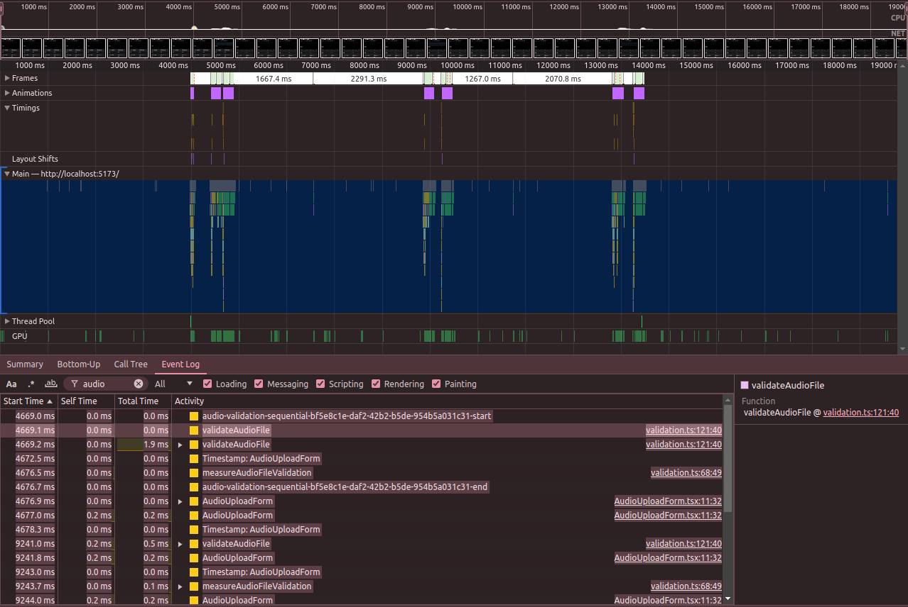

- **Evidencia 4: perfil optimizado del cliente**  
  **Descripción:** Captura general del análisis realizado con Chrome DevTools Performance durante las tres validaciones ejecutadas mediante Web Worker.  
  
  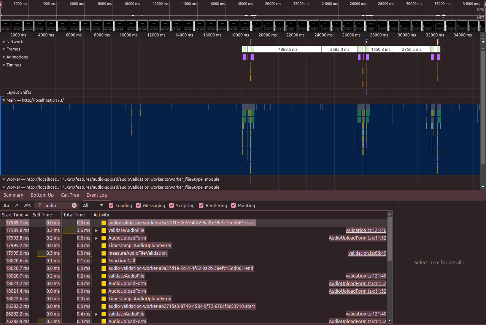

---

## 6. Autoevaluación, bloqueos y errores

- **Dificultades técnicas y errores encontrados:** Una sola ejecución no era suficiente para comparar procesos que dependen del modelo local, CPU, memoria y almacenamiento externo, además mezclar la latencia del cliente con el ahorro del servidor podía llevar a la conclusión incorrecta de que toda técnica paralela siempre debe ser más rápida.

- **Estrategia de resolución:** Se aplicó calentamiento, tres repeticiones y mediana en ambos lados, en el servidor se separaron latencia individual, p95, tiempo del grupo y rendimiento; en el cliente las marcas User Timing aislaron la validación dentro del formulario real y DevTools verificó el contexto de ejecución.

---

## 7. Conclusiones

- **Conclusión 1:** La optimización aporta su mayor beneficio cuando existen varios usuarios, el grupo de cuatro trabajos ahorró 168.07 segundos, equivalente a 31.96 %, y el rendimiento aumentó 46.96 %.

- **Conclusión 2:** Para un solo audio el ahorro fue de 0.44 % porque el resumen domina el tiempo total y la compresión solapada es relativamente corta, la paralelización debe aplicarse donde exista trabajo independiente suficiente y no solamente por el hecho de disponer de una API paralela.

- **Conclusión 3:** El Web Worker añade 24.236 ms de latencia mediana en esta validación pequeña, pero conserva el hilo principal para la interfaz, esto demuestra que una optimización también puede priorizar capacidad de respuesta y aislamiento aunque no reduzca el tiempo absoluto de una operación breve.

---

## 8. Recomendaciones

- Mantener `MaxConcurrentJobs = 2` hasta medir CPU y memoria con otros grados de paralelismo, aumentar el valor sin control puede intensificar la contención del modelo.
- Priorizar optimizaciones en la transcripción y generación del resumen, porque representan la mayor parte del procesamiento individual.
- Reutilizar el Web Worker si se incorporan validaciones frecuentes o por lotes, para reducir el costo de crear un contexto en cada solicitud.
