# Programación 7
## Reporte de Laboratorio: Laboratorio #9

**Título del Proyecto:** AudioThread  
**Nombre del Estudiante:** Damon Osvaldo Fernandez Claros  
**Correo del Estudiante:** damon.fernandez@jala.university  
**Fecha de Entrega:** 06/09/2026  
**Instructor:** Leopoldo Flores Colque

---

## 1. Introducción

- **Descripción general:** En esta actividad agregué una etapa de mejora de voz que utiliza el modelo local DeepFilterNet3 para atenuar ruido de fondo, el servidor conserva el audio original, genera y almacena una versión filtrada, y el cliente presenta ambas versiones mediante controles de reproducción independientes.

- **Objetivo:** Incorporar un filtro de audio basado en un modelo preentrenado sin bloquear la solicitud HTTP, guardar su resultado en el almacenamiento de archivos y permitir comparar desde la aplicación web el audio original con el audio que tiene el ruido reducido.

---

## 2. Arquitectura e implementación

### 2.1 Modelo local de reducción de ruido

Se integró `DeepFilterNet3`, un modelo preentrenado de mejora de voz de banda completa, la inferencia se ejecuta localmente mediante `python/enhance_audio.py`, por lo tanto el audio no se envía a un servicio externo y no es necesario entrenar un modelo propio.

El script recibe un MP3 o WAV, carga los pesos desde `python/model-cache`, procesa el audio y produce un WAV de 48 kHz, el modelo se descarga durante la preparación de Docker y luego se reutiliza sin conexión a Internet.

`DeepFilterNetAudioNoiseReducer` funciona como adaptador entre .NET y Python, esta clase crea archivos temporales independientes por operación, inicia el subproceso de manera asíncrona, aplica tiempo máximo y cancelación, valida que exista una salida y elimina los archivos temporales al finalizar.

### 2.2 Nueva etapa de procesamiento

La interfaz `IAudioNoiseReducer` mantiene al coordinador separado de los detalles de DeepFilterNet, `TplAudioProcessingCoordinator` incorpora la reducción de ruido como una tercera etapa:


Audio original:

- Compresión AAC
- Transcripción y resumen
- Reducción de ruido con DeepFilterNet3


En el modo `Optimized`, la compresión, el resumen y la reducción de ruido comienzan sobre copias de los mismos bytes y se sincronizan con `Task.WhenAll`, los jobs continúan ejecutándose en segundo plano y `Parallel.ForEachAsync` mantiene el límite existente de dos trabajos simultáneos.

En el modo `Sequential` del laboratorio 8, cada etapa espera a la anterior, de esta forma se conserva una referencia secuencial válida y la nueva funcionalidad no elimina la comparación ya implementada.

### 2.3 Almacenamiento y persistencia

Por cada carga se guardan tres recursos con nombres únicos dentro del directorio del audio:

| Recurso | Propósito |
| :--- | :--- |
| Original | Reproducir exactamente el archivo enviado por el usuario. |
| AAC comprimido | Conservar el resultado y el contrato de laboratorios anteriores. |
| WAV filtrado | Reproducir la salida generada por DeepFilterNet3. |

La entidad `AudioFile`, los DTO y la respuesta de la API incluyen las rutas y URLs del original y del filtrado, las columnas nuevas son opcionales para que los registros creados antes del laboratorio 9 continúen siendo válidos, la migración `AddFilteredAudioPlayback` agrega estas columnas y sus índices únicos.

En el flujo optimizado la carga del original comienza inmediatamente, mientras las versiones comprimida y filtrada se almacenan apenas termina su etapa correspondiente, el job solamente cambia a completado cuando el procesamiento, el almacenamiento y la persistencia finalizaron correctamente.

### 2.4 Reproducción en el cliente

Cada tarjeta de la biblioteca presenta dos controles claramente identificados:

- `Audio original` utiliza `originalUrl`;
- `Audio con ruido reducido` utiliza `filteredUrl`.

Se reutilizó `AudioPlayer` para mantener un único comportamiento de reproducción, los registros antiguos usan la URL existente como alternativa para el audio original y muestran un mensaje claro cuando todavía no poseen una versión filtrada.

El indicador del job también incorpora el paso `Reduciendo ruido con IA`, recibido mediante los eventos SSE existentes sin bloquear el hilo principal de React.

### 2.5 Flujo completo de la nueva implementación

El procesamiento comienza cuando el usuario selecciona un audio válido y el cliente lo envía al endpoint de jobs, el servidor copia temporalmente el contenido a un arreglo de bytes porque el stream de la petición deja de estar disponible cuando termina la solicitud HTTP, con esos datos crea un `AudioProcessingWorkItem`, lo agrega al Channel y responde con 202 Accepted y el identificador del job.

`AudioProcessingBackgroundService` consume el trabajo fuera de la petición HTTP, crea un scope independiente para sus dependencias y llama a `UploadAudioFileHandler`, el handler valida nuevamente la información recibida y entrega los mismos bytes originales a `TplAudioProcessingCoordinator`.

En el modo optimizado, el coordinador inicia tres operaciones independientes:

1. `FfmpegAudioCompressor` genera la versión AAC utilizada por el flujo existente.
2. `PythonAudioSummarizer` ejecuta Whisper y el modelo de resumen.
3. `DeepFilterNetAudioNoiseReducer` ejecuta `enhance_audio.py` para producir el WAV con ruido reducido.

Cada operación recibe su propio `MemoryStream`, por lo que ninguna comparte la posición de lectura con las demás, las tres tareas se ejecutan de forma solapada y `AudioProcessingSession.CompleteAsync` utiliza `Task.WhenAll` como punto de sincronización.

La reducción de ruido sigue este flujo interno:

```text
Bytes del audio
    - archivo temporal de entrada
    - subproceso Python
    - carga local de DeepFilterNet3
    - inferencia para atenuar el ruido
    - WAV filtrado temporal
    - MemoryStream devuelto a .NET
```

Mientras las etapas avanzan, el handler coordina el almacenamiento de los resultados y el original puede comenzar a subirse inmediatamente.

Después de persistir el registro, el job cambia a `Completed` y contiene `originalUrl` y `filteredUrl`.

---

## 3. Pull Request (PR)

- **Pull Request Link:** `[pegar la URL del merge request de GitLab]`

---

## 4. Benchmark y mediciones de rendimiento

### 4.1 Metodología

El benchmark evalúa cuánto aumenta el tiempo general al incorporar el filtro, no intenta demostrar que la nueva versión sea más rápida, porque ahora el servidor realiza trabajo adicional y produce un segundo audio.

Se comparó `main` sin filtro con la rama del laboratorio 9 utilizando las mismas condiciones:

- archivo `audio-test.mp3` de 3.3 MB;
- cuatro usuarios concurrentes;
- límite de dos jobs procesados simultáneamente;
- modo de ejecución `Optimized`;
- dos corridas por versión;
- mismo equipo, almacenamiento y configuración de modelos.

El incremento se calculó con:

```text
Incremento (%) = (tiempo con filtro - tiempo sin filtro) / tiempo sin filtro × 100
```

### 4.2 Resultados por corrida

| Versión | Corrida | Promedio por job | p95 por job | Tiempo del grupo | Rendimiento |
| :--- | :--- | ---: | ---: | ---: | ---: |
| Sin filtro | 1 | 157.49 s | 228.22 s | 228.22 s | 1.05 jobs/min |
| Sin filtro | 2 | 133.41 s | 177.60 s | 177.67 s | 1.35 jobs/min |
| Con DeepFilterNet3 | 1 | 177.02 s | 251.72 s | 251.79 s | 0.95 jobs/min |
| Con DeepFilterNet3 | 2 | 149.26 s | 199.48 s | 199.52 s | 1.20 jobs/min |

En las cuatro corridas se completaron correctamente los cuatro jobs, los checks alcanzaron 100 % y la tasa de solicitudes HTTP fallidas fue 0 %.

### 4.3 Comparación general

| Métrica | Sin filtro | Con DeepFilterNet3 | Diferencia | Cambio |
| :--- | ---: | ---: | ---: | ---: |
| Tiempo promedio por job | 145.45 s | 163.14 s | +17.69 s | **+12.16 %** |
| p95 por job | 202.91 s | 225.60 s | +22.69 s | **+11.18 %** |
| Tiempo del grupo completo | 202.95 s | 225.66 s | +22.71 s | **+11.19 %** |
| Rendimiento | 1.20 jobs/min | 1.08 jobs/min | -0.12 jobs/min | **-10.25 %** |

**Análisis de rendimiento:**

> La incorporación de DeepFilterNet3 aumentó 17.69 segundos o 12.16 % el tiempo promedio por job, este incremento es esperado porque la nueva versión ejecuta inferencia adicional y almacena un WAV filtrado de mayor tamaño, mientras que la versión de `main` solamente comprime y genera el resumen.
>
> El costo del filtro no se suma completamente al tiempo total porque la reducción de ruido se inicia junto con la compresión y el resumen. `Task.WhenAll` permite que una parte importante de esa etapa quede solapada con las operaciones existentes, por este motivo, el sistema obtiene un segundo audio procesado con un incremento del 11.19 % en el tiempo total del grupo, en lugar de ejecutar toda la reducción de ruido después del resumen.
>
> La transcripción promedio pasó de 9.67 s sin filtro a 27.01 s con filtro, esto indica contención de CPU entre Whisper y DeepFilterNet cuando cuatro usuarios generan trabajos al mismo tiempo.

---

## 5. Resultados de ejecución y evidencia empírica

### 5.1 Salidas de consola y logs

La suite automatizada conserva todas las pruebas anteriores y agrega cobertura para la tercera etapa y los nuevos contratos:

| Suite | Aprobadas | Fallidas |
| :--- | ---: | ---: |
| Backend Application | 30 | 0 |
| Backend Infrastructure | 16 | 0 |
| Frontend | 19 | 0 |
| **Total** | **65** | **0** |

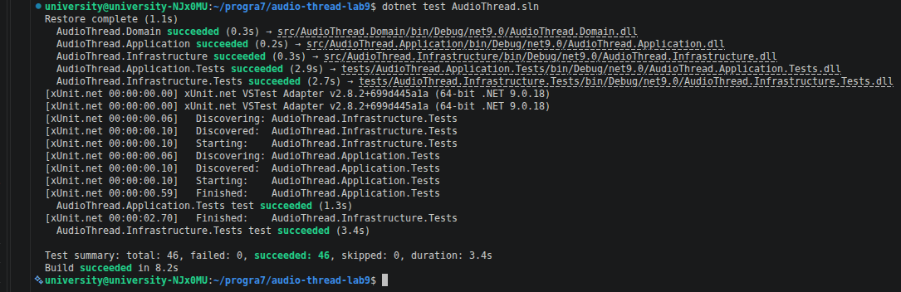
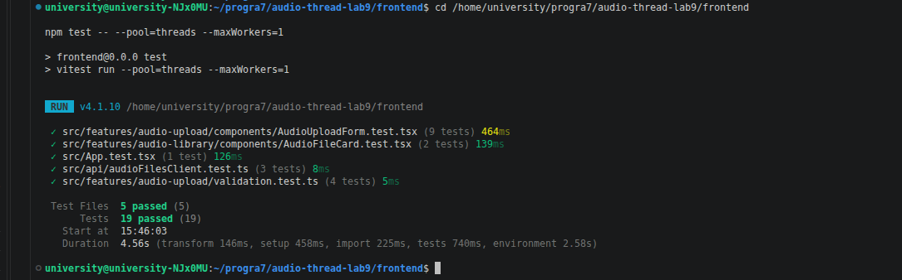

### 5.2 Evidencia de verificación

- **Evidencia 1: ejecución del modelo local**  
  **Descripción:** Logs del servidor mostrando el inicio y la finalización de la etapa de reducción de ruido con `DeepFilterNet3`, junto con el nombre del audio y la duración de la operación.  

  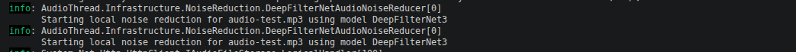
  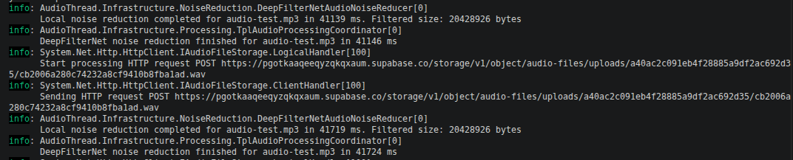

- **Evidencia 2: archivos almacenados**  
  **Descripción:** Supabase Storage mostrando dentro del mismo identificador el audio original, el AAC comprimido y el WAV filtrado, con nombres de objeto diferentes.

  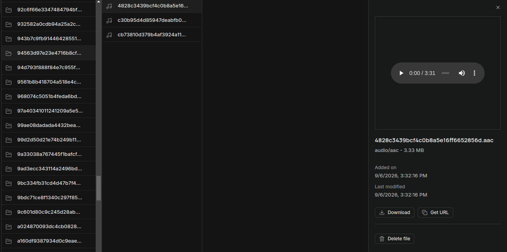

- **Evidencia 3: comparación desde el cliente**  
  **Descripción:** Tarjeta de un audio procesado mostrando las barras `Audio original` y `Audio con ruido reducido`, ambas habilitadas para reproducir sus respectivas versiones.  
  
  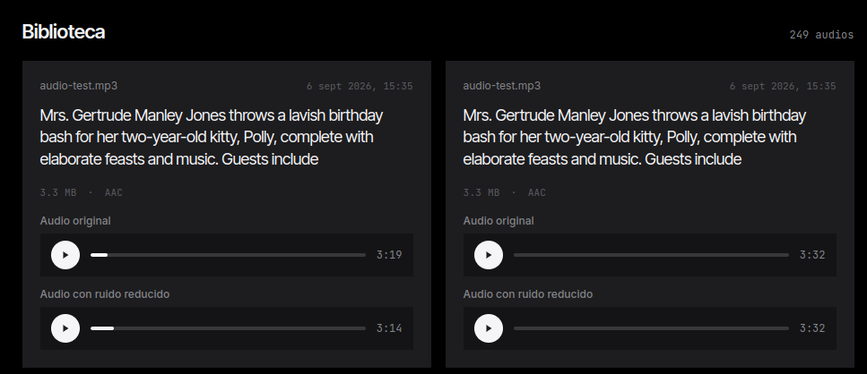

- **Evidencia 4: flujo completo terminado**  
  **Descripción:** Interfaz mostrando el paso de reducción de ruido completado y el nuevo elemento actualizado en la biblioteca sin interrumpir la carga ni las etapas existentes.

  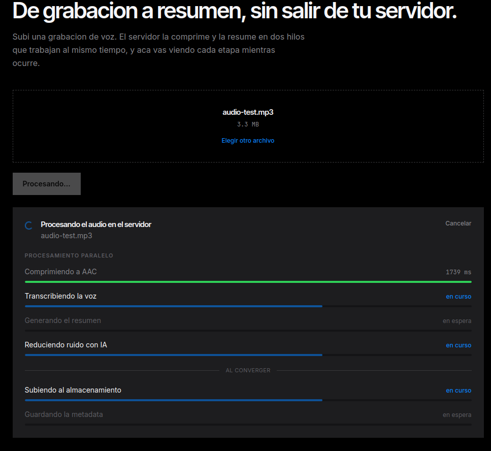
  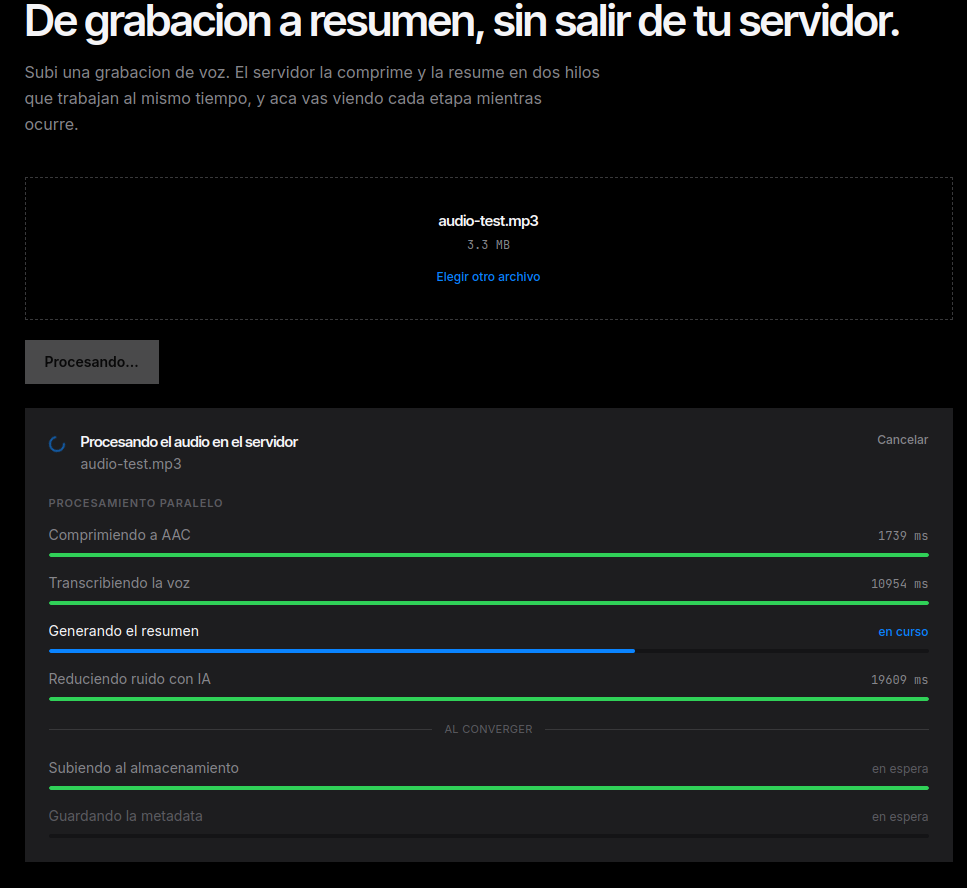
  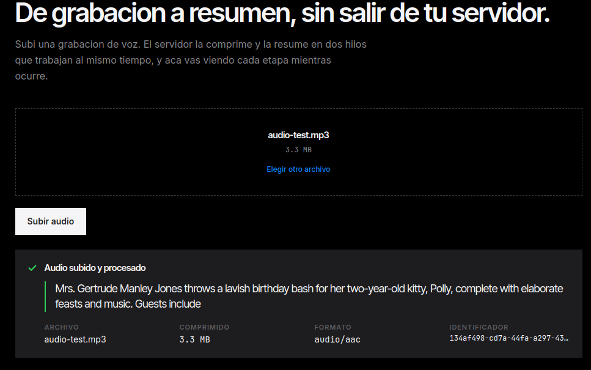

- **Evidencia 5: mediciones sin filtro**  
  **Descripción:** Resultados de las dos pruebas de carga ejecutadas sobre `main` con cuatro usuarios concurrentes y el mismo archivo `audio-test.mp3`. Las capturas deben mostrar la tasa de trabajos completados, el tiempo promedio por job, el p95 y la duración total de cada corrida. Los resultados originales se encuentran en `artifacts/performance/week9/without-filter`.  

  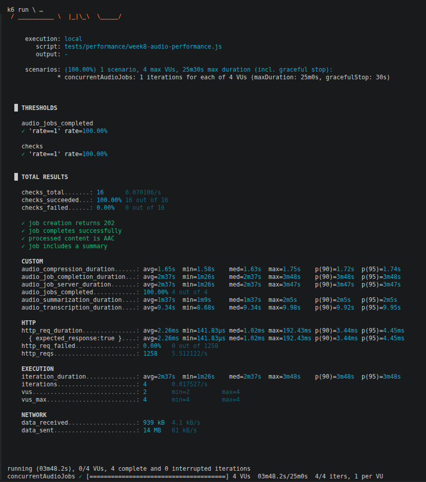  
  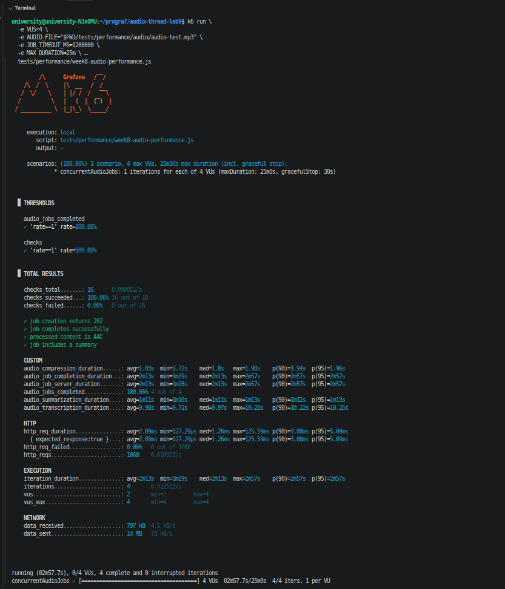

- **Evidencia 6: mediciones con DeepFilterNet3**  
  **Descripción:** Resultados de las dos pruebas de carga ejecutadas sobre la rama del laboratorio 9, utilizando cuatro usuarios concurrentes y el mismo archivo `audio-test.mp3`. Las capturas deben mostrar que los cuatro jobs finalizaron correctamente y permitir comparar el tiempo promedio, el p95 y la duración total después de incorporar la reducción de ruido. Los resultados originales se encuentran en `artifacts/performance/week9/with-filter`.  

  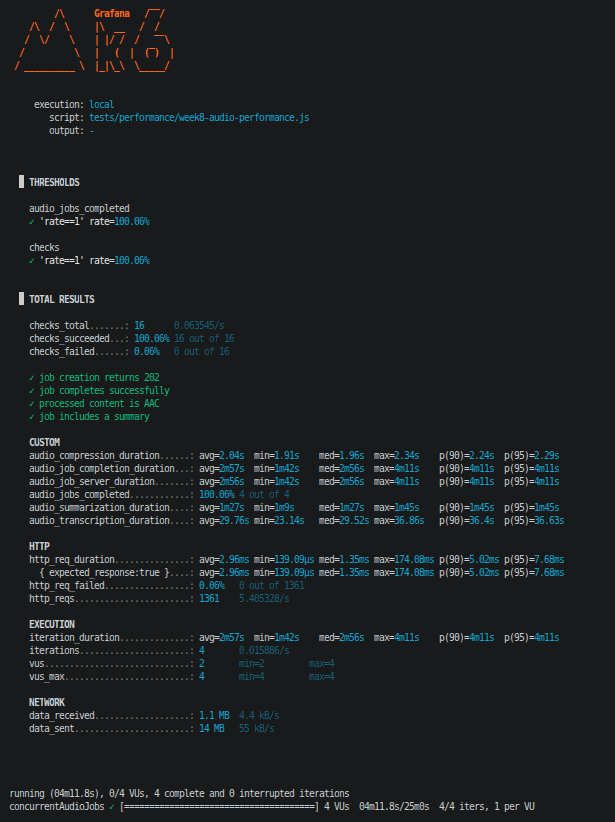 
  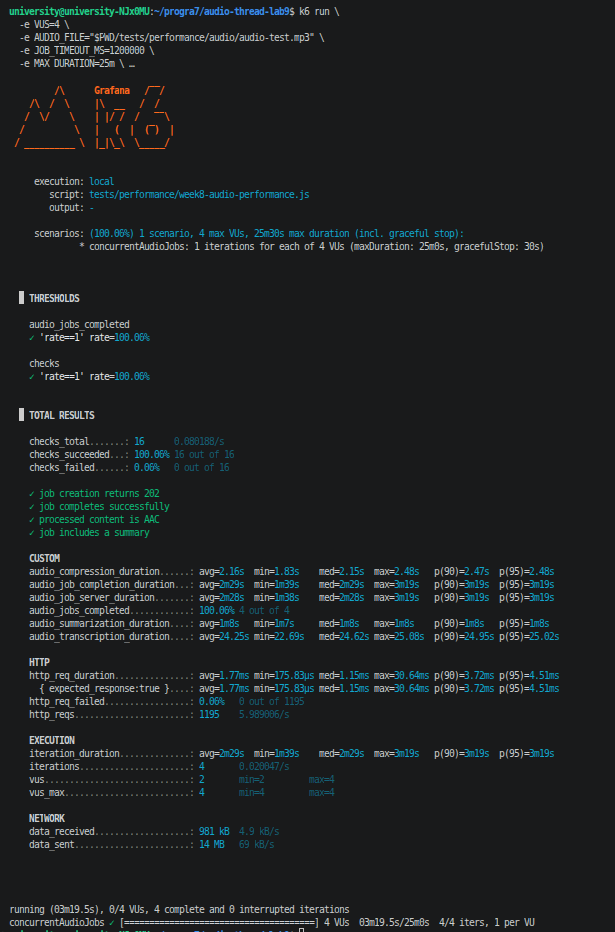

---

## 6. Autoevaluación, bloqueos y errores

- **Dificultades técnicas y errores encontrados:** DeepFilterNet depende de `torchaudio` y de una versión específica de `packaging`, la resolución inicial de `uv` consultó primero el índice de PyTorch y no encontró una combinación compatible, también fue necesario diferenciar las rutas de almacenamiento para no sobrescribir el original con el resultado filtrado.

- **Estrategia de resolución:** Se fijaron versiones CPU compatibles de `torch` y `torchaudio`, y se configuró `uv` para resolver conjuntamente PyPI y el índice oficial de PyTorch.

---

## 7. Conclusiones

- **Conclusión 1:** DeepFilterNet3 permite cumplir el filtro solicitado mediante un modelo neuronal local y preentrenado, produciendo una versión con ruido reducido sin exponer el audio a una API externa.

- **Conclusión 2:** La nueva etapa se integra con las técnicas asíncronas y paralelas existentes ya que el endpoint mantiene el trabajo en segundo plano, las tareas independientes se solapan y la concurrencia entre jobs permanece limitada.

- **Conclusión 3:** Mantener URLs separadas para el original y el filtrado permite una comparación auditiva directa en el cliente y conserva compatibilidad con el AAC y los registros creados en actividades anteriores.

---

## 8. Recomendaciones

- Mantener el límite de dos jobs simultáneos y observar CPU y memoria, porque cada job puede ejecutar al mismo tiempo los modelos de resumen y reducción de ruido.
- Conservar los pesos de DeepFilterNet en la caché local o dentro de la imagen Docker para evitar descargas durante una solicitud.
